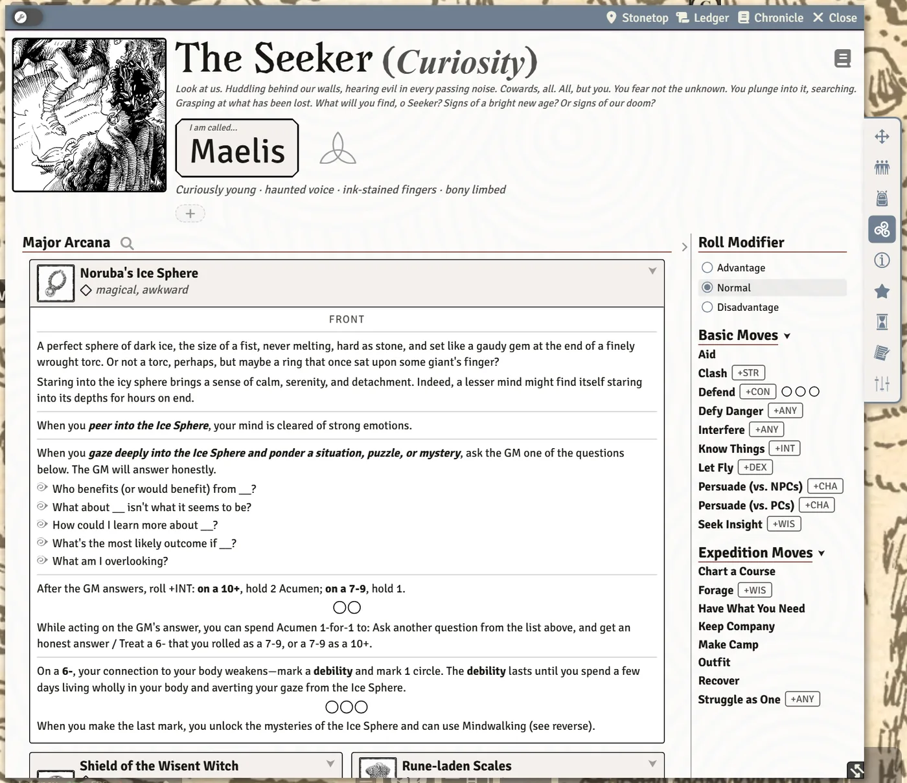

# Arcana and Artifacts

Arcana are the double-sided cards of strange, powerful things your character can own: a front you read when you get it, and a back you earn by marking its circles. Artifacts are treasures whose full nature may be hidden until you work it out. This page covers both from the player's side. The GM's side (revealing backs, handing cards over, writing hints) is on [Arcana for GMs](Arcana-for-GMs).

## The Arcana tab

Your arcana live on the character sheet's **Arcana** tab, split into a **Major Arcana** and a **Minor Arcana** section. Each section heading folds open and shut, and the sheet remembers which you folded.

**Getting a card.** Your GM gives you arcana by dropping a card from the Arcana compendium (GM only) onto your sheet. It arrives face down, and the **Arcana** tab appears once you hold one (see [Unidentified arcana](#unidentified-arcana)).

**Finding a card.** Once a section has cards, its heading carries a magnifying glass. Click it to open **Search arcana** and type to filter the cards (**Filter arcana…**).

## Reading a card

Each card has a title, the front's text, and a list of things to mark on the front (the unlock requirements). The controls along the bottom of a card depend on what you're allowed to see.

| Control | Where | What it does |
|---|---|---|
| **Collapse / expand card** | the small button in the card's top corner | Folds the card down to its title and the first paragraph of its front, or opens it again. Remembered per card. |
| **Show back** / **Show front** | card footer | Flips the card to its other side. |
| **Show both sides** / **Show front only** | card footer | Lays the card open with front and back side by side, or goes back to one side. |
| **Remove** | card footer, when the section is in edit mode | Takes the arcanum off your sheet after you confirm (**Remove the arcanum** or **Keep it**). This can't be undone. |

The flip and both-sides buttons only appear when you're allowed to read the back. That happens when:

- **you've unlocked it** by filling every mark on the front. An unlocked back is yours to read, whatever the GM's settings say;
- **the GM has revealed it to you** on that card; or
- **your GM has turned on Arcana: Players See Both Sides**, which lets every player read every back up front.

Otherwise the back stays hidden until you unlock it or the GM reveals it. Your choices of flipped or spread cards are yours alone: the GM and other players see the card their own way.

**Marking the front.** Each requirement on the front has one or more circles beside it. Tick a circle when you've done what it asks. Untick it to take the mark back. Boxes (□) and circles printed inside a card's own text are tickable too, right where they appear in the sentence.

**Choosing what a mark gives you.** Some cards let you pick something each time you mark them. When you have a pick still to make, the card shows a strip saying **Each mark on this card lets you choose one of the …**, with how many are still owed, and a **Choose** button. Click it to make your picks.

**Tracks on the back.** Some backs carry a row of uses or charges. Click a box to fill the track up to it; click the last filled box to empty it.

> **Did you know?**
> - Click a card's **title** to post that side of the card to chat (front title for the front, back title for the back). It follows your current chat roll mode, so a private roll mode keeps it private.
> - Move names printed in bold inside a card's text are buttons. Click one, or tab to it and press `Enter` or `Space`, to make that move. If the move needs a roll or a choice, you get the usual roll window; otherwise its text goes straight to chat.
> - Hover a card's small picture to see it larger beside the sheet. Click it to open the picture full size in its own window.
> - The flip and both-sides buttons work in Play mode too, so you can read a spread at the table without switching to Edit mode.

## Unidentified arcana

Sometimes a card arrives face down: you can tell it's something, but not what. The card says **This arcanum has not yet been identified.** and offers a **Know Things** button.

1. Click **Know Things**. A window asks **What are you drawing on to place this arcanum?** with a button for each stat you could roll (+INT first). If one of your moves gives advantage here, a tick box offers it, and the moves that apply are quoted so you can check their triggers.
2. The result decides how much you learn:
   - **10+**: you read the card, front and back.
   - **7-9**: you read the front. The back is owed to you once you've had time to study it or learn more.
   - **6-**: the GM makes a move.

While a back is owed, the front shows **You've read the front. The back is owed you, once you've had time to study it or learn more.** with a **Study it** button. Click it when your character takes that time: it posts a **Study it** card to chat so the GM knows to reveal the back.

**Leads.** Some cards start as a lead: **You have a lead on this arcanum's whereabouts, but haven't recovered it yet.** Once you've tracked it down, click **Arcana Discovered** and confirm with **Reveal the arcanum** to turn it into the full card.

> **Did you know?**
> - Hold `Shift` while you click **Know Things** to skip the modifier prompt for that roll.
> - The GM sees a **Give the card** button on a face-down card, which hands it over without a roll, front only or front and back.

## Summoning a follower from an arcanum

A few arcana are, or bring, a follower. Once you're allowed to read the back, it carries a button such as **Add (name) as a follower**. Click it to put them on your Followers tab. If the follower has choices to make (a name, which traits), a window asks first. When they've joined, the button reads **(name) is in your Followers** and greys out.

The Ring of Daagon only becomes a follower once you've made its last mark; until then the card shows no follower button. See [Followers](Followers) for what to do with them.

## The Seeker's major arcanum

If your background grants you a major arcanum and you haven't picked it yet, the top of the Arcana tab says **Your Background grants you 1 major arcanum, and you haven't chosen it yet.** Click **Choose your major arcanum** to open the picker. Choose **Take this one** on the card you want, or **Choose later** to come back to it. More on the Seeker in [Playbook Notes](Playbook-Notes#the-seeker).

## Making your own arcanum

If your GM has turned off **Arcana Creation: GM Only**, you can write your own card: **Create Item**, then **Gear & Treasure**, then **Blank arcanum** (or **Inspire me…** for a start from Book II's tables). Once your sheet has an Arcana tab, each section also ends with a **Create major arcanum** or **Create minor arcanum** button, which puts the new card straight on your sheet, already identified. With the setting on (the default) only the GM can do either. See [Homebrew Content](Homebrew-Content).

## Artifacts

Artifacts are treasures in your inventory. If your GM has turned on **Artifacts Arrive Unidentified**, a treasure dropped onto your sheet arrives with its tags, Value and uses withheld: you see only what's obvious at a glance. Your GM can also hide or hand over any single artifact whenever they like.

On the gear row (Inventory tab) a hidden artifact shows:

- a **question mark** chip. Hover it: **Unidentified. You know only what's obvious at a glance.** or, once you know a little, **Partly identified. You know what it is and what it's worth; the full write-up is still owed.**
- a short hint from the GM in place of the concealed tags;
- a **magnifying glass**. Hover it: **There's more to this than meets the eye. Know Things or Seek Insight about it.**

Click the magnifying glass. A window asks **How do you try to work out what (name) is?** and offers two moves:

| Move | Rolls | What you learn |
|---|---|---|
| **Know Things** | +INT | On a 10+, everything, write-up and any custom move included. On a 7-9, its tags and Value; the write-up is still owed. On a 6-, a chat card shows the GM's note on how you could learn more. |
| **Seek Insight** | +WIS (you're asked which stat you're studying it with) | On a 7+, the GM answers your questions about it honestly; the questions are posted with the roll. |

Once you know the full write-up, a caret on the row (**Show or hide the write-up**) folds the write-up open and shut. A signpost line on the row (hover: **How you could learn more about this**) shows the GM's lead, when there is one.

<!-- SHOT: arcana-and-artifacts-artifact-row | Player client: Inventory tab with an unidentified artifact's gear row, showing the question-mark chip, the GM's short hint, and the magnifying glass with its tooltip open -->

> **Did you know?**
> - Hold `Shift` when you click the magnifying glass to skip the roll prompts.
> - A treasure's long write-up folds shut by default to keep the inventory tidy. The sheet remembers which rows you left open.

## See also
- [Arcana for GMs](Arcana-for-GMs)
- [Inventory and Gear](Inventory-and-Gear)
- [Rolling Moves and Chat Cards](Rolling-Moves-and-Chat-Cards)
- [Followers](Followers)
- [Playbook Notes](Playbook-Notes)
