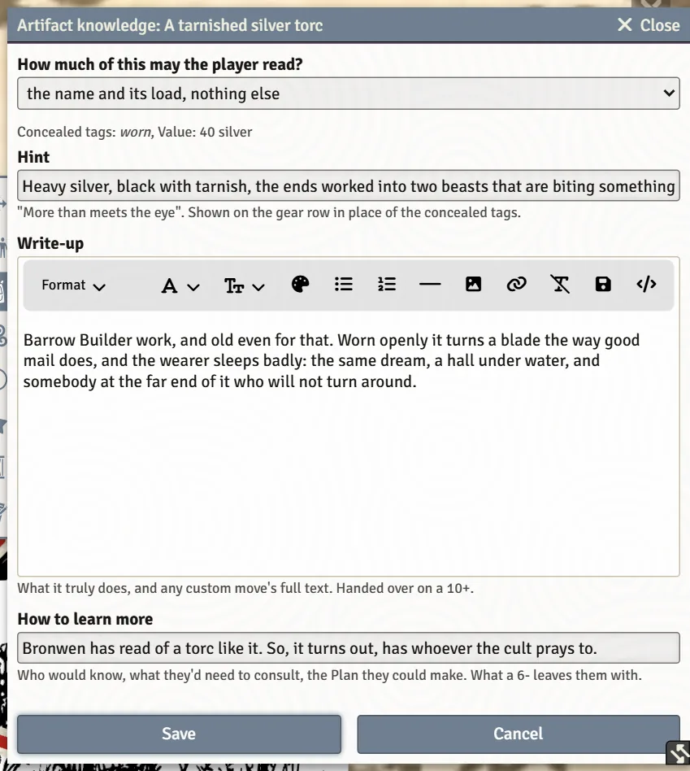

# Arcana for GMs

The GM's side of arcana and artifacts: what ships, how much of a card or an artifact a player can read, and how to hand things over. The player's side is on [Arcana and Artifacts](Arcana-and-Artifacts).

## What ships

The Arcana compendium holds the book's major and minor arcana as cards with their fronts, backs, marks and tracks. It's hidden from players. **Browse Stonetop**'s **Arcana** tab finds a card by tier, by what it grants or by curse (see [Bestiary, NPCs and Monsters](Bestiary-NPCs-and-Monsters#browse-stonetop)).

Drag a card onto a character's sheet to give it to them. It lands face down, and the sheet grows an **Arcana** tab for it.

## How much a player can read

By default a player reads a card's front, and its back once they've worked it out. The GM controls this per card, on the character's Arcana tab:

- **Reveal back to player** / **Hide back from player** shows or hides a locked card's back.
- **Give the card** hands an arcanum over without a roll: **Front only** or **Front and back** (Book I p.440).
- A card can stay unidentified ("you can tell it's something, but not what") or carry only a lead on its whereabouts, until **Arcana Discovered** reveals it.

The world setting **Arcana: Players See Both Sides** shows players both faces of every card, for tables that prefer it.

> **Did you know?**
> - Players identify an arcanum with **Know Things** right from the card (advantage when one of their moves applies). `Shift`-click skips the question.
> - A card whose moves summon a follower (Manifest) adds it to the character's Followers tab, asking the picks from the card's back first.

## Artifacts

Treasures and artifacts in a character's inventory can hide what they are. The GM's **Artifact knowledge** window (the GM button on the item's gear row) sets **How much of this may the player read?**:

| Setting | The player sees |
|---|---|
| everything (ordinary gear) | Nothing is hidden. |
| the name and its load, nothing else | Unidentified. |
| its tags and Value; the write-up is still owed | Partly identified. |
| everything, write-up included | Fully identified. |

It also holds the **Hint** (shown on the gear row in place of the hidden tags), the **Write-up** (what it truly does, handed over on a 10+) and **How to learn more** (who would know, and what a 6- leaves them with).

The world setting **Artifacts Arrive Unidentified** makes new artifacts start hidden when dropped on a sheet; a treasure's own **Lands unidentified** box makes that one start hidden even with the setting off. Players work an artifact out with **Know Things** or **Seek Insight** from its **Identify artifact** button, and the result moves the setting along.

## Homebrew arcana

**Create Item**, then **Gear & Treasure**, offers **Blank arcanum** or **Inspire me…**, which rolls Book II's artifact creation tables to start you off. Homebrew arcana use the same card sheet as the bundled ones. Whether players may make their own is the world setting **Arcana Creation: GM Only**.

## See also
- [Arcana and Artifacts](Arcana-and-Artifacts)
- [Homebrew Content](Homebrew-Content)
- [Inventory and Gear](Inventory-and-Gear#artifacts)
- [World Settings Reference](World-Settings-Reference)
