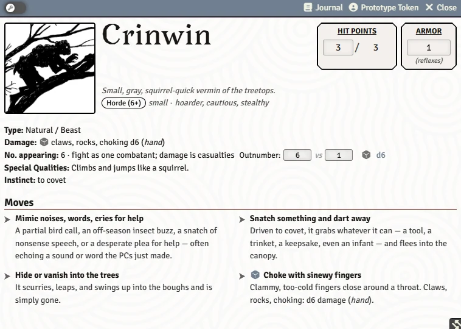
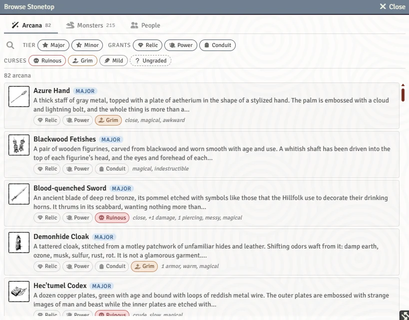

# Bestiary, NPCs and Monsters

The system ships the bestiary of Books I and II as ready-to-use stat blocks and illustrated codex entries, and gives people (NPCs) and monsters sheets of their own. This page is for GMs: finding creatures, making your own, and the NPC sheet.

## The bestiary

- **Stat blocks.** Around 200 monsters ship in the Monsters compendium, and a new world copies them into a red **Bestiary** folder in the Actors sidebar, sorted the way Book II sorts them (Peoples & Folk, Regions, Primordial & Mythic Powers, The Makers). Drag one onto the map like any actor.
- **Codex entries.** The Bestiary journal has an entry for each creature: description, impressions, questions, lore, hooks, lair and habitat, dangers, and its stat blocks. **Drag a stat block card from an entry onto the map** or into the sidebar. Creature names mentioned in other journals link to their entries and show a summary on hover.
- Monster and codex content stays hidden from players until you reveal it, so the bestiary is a spoiler-safe GM reference.

Once you've run [Import Book Art](Import-Book-Art), every creature has its portrait and token.

## Browse Stonetop

The **Browse Stonetop** macro (GM hotbar slot 5) opens one window for finding things across the bundled content:

- **Arcana**, filtered by tier, by what they grant and by curse;
- **Monsters**, filtered by section, type and how many they come in;
- **People** (your world's NPCs), filtered by status and home.

It reads the GM-only compendiums, so it's for the GM. GMs who use the console can open it on a tab with `game.stonetop.openBrowser("people")`.

## Making actors

The Actors sidebar's **Create Actor** button opens a chooser instead of Foundry's plain form:

| Choice | What you get |
|---|---|
| **Player Character** | A character for a player you pick. Their screen opens character creation. |
| **Person**: **Resident of Stonetop**, **Neighbor** or **Someone else** | An NPC, filed into the steading's lists for the first two. |
| **Monster** | **Make a Monster** (the Book I worksheet), **Corrupted being**, **Emanation** or **Blank stat block**. |
| **Settlement** | Another village or town (see [The Steading and Settlements](The-Steading-and-Settlements#other-settlements)). |

### The monster worksheet

A new monster opens the book's monster-making worksheet, with HP, Armor and Damage worked out live as you answer. You can turn this off with the world setting **Guided Monster Builder**.

## The monster sheet

A monster's sheet has **Stats** and **Notes** tabs, and **Open Bestiary Entry** in the header for a bundled creature.

- Click a move's dice to roll it; damage rolls go to the shared damage card with the right target in a fight.
- **Organization** (Solitary, Group, Horde) and **Size** set the book's HP. **Work out max HP from organization and size** applies the table from Book I p.396.
- **Group fight** (optional, Book I p.416) runs a whole group as one fighter: Hit Points becomes the group's pool. A horde's swarm rolls all of them on one foe.
- Moves that raise Armor for a moment ("Armor boosted to N") can be clicked again to revert.

## The NPC sheet

An NPC (person) sheet has **Details** and **Notes** tabs, plus **Stats** once you give them stats and **Relationships** once there is someone to rate:

- **Occupation**, traits, **Home**, **Relations**, **Status**, **Impressions** (sensory hooks), **Motivations**, **Connections** and an **Instinct**;
- **Embodiment**: a GM-only note on how you play them (a voice, a picture, an acting trick);
- **Relationships**: a heart rating for each player character (everyone starts at 3);
- **Give them stats (if they might fight or take orders)**: HP, Armor, Damage, tags and moves; or link a bestiary stat block;
- **Threat**: link the threat write-up they're part of;
- **Ledger** (header button): every change to the sheet, with search and filters.

> **Did you know?**
> - **Right-click an NPC in the Actors sidebar and choose Assign to Player…** to hand them to a player as their character, for example a resident who becomes a PC. It sets ownership and releases the previous player's hold. (Foundry's own User Configuration only lists playbook characters.)
> - Players can drag an NPC or monster onto their character sheet to turn it into a follower. See [Followers](Followers).
> - Every portrait has a crop button to frame the face that sheets and the sidebar show, and the token is cut from the same picture.
> - Right-click an NPC or character and choose **Becomes a Threat...** when someone turns. See [Threats and Hazards](Threats-and-Hazards#other-ways-to-make-threats).

## See also
- [Running Fights](Running-Fights)
- [The Steading and Settlements](The-Steading-and-Settlements)
- [Homebrew Content](Homebrew-Content)
- [Import Book Art](Import-Book-Art)
