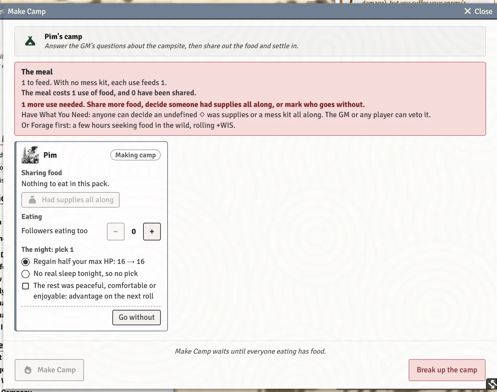

# Camp, Journeys and Group Moves

Some moves belong to the whole party: making camp, struggling through a danger together, the days on the road, and the end of a session. Each one has a shared window that everybody sees and fills in at once. This page is the player's view; the GM's side of journeys is on [Expeditions and Sites](Expeditions-and-Sites).

## Make Camp

Click **Make Camp** in the expedition moves on your sheet, or **Join the camp** on a camp's chat card when someone else starts one (it reads **Open the camp** once you're at the fire). A **Make Camp** window opens for everyone at the fire and updates live as each of you fills it in.

For each character it covers:

- **The meal.** Step your food up or down from what's in your pack, share a use with someone else, or **Go without**. Someone with a mess kit can **Cook with the mess kit, so 1 use feeds 4**. **Followers eating too** counts the followers who need feeding.
- **The night: pick 1.** For example, **Regain half your max HP**, or clear a debility. **Sleep in the bedroll: regain 1d6 extra HP** when you have one.
- **The rest was peaceful, comfortable or enjoyable: advantage on the next roll**, when the GM says so.
- **Prepared the camp site (A Safe Place)**, for a Ranger who did.

The **Make Camp** button at the bottom settles the night once everyone eating has food; until then the window says how many more uses are needed, and that anyone can decide an undefined ◇ was supplies all along (**Had supplies all along**). Click a portrait in the window to open that character's sheet. When the night is over, **Break up the camp** closes it for everyone (it asks first, in case someone clicked it by mistake).

> **Did you know?**
> - Followers who eat at camp regain half their max HP when the camp settles. Mark which followers are with the party on their cards (see [Followers](Followers)).
> - A split party can run two camps. Joining a different camp asks first.
> - A Ghost or Revenant needs no food or sleep and takes nothing from the night; the window says so.
> - A Thrall with Ravenous eats an extra 1d4 provisions or uses of supplies, added to the meal. One with Quicksilver Dreams gives everyone else at the fire nightmares: each holds disadvantage on their next roll. Ghosts and Revenants don't dream, and the ash of Keep the Home-Fires Burning wards it off.

## Struggle as One

When the whole party faces the same danger, click **Struggle as One**. You describe the danger, and the GM's screen opens the setup. A shared window follows with:

- **The danger** and the party's **approach**;
- **A Bundle of Sticks Unbroken: who rolls with advantage beside you?**, for a Judge who has it;
- the rolls and their results, and **Share the results with everyone** at the end.

On a journey, the GM can call it as part of the trip, and the window says **Part of a journey.**

## Recover, Convalesce and tending wounds

These are on your sheet's **Special Moves** tab:

- **Recover** (catch your breath): expend 1 use of supplies to regain HP. Someone else can expend a use on your behalf; their player is asked first. Tick followers to Recover with you (1 use each). **Tend a debility** asks how you tend it and clears it once the GM agrees.
- **Convalesce** (rest a few days in safety): recover all your HP and clear your debilities. Tick followers who rest with you.

Each card says why it's locked when it can't help, for example **You're already at full HP** or **You have no uses of supplies to expend**.

A problematic wound on the line under your name has a **Tend** button too. See [The Character Sheet](The-Character-Sheet).

## On the road

While the GM runs a journey, you'll see:

- the route drawn on the map scene for everyone;
- **Days on the road**, when the GM glosses a few days of travel: supplies are spent from every pack on the trip (the GM can adjust before it's spent);
- the Die of Fate and Struggle as One when the road turns perilous.

Requisition and Outfit happen before you set out. See [Inventory and Gear](Inventory-and-Gear) and [Expeditions and Sites](Expeditions-and-Sites).

## End of Session

When the GM opens **End of Session**, your copy opens too and follows the GM's **Group XP** ticks as they make them. Your own Personal XP ticks, and your praise and wish, are marked in the GM's window and kept on your character:

- **Personal XP**: whether you demonstrated or struggled with your instinct, and how a relationship changed. Each is +1 XP.
- **Group XP**: the four questions. Each "yes" is +1 XP for everyone at the table.
- **Around the Table**: your praise and your wish for future sessions.

When the GM clicks **Award XP & Close** (**Award +N Group XP & Close** when a group question was ticked), the XP lands on each sheet and a card lists who got what. Wishes go to the GM's **I Wonder...** tab, so they're remembered.

## See also
- [Followers](Followers)
- [Expeditions and Sites](Expeditions-and-Sites)
- [Chronicle, Journals and Love Letters](Chronicle-Journals-and-Love-Letters)
- [Inventory and Gear](Inventory-and-Gear)
