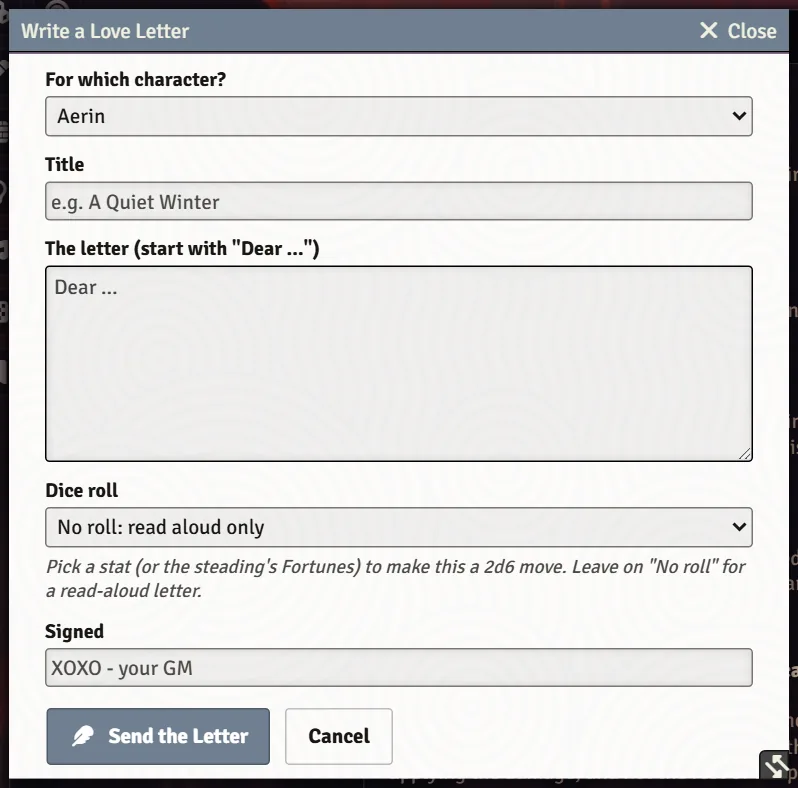

# Chronicle, Journals and Love Letters

The system keeps the campaign's record in journals (the Chronicle), makes the bundled journals easier to use at the table, and gives the GM love letters and the End of Session. This page is for GMs.

## The Chronicle

The **The Chronicle** macro (hotbar slot 7) compiles the campaign's record into a folder of journals named **The Chronicle**:

- **Player Introductions**: each character's answers from the Introductions walkthrough. Players can read it (the **Chronicle** button on their sheets opens their page).
- **Expeditions**: a page per expedition, from the Run an Expedition walkthrough. GM only.

The same folder also holds **Seasons Change** (one page per year, each season folded under it), **Places of Interest** (the steading's lettered places), the GM's threat, hazard and site journals, and the **Timeline** journal.

Running the macro again updates the pages without losing edits you made to them by hand.

## Journals at the table

> **Did you know?**
> - **Share With Players**: an eye button in a journal's window header lets the GM choose who can see it, in one step instead of Foundry's ownership window.
> - **Spoiler protection**: a link a player isn't allowed to follow is shown as plain text in prose, so the name of a secret page doesn't give it away. Safe hover summaries still work.
> - **Rollable tables**: a die appears beside the "Roll" headings in bundled journals. Click it to roll the table to chat.
> - **Checklists**: checkboxes in a journal can be ticked while reading. Ticks are shared with everyone; only the page's owner can change them.
> - **Treasures**: the treasures in the Book II journals can be dragged straight onto a character's Inventory tab, with their ◇ and ○ intact.
> - **Hover summaries**: links to places and lore show a short summary when hovered. Each player can turn hover info off by category on their Preferences tab.
> - **Compendiums are read-only**: try to edit bundled content and the system explains how to import a copy into your world first.

## Map pins

The system's map pins (places of interest, threats, hazards and sites) print their names in cream on a dark, see-through backing, so they stay readable on the busy maps.

- The world setting **Map Pin Names** (**Configure**) chooses whether pins show their names all the time or only on hover, for all maps at once or one poster map at a time. Site pins always show their names; only the eye button below hides them.
- Each person can quiet the names for themselves: an eye button beside the sidebar, **Hide place names on this map**. Only that person's screen changes. Right-click it to follow the world setting for that map again.

## Love letters

A love letter is a short message to one character about what happened between sessions, often with a roll (Book I p.569). The **Write a Love Letter** macro (GM slot 3) opens the editor:

- **For which character?**, a **Title**, and **The letter** (start with "Dear …");
- **Dice roll**: a stat, the steading's Fortunes, or **No roll: read aloud only**;
- **Roll results (optional)**: describe each outcome, or give a list to pick from with how many they pick on a 10+, 7-9 and 6-;
- **Mark XP on a miss**, and a **Signed** line;
- **Send the Letter**.

The player gets a red envelope that drops in at the top of their screen, with a jingle, and the letter appears in a **Love Letters** section on their Moves tab. Once they've resolved it, the GM keeps a dimmed copy on that tab with **Edit this love letter**, **Delete this love letter** and a resend button. The player's side is on [Relationships, Notes and Reminders](Relationships-Notes-and-Reminders#love-letters).

## End of Session

The **End of Session** macro (hotbar slot 10, the `0` key) opens the end-of-session questions:

- **Personal XP**: each player's instinct, and a relationship that changed.
- **Group XP**: the four questions. Each "yes" is +1 XP to every character at the table.
- **Who marks it** (your window only): each character has an attendance tick (untick anyone who wasn't there), their own **Instinct (+1)** and **Relationship (+1)** ticks, and a box for their praise and wish, with what they wished for **Last time:** shown alongside. Notes are kept on the character.
- **Around the Table**: the book's prompts for praise and a wish.
- **Review followers** (folded, your window only): the book's between-session checklist for updating followers (Book I, p.480).

Each player sees a read-only copy that follows your Group XP ticks. **Award +N Group XP & Close** (or **Award XP & Close** when no group question is ticked) pays everyone and posts a card listing who got what. Wishes are gathered on the GM Toolkit's **I Wonder...** tab. If you open it twice in one session, it asks before paying again.

## Wounds and the Ledger

Wounds are recorded with the wound editor (from a character's HP box) and kept on the character's Ledger: when each wound was taken, healed, scarred or reopened. With the world setting **Problematic Wound Reminder on 9- Rolls** on, roll cards remind the table when a wound might apply.

## Retiring and returning

Right-click a character in the Actors sidebar for **Retire...** (the owner or GM; the sheet's **Special Moves** tab has a **Retire** button too): choose how they leave and write an epilogue, and a character who stays in the region can become an NPC on the steading. **Becomes a Threat...** (GM) turns a character into a threat, and **Return to Play** (GM) brings a retired character back. See [Death and Beyond](Death-and-Beyond#retiring-a-character).

## See also
- [Your First Session](Your-First-Session)
- [The Timeline](The-Timeline)
- [Macros and Console Commands](Macros-and-Console-Commands)
- [Camp, Journeys and Group Moves](Camp-Journeys-and-Group-Moves#end-of-session)
