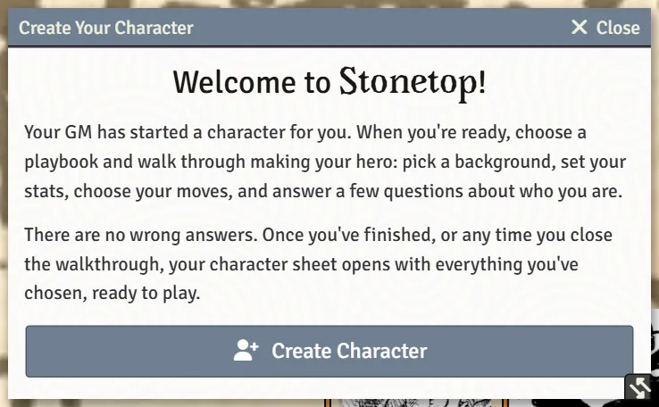
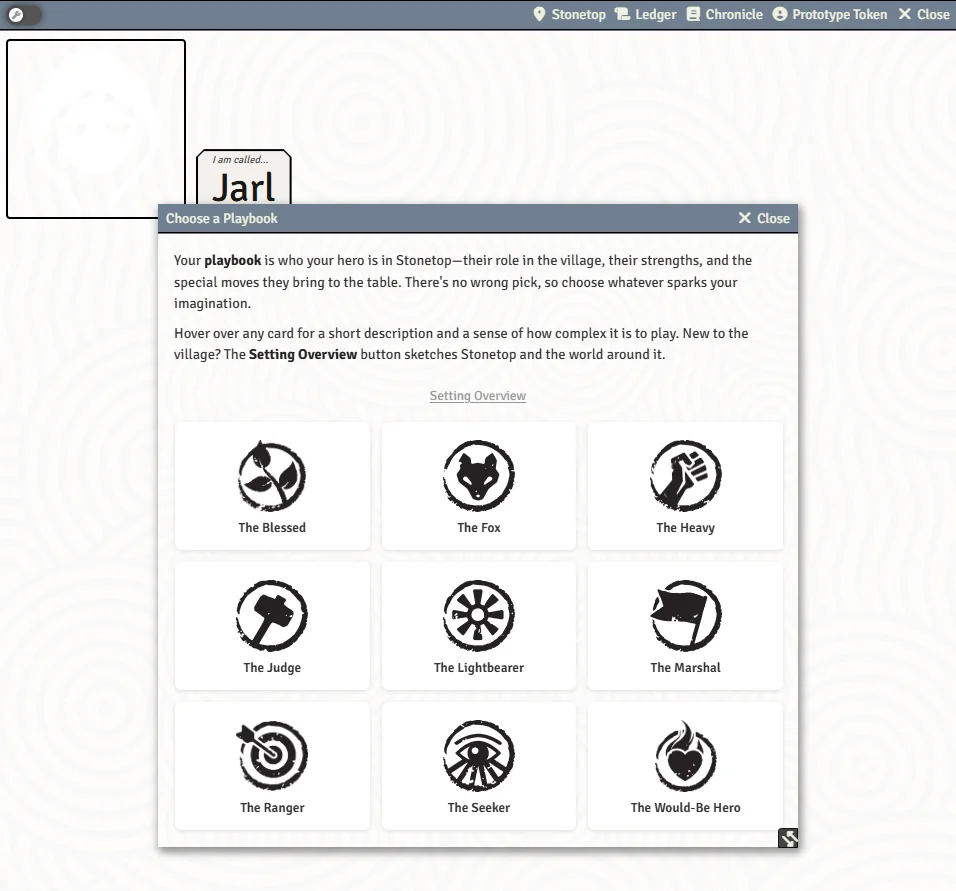

# Creating a Character

This page walks you through making a Stonetop hero in Foundry: how the walkthrough starts, what each step asks, and how to come back later to change your answers.

## How it starts

Your GM usually starts the character for you. They can do it from the **Welcome to Stonetop** guide (its **Create characters** step lists each player) or from the Actors sidebar with **Create Actor**, choosing **Player Character** and then the player it belongs to.

The moment the character exists, a window titled **Create Your Character** opens on your screen with the heading "Welcome to Stonetop!". Press **Create Character** to begin. You never land on a blank sheet: once you finish the walkthrough, or close it part way, your character sheet opens with everything you chose so far.

Players can also make their own character with **Create Actor** > **Player Character**. If you already play a character, a window asks whether to **Add Another** (keep yours and play both) or cancel. Replacing a character means deleting it, which only your GM can do.

## Choosing a playbook

The **Choose a Playbook** window shows one card per playbook, each with its portrait and name.

- **Hover a card** to see a short description of the playbook and how complex it is to play (from Low to High complexity).
- The **Setting Overview** button at the top opens the Setting Overview journal, a short tour of Stonetop and the lands around it.
- A playbook another player already holds says **Taken by** and names the character and player. It is a reminder, not a lock: the book asks each player to pick a different playbook, but your table may agree otherwise, so you can still pick it. Characters who have died or left play are listed as "(dead)" or "(out of play)" and do not count as taking the playbook.

Click a card to pick it and move on to the walkthrough.

## The walkthrough, step by step

The walkthrough shows your playbook's name and icon at the top, a row of progress dots, and a step counter (for example "3 / 9") at the bottom. Use **Next** to move on and **Back** to go back. **Back** on the first step returns you to the playbook picker.

Every playbook has these steps, in this order, when the playbook has something to choose there:

| Step | What you do |
|---|---|
| **Background** | Pick your background. Some backgrounds ask follow-up questions, such as naming neighbors or choosing traits. |
| **Instinct** | Pick an instinct, or write your own (one word plus a description). |
| **Appearance** | Choose one option on each line, or write in your own. |
| **Origin & Name** | Pick where you or your family come from, then type a name or click a suggested name. |
| **Stats** | Assign your playbook's scores to the six stats. |
| **Special Possessions** | Choose your special possessions, including any "pick N from this list" bundles, or describe a write-in possession to agree with your GM. |
| **Starting Moves** | Tick your starting moves. A counter shows how many you have chosen out of how many you may pick. |

Some playbooks add their own steps after these:

| Step | Playbook |
|---|---|
| **Invocations** | The Lightbearer chooses their starting Invocations. |
| **Initiates of Danu** | The Blessed with the Initiate background sets up their initiates. |
| **Crew** | The Marshal names and describes their crew and picks its tags. |
| **Animal Companion** | Appears when you take the Animal Companion move: pick the kind of animal, its traits, instinct, cost and name. |
| **Collection** (choose your **Major Arcanum**) and **Minor Arcana & Questions** | The Seeker picks a major arcanum, then assigns three minor arcana and answers its questions. |

After those come your playbook's own background questions (lore), one page per section.

### Stats

The **Stats** step shows a row of score chips under **Scores to assign** and a box for each stat. Most playbooks give you +2, +1, +1, +0, +0 and -1 to place; the Would-be Hero gives +1, +0, +0, +0, +0 and -1. Each score must be used exactly once.

You can do it two ways:

- **Drag** a score chip and drop it on a stat box.
- Use the **dropdown** inside each stat box.

**Reset** clears every stat so you can start over.

### Names

On **Origin & Name**, choosing a region shows "Suggested names for" that region as clickable chips. Clicking a chip puts that name in the **Name** box. People from Gordin's Delve always come from somewhere else, so that region lists names from the other places instead.

### Starting moves

The move cards show each move's full text. You can filter them with the **Filter moves…** search box, and some playbooks show group chips above the cards to narrow the list. A move like Improved Stat asks **Increase which stat?** right on its card, showing each stat's current and new value; stats already at their maximum cannot be picked.

### The Seeker's minor arcana

Three minor arcana are drawn at random. Assign each a role (one Mastered, one Found, one you have a Lead on). **Draw again** rerolls all three, and each card also has a dropdown to swap in a specific arcanum instead.

> **Did you know?**
> - On the Blessed's **The Wild** names, the chips are words to combine ("mix and match 1-3 of these"). Each click adds the word to the end of your name instead of replacing it, up to three words, and a word already in the name is not added twice.
> - Hover a Seeker arcanum card in the walkthrough to see a preview of the card, front and back.
> - Bold words and move names in move text explain themselves when you hover them.
> - The names of Stonetop's four gods (Danu, Aratis, Helior and Tor) explain who they are when you hover them. You can turn this off with **Hover Descriptions: Lore Terms** in the **On Hover Info** settings (see [Preferences and Accessibility](Preferences-and-Accessibility)).

## Skipping steps

Not sure yet? Press **Skip** to leave a step for later. On the last page, a **Not finished yet** note lists every step you skipped. Click a step's name to jump straight back to it, or press **Create Character** anyway and fill it in on the sheet later.

## The FAQ badge

On steps that have related questions in the Character Creation FAQ, a round **?** badge appears next to the playbook name.

- **Hover** it to read the questions and answers that matter for this step.
- **Click** it to open the full Character Creation FAQ page.

The FAQ lives in the Setting Overview journal, so the badge only appears when your world has that journal.

<!-- SHOT: creating-a-character-faq | Player client: the Stats step of the walkthrough with the mouse over the "?" badge, showing the Related questions popup -->

## Saving and coming back

You do not have to finish in one sitting.

- The **Save** button in the walkthrough's title bar saves your choices so far and offers **Close for Now** or **Continue Editing**.
- Your answers are also saved in your browser as you type. If Foundry reloads or your connection drops, the walkthrough reopens on the page you were on with your answers in place.

> **Did you know?**
> - The automatic save lives in the browser you are using. On a different computer or browser, the walkthrough starts again from the page it was on, without the unsaved answers.
> - If you closed the walkthrough on purpose, it does not keep popping up. Your sheet opens instead, with a **Create Character** button to pick up where you left off.

## Changing your answers later

Once your character exists, you can return to the walkthrough at any time:

- The **Edit Character** button in the sheet's title bar asks what you want to do: **Edit this character** reopens the walkthrough with your current answers, **Choose a playbook** starts over with a new playbook, and **Leave it as it is** cancels. Choosing a different playbook clears everything that came with the old one (its moves, special possessions, background, instinct, lore answers and followers), while your name, level, XP, stats, notes, relationships, inventory and arcana stay.
- While something is still unfinished, the sheet shows shortcut buttons that open the walkthrough on the right step: **Choose Starting Moves** on the Moves tab, **Answer Background Questions** on the Details tab, and **Choose Special Possessions** on the **Inventory** tab.

> **Did you know?**
> - You can change playbook by dragging a playbook item from the compendium onto your sheet. While you drag, the playbook name in the header turns into a **Drop a playbook here** zone. If the sheet already has a different playbook, you are asked to confirm first (**Become** the new one, or **Stay** the old one).
> - Dropping the same playbook again keeps everything and clears nothing.

## See also
- [The Character Sheet](The-Character-Sheet)
- [Playbook Notes](Playbook-Notes)
- [Inventory and Gear](Inventory-and-Gear)
- [Followers](Followers)
- [Preferences and Accessibility](Preferences-and-Accessibility)
- [Your First Session](Your-First-Session)
