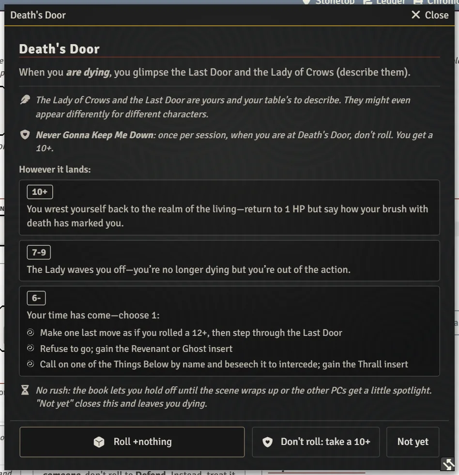
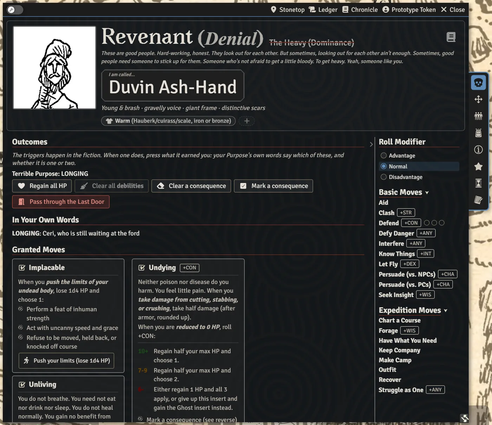

# Death and Beyond

When a character drops to 0 HP, the system walks the table through Death's Door, records how it marked them or what they chose, and, if they come back as a Ghost, Revenant or Thrall, adds that insert to their sheet. This page also covers retiring a character.

## Dropping to 0 HP

When a character reaches 0 HP, a card in chat says they're **dying**. If your GM has **Announce When a Character Is Dying** on (the default), everyone sees it. The GM can use **Not lethal: out of the action** when whatever dropped them wasn't likely to kill anyone, or **Mark dying** to put it back.

If **Open the Dying Character's Move Automatically** is on (also the default), Death's Door opens on the dying player's screen. Otherwise open it from the card, or from **Face Death's Door** on the **Special Moves** tab.

## The Death's Door window

The window shows the move and all three results before you roll. Nothing is final until you click **Accept this result**.

1. **Roll.** Death's Door adds no stat, so the button reads **Roll +nothing**. Some moves change this: a Heavy with Hard to Kill picks +CON or +nothing (the button then reads **Roll the dice**, and on a 7-9 they can mark a debility to regain 1 HP), a character with a once-per-session "don't roll" (such as Never Gonna Keep Me Down) can click **Don't roll: take a 10+**, and Destined or Unstoppable characters see their modifier explained.
2. **Push it up, if you can.** Before accepting, you may be able to **Burn Brightly** (spend XP for +1) or, as a Would-Be Hero, give it your all (Impetuous Youth). Another player with Diligence, Many Hands, Sanction or a Blessing can still add +1.
3. **Accept.**
   - **10+**: back to 1 HP. Say how the brush with death marked you: pick a suggestion (**a nasty scar**, **a lost eye**, **visions of the Last Door**, **a murder of crows, always nearby**) or write your own. It's recorded on your sheet as a wound.
   - **7-9**: no longer dying, but out of the action at 0 HP until the GM says otherwise.
   - **6-**: choose your fate.

**No rush:** **Not yet** closes the window. The book lets you hold off until the scene wraps up.

> **Did you know?**
> - If the dying player has stepped away, someone else can open Death's Door and click **Take over their roll** (or **Take over and roll** if nothing was rolled yet). Everyone else's window follows the roll as it happens.
> - The 10+ mark lands on the sheet as a lasting wound, so it's there to bring up in play. See [The Character Sheet](The-Character-Sheet).

## Choosing your fate (6-)

The three fates are buttons:

- **Make one last move as if you rolled a 12+, then step through the Last Door.** Pick the move and the card is made at 12+. The character is then dead; their sheet shows a **Dead** chip.
- **Refuse to go; gain the Revenant or Ghost insert.** Name the person, task or reckoning you won't leave behind (your Terrible Purpose). You become a Revenant or a Ghost.
- **Call on one of the Things Below** by name and beseech it to intercede: you gain the Thrall insert. Name your master; the GM chooses the Mark it leaves.

Whatever the insert asks you to decide can be answered right away or later: anything left undecided waits on your **Post-Death** tab. If the table played the result out in conversation instead, the GM can **Clear the pending fate**.

> **Did you know?**
> - If a dead character's HP goes back above 0, the system asks **Is (name) being brought back?** Answer **Yes, they live again** and the sheet becomes theirs again; **No, they are still dead** leaves it as it was.
> - A dead character no longer levels up. Choosing a playbook on their sheet asks **Make a New Character?** and makes a fresh level-1 character on a new sheet (Book I p.53), so the dead one stays as the record of their story.
> - Some arcana decide the 6- for you once their Death's Door box is ticked: the Redwood Effigy, Noruba's Ice Sphere and the Hungering Maw of Hlad. The fate step names the arcanum, marks the fate it dictates in gold and picks it for you; the other fates stay clickable, since the table has the last word. Taking the Ghost through the Ice Sphere fills in your tether with the sphere, and the Maw warns that the character dies and becomes a wraith.

## The Post-Death tab

A Ghost, Revenant or Thrall gets a **Post-Death** tab. Their new name replaces the playbook name at the top of the sheet, with the old one struck through, and the playbook's Instinct is retired (it comes back if the insert is removed).

The tab holds:

- the insert's **Instinct**, **Granted Moves**, and your answers **In Your Own Words**;
- for a Ghost, **Your Tether**; for a Thrall, **Your Master's Task** and their **Favor** pips;
- **Outcomes** buttons for what the insert's moves do: **Regain all HP**, **Clear a debility**, **Mark a consequence**, **Pass through the Last Door**, and so on. Each says why it's greyed out when it can't apply;
- the consequences you've marked, with the Final Consequence apart from the rest;
- **Remove Insert** (in edit mode), for mistakes. Once no insert is left, **Remove Post-Death Tab** takes the tab off the sheet.

At 0 HP an undead character doesn't face Death's Door again. Their insert's own move (Undying, Tethered or Dark Succor) opens instead and applies its costs to the sheet.

> **Did you know?**
> - Everything a Ghost, Revenant or Thrall says in chat is drawn on a black card.
> - A dead character's sheet turns dark too, so the whole table can see at a glance who has passed.

### Moves on the cards

The insert's granted moves carry buttons of their own, so their costs land on the sheet:

- **Instinct.** In edit mode, pick one of the insert's Instincts or write your own: a word, and what it means.
- **Possess (lose 1d4 HP)** (Ghost, Bodysnatcher). Target the person's token first. While you possess them, the damage they take comes off your HP on its own, with a line in chat. **End possession of (name)** stops it; so does dropping to 0 HP.
- **Manifest** (Ghost, Disembodied). Pick 1 option, and lose 1d4 HP for each extra one. With "Your touch (or ghostly weapons) can harm the living", your own damage cards open with **Ignores armor** ticked. **End manifestation** when you stop concentrating, or when pain, shock or sunlight breaks it; dropping to 0 HP ends it too. A Ghost who is neither manifest with that touch nor possessing someone gets a gold caution on their own damage card: the blow may not harm the living. The numbers are left alone.
- **Get angry** (Ghost, Poltergeist). Lose 1d4 HP and hold that much Fury, with no cap. **Shatter**, **Hurl (+DEX)** and **Telekinetic force (+INT)** each spend 1.
- **Push your limits (lose 1d4 HP)** (Revenant, Implacable). Then choose 1.
- **+1 Favor** (Thrall). At 3 Favor, gaining another resets it to 0 and asks what your master gives you: answer a question (advantage on your next roll to act on it) or a new Mark, after which the GM crosses off a Mark you don't have. **Lash out** and **Speak a word of torment** spend 1-3 Favor and roll +Favor spent.
- **Call the tentacle (1 Favor)** (Thrall, Child of the Deeps). The tentacle joins your Followers tab.
- **Gain the maw (1 Favor)** (Thrall, Ravenous). A horrid maw (*hand*, 3 piercing, *messy*) that Clash offers as a weapon until you **Put the maw away**.
- **Mark the Final Consequence** is the last of a Terrible Purpose's Outcomes. It asks first. When Undying or Tethered finds every Consequence already marked, its window says so and offers the same box, unticked.

Damage cards add boxes for undead targets, ticked where the source's tags say so and yours to change:

- **Undying**: cutting, stabbing or crushing does half damage after armor, and poison or disease does a Revenant no harm.
- **Disembodied**: only silver, salt or what harms spirits can hurt a Ghost.
- **A Festering Rot**: poison, disease, caustic substances and vermin bites do this Thrall no harm.
- **Child of the Deeps**: cold and pressure do this Thrall no harm. This one always starts unticked.

## Retiring a character

To retire a character who's still alive, click **Retire** on the sheet's Special Moves tab (or right-click the character in the Actors sidebar). You say whether they retire nearby or leave Stonetop, write a short epilogue, and can have them become an NPC (a new resident or neighbor, or an NPC already on the steading). The GM can right-click a retired character and choose **Return to Play** to bring them back.

## See also
- [Rolling Moves and Chat Cards](Rolling-Moves-and-Chat-Cards)
- [Playbook Notes](Playbook-Notes)
- [The Timeline](The-Timeline)
- [Running Fights](Running-Fights)
