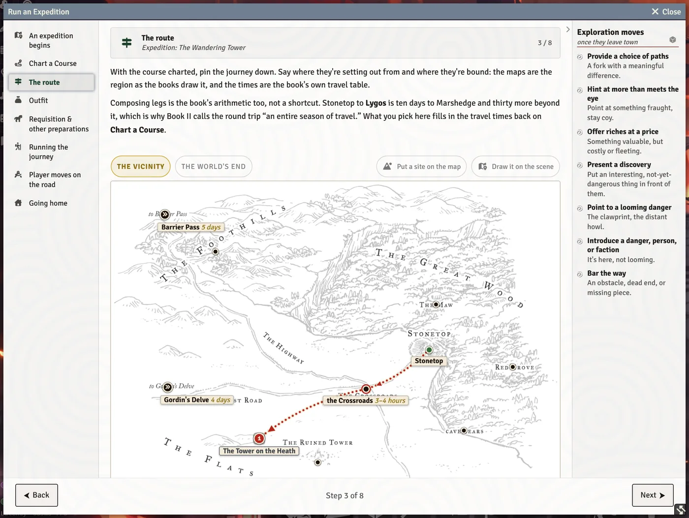
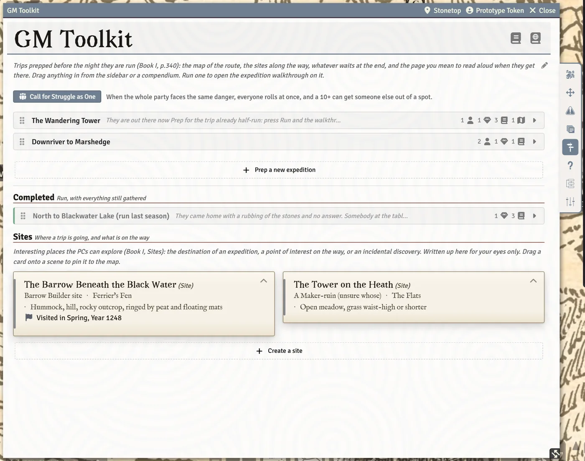

# Expeditions and Sites

Leaving town is where Stonetop's adventures happen. The **Run an Expedition** walkthrough takes the GM through an expedition from planning to homecoming, with the route on the map, the party's load, requisitions, the road itself and the return. Sites (the places the party explores) have their own write-up wizard. This page is for GMs; players see the results on their sheets and the map.

## Run an Expedition

Open it from the **Run an Expedition** macro (hotbar slot 2), or with **Run it** on an expedition prepared on the GM Toolkit's **Expeditions** tab. It's a stepped window with the steps listed on the left and the **Exploration moves** (the GM's moves for the road) always on the right:

| Step | What it does |
|---|---|
| **An expedition begins** | Name the expedition (or pick a logged one) and read what to prep. |
| **Chart a Course** | Record the destination and route, the requirements (days, supplies, guides) and the challenges you plan to bring in. |
| **The route** | The map, with the way there drawn on it and the travel times from the book's table. |
| **Outfit** | The whole party's load at a glance: who's carrying what, light, normal or heavy, and who's coming. |
| **Requisition & other preparations** | Roll +Fortunes for the steading's communal assets, and tick which assets they take. |
| **Running the journey** | The core loop for each leg, the Die of Fate, Struggle as One and the days on the road. |
| **Player moves on the road** | What the players might do: Have What You Need, Recover, Struggle as One, Keep Company, Make Camp, Forage. |
| **Going home** | Questions for the homecoming, Return Triumphant, and **Save to the Chronicle**. |

> **Did you know?**
> - The walkthrough reopens where you left it after a reload.
> - Requisitioned assets are struck through on the steading sheet and tagged with the expedition until it comes home. Deleting an expedition from the log returns them.
> - While an expedition is out, the Level Up window reminds players that the book levels up only at home.

## The route

The **Chart a Course** and **The route** steps work out the way from the book's travel table. On the map:

- Click to say where the party sets out from, if it isn't Stonetop.
- **Shift-click the map to lay a route by hand**, one leg at a time. Click to move the end of the way; right-click to take a leg back. **Start over** throws the hand-drawn marks away. Hand-drawn times are measured off the map at the pace of the book's own journeys: a good guess, not a printed time.
- **Draw it on the scene** puts the route on the poster-map scene your players are viewing, as a ribbon everybody sees. **Take it off the scene** removes it.
- A larger copy of the map opens in its own window, and there's a link to read the gazetteer entry for where they're bound.

The poster-map scenes come from [Import Book Art](Import-Book-Art).

## On the road

The **Running the journey** step has the tools for each leg:

- **Roll the Die of Fate**, with advantage or disadvantage, and its table for perilous legs.
- **Call for Struggle as One** when the whole party faces the same danger. The window says it's **Part of a journey**. See [Camp, Journeys and Group Moves](Camp-Journeys-and-Group-Moves).
- **Days pass on the road...** for days you gloss over: it spends the supplies each traveller eats (1 use a head a day; a mess kit feeds four). You can adjust each person before it's spent.

Players run Make Camp themselves in its shared window.

## Going home

The last step asks the questions for the homecoming, runs Return Triumphant inline, and **Save to the Chronicle** writes the expedition into The Chronicle's Expeditions journal (GM only). The trip goes onto the timeline of everyone who went.

## Sites

Sites are the places the party explores: a barrow, a ruined tower, a cave. They live at the foot of the GM Toolkit's **Expeditions** tab.

- **Create a site** walks through Book I's process for creating sites in nine steps, with a list on the left to jump between them.
- Each site card has its tables (click a d20 table to roll it), a **Running it** reference (light sources, tags and marching order), and edit and delete buttons.
- **Mark visited** asks **Who went to (site)?** and writes the visit onto their timelines and Stonetop's, where the players can read it.

### Sites on the map

- In the route step, **Put a site on the map** places one of your sites (or a new one) on the poster map: click where it stands.
- Drag a site card from the toolkit onto a scene to pin it.
- Click a site pin to run the way through it; `Shift`-click to add it as another stop; right-click to take the pin off the map (the write-up stays). Dragging a pin on the scene moves the site on the map too.

## Preparing expeditions ahead of time

The GM Toolkit's **Expeditions** tab holds prepared expeditions: bundles of the actors, journals, scenes and notes you'll want on the road, like the Encounters tab. **Run it** starts the walkthrough named after the bundle. See [The GM Toolkit](The-GM-Toolkit).

## See also
- [Camp, Journeys and Group Moves](Camp-Journeys-and-Group-Moves)
- [The GM Toolkit](The-GM-Toolkit)
- [Threats and Hazards](Threats-and-Hazards)
- [Chronicle, Journals and Love Letters](Chronicle-Journals-and-Love-Letters)
