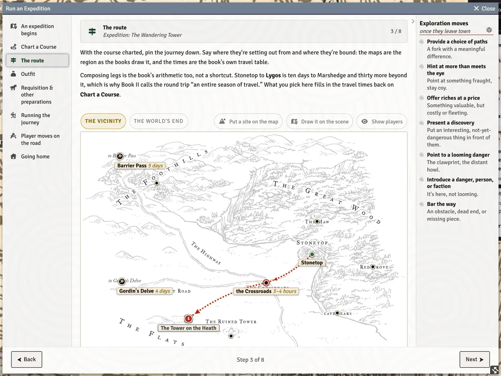
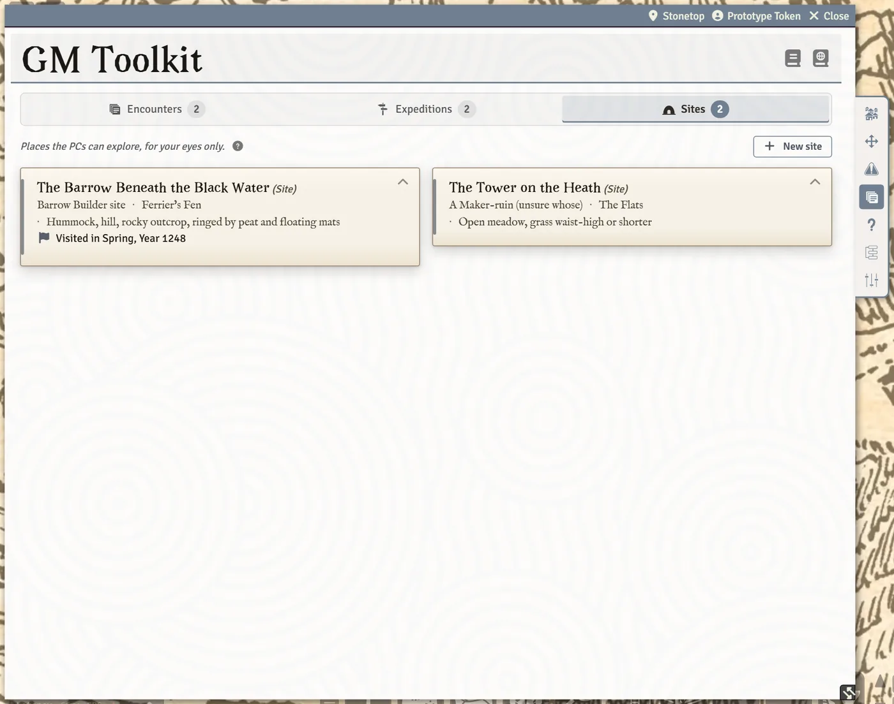

# Expeditions and Sites

Leaving town is where Stonetop's adventures happen. The **Run an Expedition** walkthrough takes the GM through an expedition from planning to homecoming, with the route on the map, the party's load, requisitions, the road itself and the return. Sites (the places the party explores) have their own write-up wizard. This page is for GMs; players see the results on their sheets and the map.

## Run an Expedition

Open it from the **Run an Expedition** macro (hotbar slot 2), or with **Run the expedition** on an expedition prepared in the GM Toolkit (**Prep** tab, **Expeditions**). It's a stepped window with the steps listed on the left and the **Exploration moves** (the GM's moves for the road) always on the right:

| Step | What it does |
|---|---|
| **An expedition begins** | Name the expedition (or pick a logged one) and read what to prep. |
| **Chart a Course** | Record the destination and route, the requirements (days, supplies, guides) and the challenges you plan to bring in. |
| **The route** | The map, with the way there drawn on it and the travel times from the book's table. |
| **Outfit** | The whole party's load at a glance: who's carrying what, light, normal or heavy, and who's coming. |
| **Requisition & other preparations** | Roll +Fortunes for the steading's communal assets, and tick which assets they take. |
| **Running the journey** | The core loop for each leg, the Die of Fate, Struggle as One and the days on the road. |
| **Player moves on the road** | What the players might do: Have What You Need, Recover, Struggle as One, Keep Company, Make Camp, Forage. |
| **Going home** | Questions for the homecoming, Return Triumphant, what is still out with the trip, **Reset Inventory** for the party, and **Save to the Chronicle**. |

> **Did you know?**
> - The walkthrough reopens where you left it after a reload.
> - Requisitioned assets are struck through on the steading sheet and tagged with the expedition until it comes home. Deleting an expedition from the log returns them.
> - While an expedition is out, the Level Up window reminds players that the book levels up only at home.

## The route

The **Chart a Course** and **The route** steps work out the way from the book's travel table. On the map:

- Click to say where the party sets out from, if it isn't Stonetop.
- **Shift-click the map to lay a route by hand**, one leg at a time. Click to move the end of the way; right-click to take a leg back. **Start over** throws the hand-drawn marks away. Hand-drawn times are measured off the map at the pace of the book's own journeys: a good guess, not a printed time.
- **Draw it on the scene** puts the route on the poster-map scene your players are viewing, as a ribbon everybody sees. **Take it off the scene** removes it.
- **Show players** lets the players see the route on their own screens, whichever scene they're on. It posts a chat card with every leg and the total time written out, and puts a **See the route** button on the steading sheet. Both open the map with the route drawn on it, which players can zoom and drag but not change. A screen reader reads the legs as text. **Show players** works on its own: it doesn't draw on any scene, and **Draw it on the scene** doesn't share anything.
- Once the trip goes somewhere else, the button reads **Show players the new way**. If only the words changed (a stop you put down by hand, where they set out from, or the Chart a Course lines), **Change what they're told** posts the way again with the new words. **Hide from players** (or **Stop showing players** in the players' window, which only the GM sees) takes the **See the route** button away. Cards already in chat keep the route they posted, marked as an older route.
- A larger copy of the map opens in its own window, and there's a link to read the gazetteer entry for where they're bound.

The poster-map scenes come from [Import Book Art](Import-Book-Art). If you made your own scene of the map, mark it as one: right-click it in the Scenes sidebar and choose **Stonetop map...**, or press **Draw it on the scene** while you're on it and say which map it is. Routes and pins only land in the right places when the scene's picture is the poster map or the map page from the book, not trimmed.

## On the road

The **Running the journey** step has the tools for each leg:

- **Roll the Die of Fate**, with advantage or disadvantage, and its table for perilous legs.
- **Call for Struggle as One** when the whole party faces the same danger. The window says it's **Part of a journey**. See [Camp, Journeys and Group Moves](Camp-Journeys-and-Group-Moves).
- **Days pass on the road...** for days you gloss over: it spends the supplies each traveller eats (1 use a head a day; a mess kit feeds four). You can adjust each person before it's spent. A Ghost or Revenant needs no food, so their **Eats** box starts unticked with a line saying why; their followers still eat. So does someone holding a length of prayer beads whose back is realised, while they hold at least 1 Preparation. Tick the box to count them anyway.

Players run Make Camp themselves in its shared window.

## Setting out and coming home

The walkthrough asks before it records either end of the trip:

- The first **Next** into **Running the journey** asks **Setting out now?** **They set out now** notes the season they leave and who goes, and Level Up reminds anyone still on the road; **Not yet** leaves it for later. The step itself says whether it's marked, with **They set out now**, or **Redo: they set out now** and **Clear: they haven't left** once it is.
- The first **Next** into **Going home** asks **Are they home now?** **They're home: put it on the timeline** writes the trip onto the timeline of everyone who went, and Stonetop's, dated this season. The step has the same **Redo** and **Clear** buttons.

Back, the list of steps and a reload never ask.

## Going home

The last step asks the questions for the homecoming, runs Return Triumphant inline (it asks before running it a second time), and **Save to the Chronicle** writes the expedition into The Chronicle's Expeditions journal (GM only). It also has:

- **Still out with this trip**: every steading asset they took. **Brought it home**, or **Lost it (Meet with Disaster)**, which asks whether it's **Lost it: Meet with Disaster**, **Lost it, but no disaster**, or **Keep it out for now**. Horses from the herd have **Count them home**.
- **Reset Inventory**: back home, everyone clears the marks from their Inventory (Book I p.89). Each PC on the trip is listed with their followers and crew under them, ticked when they have something marked. **Reset Inventory** asks once (**Clear the marks** or **Keep them**) and clears them all. Anything they found stays on their lists.
- **Then open each PC's Convalesce**: tick it, and each PC's own Convalesce window opens after the reset, so their own rules (a Ghost, the dying) still apply. When everyone has already unpacked, the card has an **Open each PC's Convalesce** button instead.

**Deleting an expedition** from the log asks **Delete this expedition?** and offers to remove its Chronicle page and its timeline rows, put the horses it took back in the herd, and stop showing its route to the players. Anything it requisitioned goes back to the steading.

## Sites

Sites are the places the party explores: a barrow, a ruined tower, a cave. They live in the GM Toolkit: open the **Prep** tab and choose **Sites** at the top.

- **New site** walks through Book I's process for creating sites in nine steps, with a list on the left to jump between them.
- You don't have to finish it in one go. **Save for now**, beside **Next** on every step, saves the site as it stands; its card's pencil reopens the walkthrough with your answers in place. Closing the window with unsaved answers asks first: **Save my changes** or **Discard what I wrote**; close the question to keep writing.
- Each site card has its tables (click a d20 table to roll it), a **Running it** reference (light sources, tags and marching order), and edit and delete buttons.
- **Mark visited** asks **Who went to (site)?** and writes the visit onto their timelines and Stonetop's, where the players can read it.

### Sites on the map

- In the route step, **Put a site on the map** places one of your sites (or a new one) on the poster map: click where it stands.
- Drag a site card from the toolkit onto a scene to pin it.
- Click a site pin to run the way through it; `Shift`-click to add it as another stop; right-click to take the pin off the map (the write-up stays). Dragging a pin on the scene moves the site on the map too.

## Preparing expeditions ahead of time

The GM Toolkit's **Prep** tab holds prepared expeditions under **Expeditions**: bundles of the actors, journals, scenes and notes you'll want on the road, like its encounters. **Run the expedition** at the foot of a card starts the walkthrough named after the bundle, and the card says **On the road** until the trip is over. See [The GM Toolkit](The-GM-Toolkit#expeditions).

## See also
- [Camp, Journeys and Group Moves](Camp-Journeys-and-Group-Moves)
- [The GM Toolkit](The-GM-Toolkit)
- [Threats and Hazards](Threats-and-Hazards)
- [Chronicle, Journals and Love Letters](Chronicle-Journals-and-Love-Letters)
