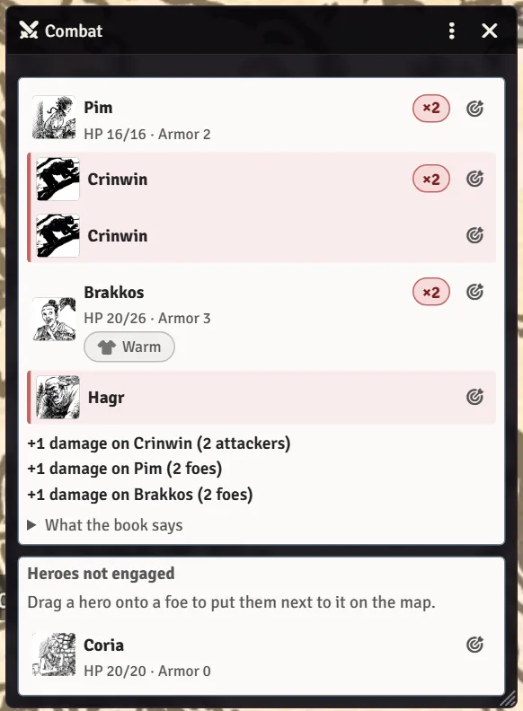
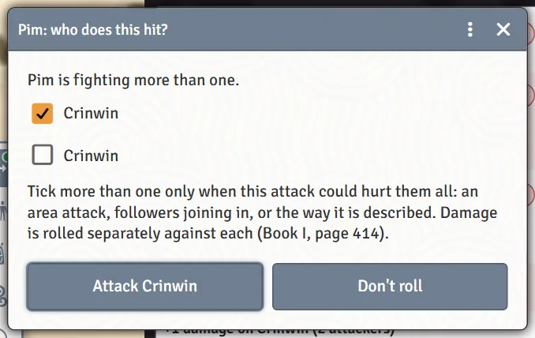

# Fights (for Players)

Stonetop has no initiative and no turns, so the system replaces Foundry's Combat tracker with a **Fight** tab that shows who is fighting whom. This page is the player's view: following a fight, and acting in one without opening your sheet. The GM's side is on [Running Fights](Running-Fights).

## The Fight tab

When your GM starts a fight, the Fight tab (where Foundry's Combat tab used to be, in the sidebar) lists everyone in it:

- each hero and each foe, and who they are **fighting** or **shooting at**;
- headings for **Foes not engaged**, **Heroes not engaged**, **Out of the fight** and **Not on this map**;
- a **Fought by N** or **Facing N** badge when someone is up against several at once;
- the group rules that apply right now, such as **+1 damage on Crinwin (2 attackers)**, each with a page citation you can click to open the rulebook (if your GM has added it; see [The Rulebook Reader](The-Rulebook-Reader)).

Hover a row to see that fighter's HP, Armor and Readiness. Click the target icon on a row (**Point this out on the map**) to ping that token for everyone.

If a fight starts on the map you're looking at, the Fight tab also opens in a window of its own (titled **Combat**), and closes when the fight ends. If you'd rather keep it in the sidebar, turn off **Open the Fight window when a fight starts** in Foundry's **Configure Settings** under Stonetop. You can always pop it out with **Open in a window** at the top of the tab.

## Lines on the map

While a fight is on, the map shows who is engaged with whom: a solid line between two tokens in melee, a dashed arrow from someone shooting to their target, and a small **×N** disc on a token that several are fighting. Move your token next to a foe to engage it; target a foe from range to shoot at it.

## Buttons around your token

During a fight, **left-click your own token** (with Foundry's normal Select tool, no keys held) and buttons appear around it:

- **Clash**, **Let Fly**, **Defend** and **Defy Danger** on one side;
- your damage die on the other;
- for a Would-Be Hero with Big Damn Hero, **Leap in (Big Damn Hero)** beside Defend, once per fight;
- while you hold Readiness from Defend: **Strike back** (spend 1 Readiness to deal your damage, with disadvantage) and, for a Would-Be Hero with Big Damn Hero, **Lock eyes**. How much Readiness you hold is shown over the token.

Your followers get **Clash**, **Let Fly**, **Defend** and **Order** around their tokens; you roll for them, just as from their card on your sheet (see [Followers](Followers)).

Each button does exactly what the same click on your sheet does, including the weapon choice, the damage window and the target. Click the token again, or anywhere on the map, to put the buttons away.

<!-- SHOT: fights-for-players-ring | Player client: the map zoomed in on Pim's token in a fight, with the ring of buttons around it (Clash, Let Fly, Defend, Defy Danger on the left, the d6 damage button on the right) and the Readiness count over the token -->

> **Did you know?**
> - The buttons never shrink below a readable size, even when the map is zoomed far out.
> - `Shift`, `Ctrl` or `Alt` clicks never open the buttons (they're for adding tokens to your selection), and dragging the token just moves it. Right-click still opens Foundry's usual token controls.
> - `Shift`-click a button to roll without any of the windows that would normally ask first.
> - Don't want the buttons? Turn off **Fight buttons when you click a token** in Configure Settings.

## Choosing who you hit

When you're fighting more than one foe, the system asks who the attack hits. Tick more than one only when the attack could hurt them all: an area attack, followers joining in, or the way you described it. Damage is rolled separately against each.

When you attack with Readiness held, you'll be asked whether you're **rushing in** (and lose it) or **holding your ground** (and keep it).

## Moving into position

On the Fight tab, **drag your row onto a foe's row** and your token steps up next to that foe on the map. (The GM can do the same with foes onto heroes.) If there's no room next to them, a notice says so.

> **Did you know?**
> - Right-click a row on the Fight tab and choose **Open sheet** to open that character.
> - The "+N damage" for several attackers is filled into your damage window automatically. See [Rolling Moves and Chat Cards](Rolling-Moves-and-Chat-Cards#attacks-and-damage).
> - If your GM has Sequencer, JB2A and SoundFx Library installed, your blows are drawn and heard on the map. See [Installing and Recommended Modules](Installing-and-Recommended-Modules).

## When things go badly

At 0 HP your character goes to Death's Door. See [Death and Beyond](Death-and-Beyond).

## See also
- [Rolling Moves and Chat Cards](Rolling-Moves-and-Chat-Cards)
- [Followers](Followers)
- [Running Fights](Running-Fights)
- [Hidden Tricks](Hidden-Tricks)
