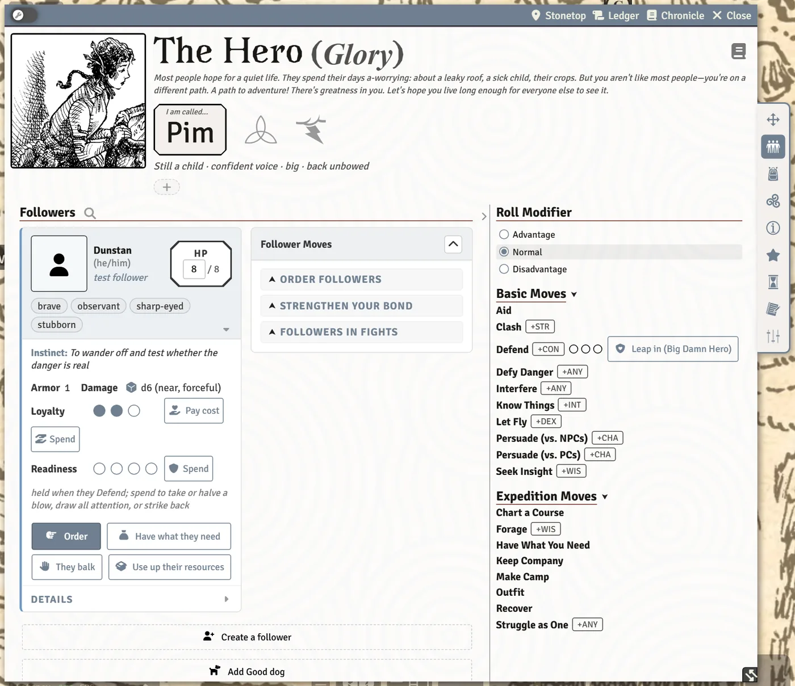

# Followers

Hirelings, initiates, a crew, an animal companion, a summoned thing: everyone who follows your character lives on the **Followers** tab of your sheet, each on their own card. This page covers the cards, ordering followers around, and what happens when they're hurt. Your GM portrays them, and two buttons on each card are for the GM's side: **They balk** and **Use up their resources**.

## Getting a follower

- **Create a follower** at the bottom of the tab makes a new one from scratch. When a move or possession of yours brings a particular follower, a button for it sits beside that one (Pim's sheet reads **Add Good dog**).
- Some moves and possessions bring followers with them (a Marshal's crew, a Blessed's initiates, a Ranger's companion). They're added when you take the move.
- **Drag an NPC or a monster onto your sheet** and the system offers to turn it into your follower, with the stats it needs.
- An arcanum that lets you summon something (Manifest) adds the summoned follower here, asking the picks from the card's back first. If an older follower is missing picks, a **Finish** prompt lets you complete it, or **Remind me later**.

## The follower card

Each card shows the follower's **HP**, **Instinct**, **Cost**, tags, gear, moves and **Readiness**, plus:

- **Loyalty pips.** Click a pip to set it.
- **Pay cost** (Strengthen Your Bond). Pay their cost and, if you haven't done so recently, they hold +1 Loyalty, up to 3. If you already paid since the last End of Session, the button tells you the book wants a significant scene "on camera" first.
- **Spend** Loyalty, when a move or the GM calls for it.
- Tags with an explanation on hover, and **Add a tag…** to give them a new one.
- **Outfit**, to pack their gear for an expedition.
- **Debility (p.243)**, when they're weakened, dazed or miserable.

> **Did you know?**
> - Each card's sections fold like an accordion: opening one closes the others. Hold `Shift`, `Ctrl` or `Cmd` while clicking to keep several open at once.
> - The magnifying glass beside **Followers** filters the cards by name (`Esc` clears it).
> - The small portrait on a card opens bigger when clicked, with the same framing and Tokenizer buttons as your own portrait.
> - **Drag a follower's card onto the map** to put their token there. Drags that start on a button or a box don't count, so you can still click those normally.

## Ordering followers

Click **Order** on a card (or around their token in a fight) to open **Order Followers**. Mark each of their tags as helping, getting in the way, or neither, and the bonus is worked out as you go. Advantage and disadvantage have their own switches. You roll the move for them.

In a fight, followers get **Clash**, **Let Fly**, **Defend** and **Order** around their token; see [Fights (for Players)](Fights-for-Players).

### When they balk

Followers never act on their own. When the GM decides one won't do as they're told (Book I, p.466), the GM, or you on the GM's word, clicks **They balk** on the card. A window asks why (**Scared**, **Overwhelmed**, **Unreasonable order** or **Against their nature**) and, optionally, what the order was. A card goes to chat with three answers:

- **Spend 1 Loyalty**: the follower does it anyway.
- **Persuade them**: rolls the leader's Persuade (vs. NPCs).
- **Let it drop**: they don't do it.

Only the leader's owner can answer, or the GM while none of that character's owners is logged in. The answer posts as its own card, and deleting that answer card reopens the question.

### Use up their resources

When the GM makes the move "Use up their resources" (Book I, p.182) on a follower, click **Use up their resources** on the card. It lists only what that follower has to lose:

- **1 Loyalty**, while they hold any;
- **Uses of Supplies** (a crew), taken from a part-used ◇ before a full one;
- **Ammo**, one step: low, then all out (a follower who uses ammo);
- **A piece of their gear**, which is unticked rather than struck off, so it can be packed again.

Type how it shows if you like ("a strap snaps and the waterskin is gone"). The change is logged under the move's name, and a card tells the table what was lost.

## Crews and groups

A crew or group follower is one card for many people. Its card adds:

- steppers to add or remove members, and **Name this member** to name each one;
- shared HP, with a reset;
- **Restock supplies** (a crew only).

When members fall, they're struck off the roster (a group keeps at least two).

## Away from the fight

- **With the party.** Mark which followers are with the party. At Make Camp, they're the ones who need feeding, and fed followers regain half their max HP when the camp settles. See [Camp, Journeys and Group Moves](Camp-Journeys-and-Group-Moves).
- **Recover and Convalesce.** Both moves can include your followers: tick who Recovers with you (1 use of supplies each) or who rests with you back to full HP.
- **Handing over.** You can give a follower to another player's character. A GM must be online to make the change.
- **Lend it your strength.** A Ranger with Beast-Bonded can lose 1d6 HP to heal their animal companion by as much.

## When a follower drops

At 0 HP a follower faces their own Death's Door, rolled from the chat card. If you have **Sir, Permission to Die, Sir**, you can spend 1 of their Loyalty to keep them alive (at 0 HP and out of the action), or let them go and mark XP.

## See also
- [Fights (for Players)](Fights-for-Players)
- [Camp, Journeys and Group Moves](Camp-Journeys-and-Group-Moves)
- [The GM Toolkit](The-GM-Toolkit)
- [Playbook Notes](Playbook-Notes)
