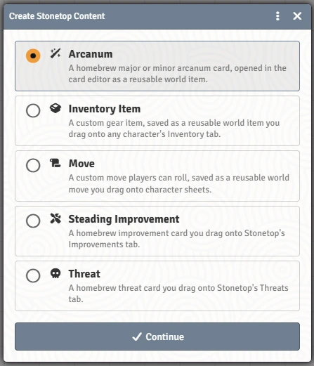

# Homebrew Content

Your table's own moves, gear, treasures, arcana, improvements, threats and sites can be made once as world items and then dragged where they belong. This page is mostly for GMs; players can make custom moves and arcana if the GM allows it.

## The Create Item chooser

The Items sidebar's **Create Item** button opens a chooser instead of Foundry's plain form:

| Group | Choices |
|---|---|
| **Move** | A custom move players can roll. |
| **Steading Improvement** | An improvement for Stonetop, with requirements and effects. |
| **Gear & Treasure** | **Inventory Item**; **Treasure** (GM only, hidden until handed over); **Blank arcanum**; **Inspire me…** (rolls Book II's artifact creation tables). |
| **Dangers & Places** | **Threat**; **Site**; and the Things Below: **A Thing Below**, **A corrupted site**, **A corrupted being**, **An emanation**. |

Each is saved once as a world item. Drag it onto the sheet or tab where it belongs: a move or item onto a character, an improvement onto the steading's **Improvements** tab, a threat onto the GM Toolkit's **Threats & Dangers** tab.

## Custom moves

A custom move can also be written straight onto a character: **Create a move** at the foot of the Moves tab. The editor has four sections:

- **The move**: name and text, with `***bold italic***` style formatting;
- **Dice roll**: which stat, and what each result does;
- **Resource track**: circles the move tracks (hold, uses);
- **Bonuses & XP**: what it adds and when it marks XP.

By default only the GM can add custom moves; turn off the world setting **Custom Moves: GM Only** to let players write their own. A threat's player move can be turned into a custom move with **Give to players** (see [Threats and Hazards](Threats-and-Hazards#tracking-a-threat)).

## Treasures and inventory items

**Inventory Item** and **Treasure** use the same form as a character's **Add item** (column, weight, armor, tags, uses, Value), plus an image. A treasure adds a **Write-up**, a section on **Identifying it**, and **Lands unidentified** so the player sees only its name and ◇ until they work it out. Only the GM can see a treasure until it's dragged onto a character. See [Arcana for GMs](Arcana-for-GMs#artifacts).

## Improvements

The improvement builder lays out an improvement the way the book does: its requirements in groups, and its effects, some of which the system applies automatically (for example to Seasons Change). Drag the finished improvement onto the steading's **Improvements** tab.

## Threats and sites

- **Threat** opens the same guided write-up as the GM Toolkit's **Write up a ... threat** buttons.
- **Site** runs the nine-step Creating Sites process.
- The Things Below generators make a threat, a corrupted site, or a monster stat block.

Homebrew threat ideas can be kept as cards in a GM-only journal and dragged onto the Threats tab when they come into play. See [Threats and Hazards](Threats-and-Hazards) and [Expeditions and Sites](Expeditions-and-Sites#sites).

## Arcana

See [Arcana for GMs](Arcana-for-GMs#homebrew-arcana). Whether players can make their own is the world setting **Arcana Creation: GM Only**.

## See also
- [The GM Toolkit](The-GM-Toolkit)
- [The Steading and Settlements](The-Steading-and-Settlements#improvements)
- [World Settings Reference](World-Settings-Reference)
