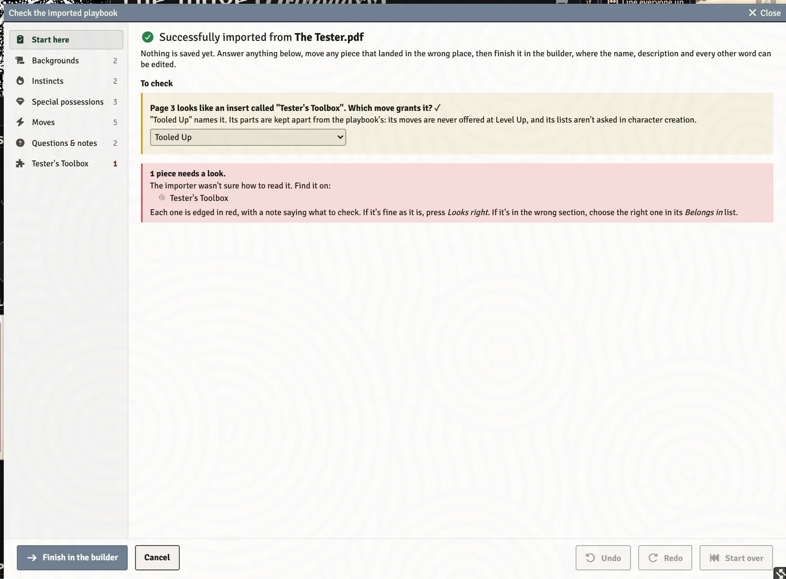
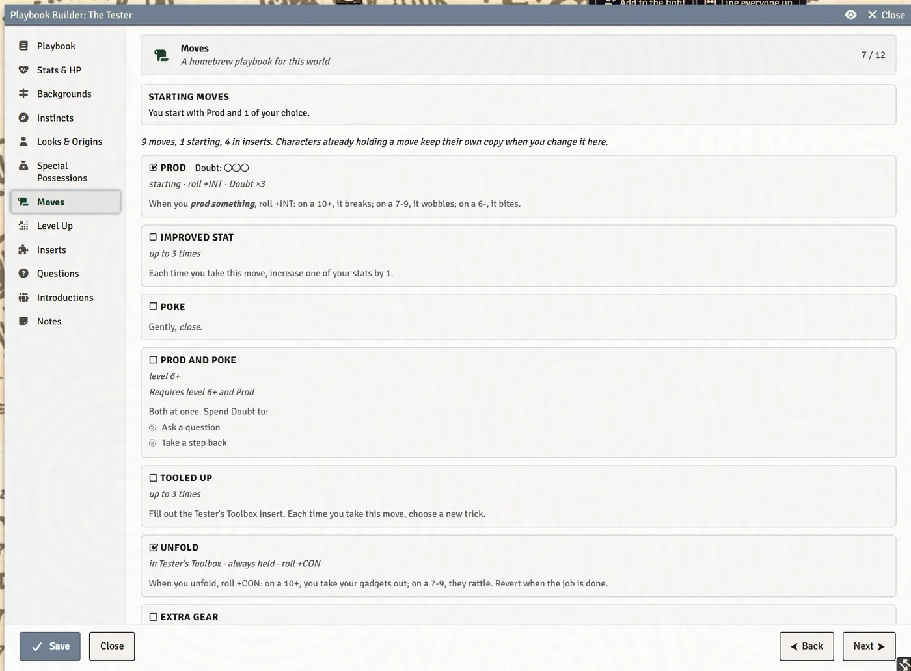

# Homebrew Playbooks

A community or third-party playbook (or one you wrote yourself) can be added to a world and played like the nine in the book: it appears in the playbook picker, character creation walks through it, and its moves roll on the sheet. This page is for GMs; only a GM can add or change a playbook.

Add any playbook before characters are made, so it's in the picker when players choose. The welcome guide's optional **Third-party playbooks** step has an **Add a Playbook** button for this (see [Your First Session](Your-First-Session)).

## Adding a playbook

Open the Items sidebar's **Create Item** and choose **Homebrew Playbook**, or **Add a Playbook** in the welcome guide. A window asks **Do you have the playbook as a PDF?**

- **Read it from a PDF…** reads a playbook made with the community Stonetop playbook template, then opens a review where you check what was read (below).
- **Fill it in by hand** opens an empty Playbook Builder.

You can also drop a playbook PDF, or a playbook file someone exported, onto the Items sidebar.

### Playbooks the system knows

Four third-party playbooks are recognised from the PDF on their creator's store page. Get the PDF there and drop it in, and it imports with no review:

| Playbook | Creator | Where to get it |
| --- | --- | --- |
| **The Stranger** | Dissonance | [moth-lands.itch.io](https://moth-lands.itch.io/stonetop-stranger-playbook) |
| **The Standout** | leopolitan | [leopolitan.itch.io](https://leopolitan.itch.io/stonetop-playbook-the-standout) |
| **The Familiar Face** | lexchxn | [lexchxn.itch.io](https://lexchxn.itch.io/the-familiar-face) |
| **The Abhorsen-in-Waiting** | Sundance09 | [sundance09.itch.io](https://sundance09.itch.io/stonetop-abhorsen) |

These playbooks were written by their creators, not by this system. None of their text ships with it: everything is read from your copy of the PDF. If you enjoy one, please buy it or leave a tip on its page, so the people who make them keep making them.

The playbook is saved straight away and a window says **(name) is ready**, with **Done**, **Try character creation** and **Open it in the Playbook Builder**. Only the versions above are recognised. If a creator puts out a new version, it still reads, but goes through the review like any other PDF.

**Want another playbook supported?** If there's a third-party playbook you'd like to import this way, tell me on [Discord](https://discord.gg/jB9eWUyAVh) and I'll look at adding it.

### A PDF with no text

A scan, or a PDF made with "Print to PDF", holds only pictures of words. The window **This PDF has no text to read** explains why and offers **Fill it in by hand, with the PDF beside it**, which opens the PDF in its own window next to the Builder. To have it import by itself, ask the playbook's creator for a PDF made from the community template that keeps its text as text.

## Checking an import

**Check the imported playbook** shows everything the reader found, one page per section, with **Start here** first. Nothing is saved until you finish.

- **Start here** asks what the reader couldn't settle: the playbook's name, a max HP printed twice or not found, the damage die, the stat scores.
- Pieces the reader wasn't sure about are marked in red, and each page's count in the rail says how many need a look. Press **Looks right** on a piece that's fine, or pick where it goes from **Belongs in**.
- **Split into N** breaks a piece that ran two together; **Join to the one above** mends one that was cut in half. On a piece that isn't marked, these sit behind its pencil.
- **Undo**, **Redo** and **Start over** are in the footer. **Finish in the builder** opens the Builder with the result.
- If this world already has the playbook, finishing offers to update it from the PDF while keeping what you changed by hand, or to keep the new one separate.

### Inserts

Some playbooks carry an insert: a page of extra lists unlocked by one of their moves, like the Stranger's Monster Compendium. The reader looks for one, and if it isn't sure it asks which move grants it, whether every character has it, or whether it isn't an insert at all. Each insert gets its own page in the review.

## The Playbook Builder

The Builder edits every part of a playbook. The rail on the left lists its panels: **Playbook**, **Stats & HP**, **Backgrounds**, **Instincts** (or **Drives**), **Looks & Origins**, **Special Possessions**, **Moves**, **Level Up**, **Inserts**, **Questions**, **Introductions** and **Notes**. **Save**, **Back** and **Next** are at the bottom, and closing with unsaved changes asks first.

- **The eye** at the top of the window decides whether players can pick it. Open, it's in their playbook picker; shut, only you see it there (marked **Homebrew draft: players can't see it yet**).
- **Read a PDF or playbook file…** on the Playbook panel fills the Builder from a PDF or from a file someone exported.
- **Choose picture…** sets the playbook's emblem, and **Cut from the PDF…** lets you cut it from a page of the PDF, with a **Clear background** option.
- **Try character creation** walks through making a character with this playbook, as a player would. Nobody is created and nothing is kept.
- A move's own words fill in what the sheet needs: its roll, a hold it gives, "Mark one:" options, a stat cap for Improved Stat, a once-only use.
- A playbook can change how it levels up on the **Level Up** panel: its own advances (a stat, HP, a damage die, a move) in place of the usual new move, or a switch to a different playbook from a given level.
- On **Looks & Origins**, a place of origin can carry a question (`Place: names | question`), and `Somewhere else: ___` lets the player write in their own.

After you save a change to moves characters already hold, the Builder asks **Update the characters' copies?** Their filled pips and ticked options stay as they are.

### Where it's kept

The playbook goes in the Items sidebar under **Homebrew Playbooks**, in a folder of its own, with its moves in **Moves** and each insert's moves in a folder named after the insert. Right-click it there for **Open in Playbook Builder**, **Export Playbook File** (to give it to another GM) and **Stop Sharing with My Other Worlds**. Deleting it (**Delete this playbook…** in the Builder) takes it and its moves out of this world only.

## Your other worlds

Every save also goes into your playbook library, so the playbook reaches your other worlds. When one of them loads, it adds the playbooks it doesn't have yet, hidden from players until you open the eye. If a playbook was changed in another world, it asks **A newer (name)**, listing what's different, with **Update (name)** or **Keep mine**. **Add from my library…** in the Builder brings back one you deleted here.

**Stop Sharing with My Other Worlds** keeps a playbook to this world: new worlds won't get it, and edits made here won't reach the others. Worlds that already have it keep their copy.

## At the table

- A homebrew move rolls, holds and marks like a book move: "hold 1; on a 10+, hold 2" fills its hold, and "roll +CHA instead", advantage, or "a miss counts as a 7-9" join the roll window.
- **Inserts** get their own tab on the character sheet, next to Moves, once the move that grants them is taken. A list over its count is flagged, never refused. An insert with a form has a **Transform** / **Revert** switch on the tab and a glyph in the sheet header; in the form, its weapons and armor count on the sheet. If a move brings the form out, switching it on asks whether to roll that move.
- A playbook with its own Level Up shows its advances in the Level Up window and on the **Details** tab under **Advancement**. A playbook that switches when you level up takes the level, then opens the playbook picker.
- Characters carry a copy of their playbook. If a world doesn't have it (a character brought over from elsewhere, or a deleted playbook), their sheet says so, and the GM can press **Restore it** to add it back from that copy. At load the GM is told which characters play a playbook the world is missing.

## See also
- [Homebrew Content](Homebrew-Content)
- [Creating a Character](Creating-a-Character)
- [Leveling Up](Leveling-Up)
- [Your First Session](Your-First-Session)
