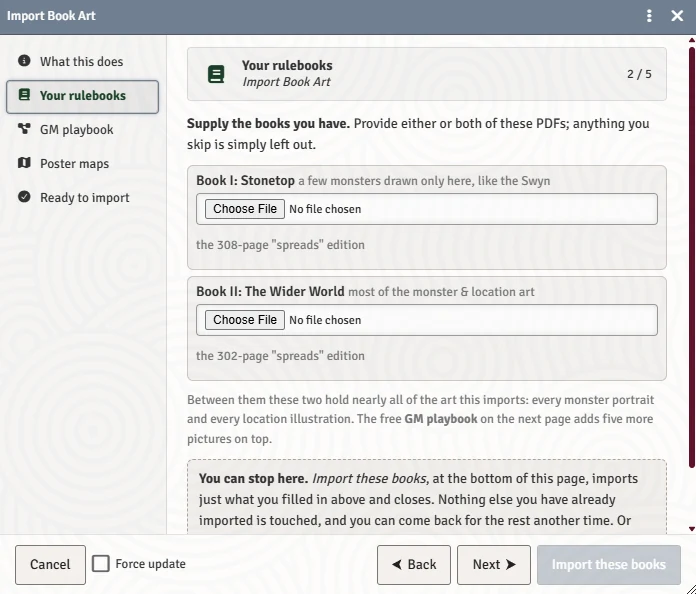

# Import Book Art

Lucie Arnoux's illustrations are not open-licensed, so none of them ship with this system. If you own the Stonetop PDFs, the art is already yours, and the **Import Book Art** macro pulls it out of your own copies and into your own world. This page is for GMs.

## What you get

Once the import has run, the system picks the pictures up on its own:

- Every monster portrait and token in the bestiary, and the art in the bestiary codex.
- Every location illustration in the gazetteer journals.
- The villagers' faces, which fill the **People of Stonetop** portrait gallery (see [The Character Sheet](The-Character-Sheet) and [The Steading and Settlements](The-Steading-and-Settlements)).
- Treasure and steading art.
- The GM playbook's core loop and flow of play diagrams, shown on the GM Toolkit's Core Loop tab (see [The GM Toolkit](The-GM-Toolkit)).
- The five poster maps as ready-made Scenes with landmark pins.

If you do not own the books, everything else still works. The illustrated slots stay empty or show initials.

## Running it

The GM Welcome guide has an **Import Book Art** step and button, and the macro also sits in your Macro Directory as **Import Book Art**. The first time you load a world, a GM-only chat card reminds you it exists.

The macro opens one window with a list on the left. Every part is optional: skip one and that part is simply left out.

| Panel | What to give it |
|---|---|
| **What this does** | An explanation, plus what this world already has from earlier runs. |
| **Your rulebooks** | Book I (*Stonetop*) and Book II (*The Wider World*). These must be the **"spreads" editions**, two printed pages side by side: 308 and 302 pages. Book II holds most of the monster and location art; Book I holds nearly every villager's face and a few monsters drawn only there, like the Swyn. |
| **GM playbook** | The free 12-page GM playbook from the publisher, either edition. It carries the sharpest regional maps and the only copies of the core loop and flow of play diagrams. |
| **Poster maps** | The five poster maps (Stonetop village, the Vicinity, the World's End, Marshedge, Gordin's Delve), either as five image files or as the single "All maps" PDF with one map per page. |
| **Ready to import** | A summary of what you supplied and the button to start. |

Each panel with a file has its own import button, so you can bring in just the maps, just one book, or everything at once with **Import everything filled in**.

> **Did you know?**
> - The macro checks the page count before it starts. Hand it a 1-up copy of a rulebook (one printed page per sheet) and it refuses with "You have the wrong edition" rather than filling your world with the wrong pictures. If you put a book in the wrong field, it says which field it belongs in.
> - Everything happens in your browser, on the file you picked. Nothing is uploaded anywhere except into your own Foundry data folder.
> - Coming back later costs nothing: anything already imported is skipped. Tick **Force update** in the window's footer to re-extract and replace art you already have (useful after a Stonetop update changes an illustration, or if an earlier import came out wrong). Poster maps ignore Force update; they are always rewritten from what you supply.
> - If you already imported the art and only want the maps, leave every book field empty and fill in **Poster maps**.

## Where the files go

The images are written into your Foundry data under `stonetop-book-art/`, never into the system's own folder and never into a release. That matters because a system update replaces the whole system folder: your art survives it.

After each system update, the system re-points the compendiums, journals and actors at the art already on disk, so you only need to run the macro again when you want to add or refresh something.

## Portraits and poster-map scenes

- **Rebuild portraits.** The square face crops and token images are cut from the art on disk. If they ever look wrong or go missing, use **Build N more portraits from art you already have** in the Welcome guide (it shows only when some can be built), or **Rebuild N pictures** on the chat card that offers it. GMs comfortable with the browser console can run `game.stonetop.rebuildPortraits()`.
- **Poster map scenes.** When a new world finds poster maps already on disk, it offers to build their Scenes, with a tick box per map.
- **Partial imports.** If a run only brought in part of the art, a GM chat card offers to finish it. These offers are posted once each.

> **Did you know?**
> - The People of Stonetop gallery, opened from any portrait picker, can start the import itself when it is empty: it asks for Book I (nearly every face) or Book II (a handful more).
> - Each of the system's map pins prints its name on a dark, see-through backing so it stays readable, and each player can quiet the place names for themselves. See [Chronicle, Journals and Love Letters](Chronicle-Journals-and-Love-Letters).

## See also
- [Your First Session](Your-First-Session)
- [Installing and Recommended Modules](Installing-and-Recommended-Modules)
- [FAQ and Troubleshooting](FAQ-and-Troubleshooting)
