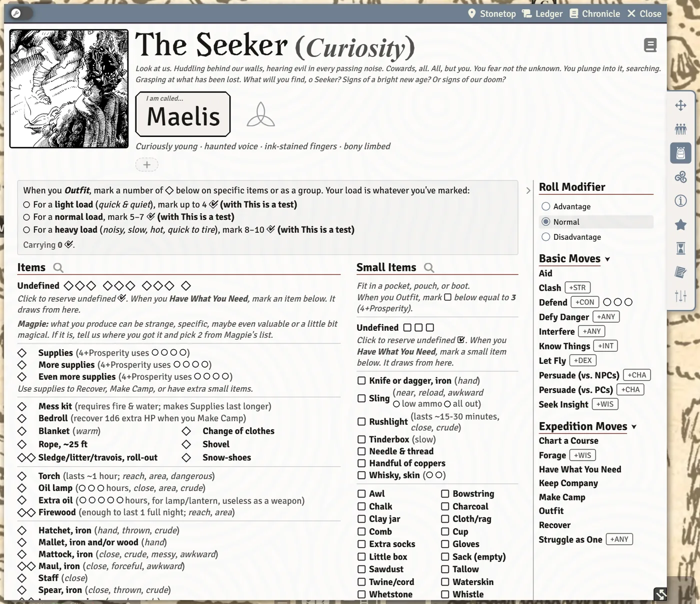

# Inventory and Gear

The **Inventory** tab is the playbook's gear page made interactive: mark what you carry, watch your load, tick off uses, and add the things you find. This page covers how it works and the parts that are easy to miss.

## Outfitting and load

When you **Outfit** before an expedition, mark the ◇ next to each item you take. The box at the top shows how many you're **Carrying** and highlights whether that's a **light load** (quick and quiet), a **normal load**, or a **heavy load** (noisy, slow, hot, quick to tire). Go past heavy and it says **Overloaded!**

Some moves change the bands; when one does, it's named beside them.

### Undefined items

You don't have to decide everything up front. Click the **Undefined** ◇ boxes to reserve load for things you'll name later, and the □ boxes for small items. When you later mark a write-in item, the system asks **Where did this come from?**:

- **Had it all along** (Have What You Need) uses up your reserved boxes;
- **Found it** adds the item to your load and leaves the reserved boxes alone.

If you've used all your small-item slots, Have What You Need lets you **Expend 1 use** of supplies for an extra small item.

### Small items

Small items fit in a pocket, pouch or boot. You can carry 4 + Prosperity of them; the column tells you when you're over.

> **Did you know?**
> - Hover a tag in brackets (*close*, *piercing*, *messy*, *reload* and so on) to read what it means. Hover **Value N** to see what it's worth in trade.
> - If a move stops working because your load is too heavy or you're wearing armor, the move says so on the Moves tab (**needs a light load**, **needs you unarmored**), with a tooltip explaining why.
> - **Reset Inventory** clears every mark and the undefined pools in one go, ready for the next expedition. Uses (like supplies) are kept.
> - Each column has a magnifying glass to filter it by name.

## Adding items

Click **Add item** (or **Add small item**) to open the item form:

| Field | What it does |
|---|---|
| **Column** | Items (◇, counts toward load), Small items, or Immobile (can't be carried off). |
| **Weight (◇)** | How much load it takes. |
| **Armor** and **Worn armor** | Body armor doesn't stack (the best worn piece counts); a shield isn't worn. Tick **Shield** for its +1 Readiness on Defend. |
| **Tags / notes** | Shown in brackets after the name. Click a suggested tag to add it, or type your own. |
| **Uses (○)** | Circles to track, with an optional label ("hours", "Blood"). Tick **Ammunition** for a bow's low-ammo / all-out track. |
| **Value** | What it's worth in trade, and optionally to whom. |

Turn on Edit mode (the wrench at the top left of the sheet) to change an item you added or **Remove** it.

> **Did you know?**
> - Treasures in the Book II journals can be **dragged straight onto your Inventory tab**. They keep their ◇ and ○ markings.
> - Items dropped on a map token that isn't linked to your character still land on your character sheet.
> - Some possessions produce things (valuables, a butchered goat's meat). A button on the item does the bookkeeping and puts the result in your inventory.

## Special possessions

Your playbook's special possessions are listed here too. While you haven't chosen them yet, a **Choose Special Possessions** button walks you through it. If you have more than the playbook allows, a note says so; it's a warning only, in case your GM agreed to it.

## Artifacts

An artifact might arrive with its name and ◇ only, if your GM keeps them mysterious (the world setting **Artifacts Arrive Unidentified**, or per item). It shows a question mark and an **Identify artifact** magnifying glass: click it to work out what it is with **Know Things** or **Seek Insight**. See [Arcana and Artifacts](Arcana-and-Artifacts) for the whole process.

## Supplies and provisions

Supplies are a track of uses. They pay for Recover, Make Camp and extra small items, and the GM's **N days pass** on a journey spends them for everyone on the trip. See [Camp, Journeys and Group Moves](Camp-Journeys-and-Group-Moves).

## Outfit and Requisition

The **Outfit** and **Requisition** expedition moves have their own windows. Outfit helps you pick your load. Requisition rolls +Fortunes and takes an asset from the steading (horses, weapons of war); what you take is struck through on the steading sheet until you bring it home. See [Expeditions and Sites](Expeditions-and-Sites).

## See also
- [Arcana and Artifacts](Arcana-and-Artifacts)
- [Camp, Journeys and Group Moves](Camp-Journeys-and-Group-Moves)
- [Relationships, Notes and Reminders](Relationships-Notes-and-Reminders)
- [The Character Sheet](The-Character-Sheet)
