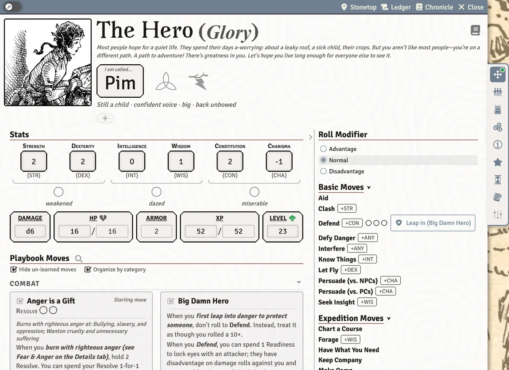
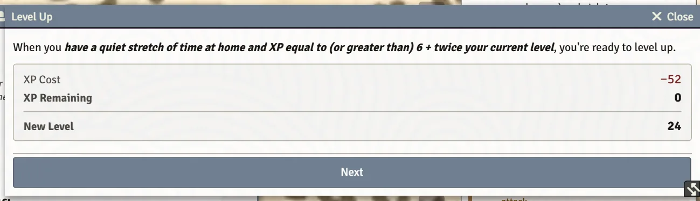

# Leveling Up

When your character has a quiet stretch of time at home and enough XP, the system walks you through leveling up one step at a time: a new move, any choices that move brings, and the bookkeeping. This page shows where to find it and what each step asks.

## When you can level up

Your XP box on the character sheet shows your XP and, beside it, the most XP you need. By the book, Level Up costs 6 + twice your current level. Once your XP reaches that number:

- a **level-up icon** appears beside **Level** at the top of the sheet (hover it: **Ready to level up!**);
- the **Moves** tab gets an attention dot with the same label;
- on the **Special Moves** tab, the **Level Up** card unlocks and its **Open Level Up** button becomes clickable. Until then the card is greyed out with a lock and explains what you still need.

Click the level-up icon or **Open Level Up** to start.

> **Did you know?**
> - If the Level Up window is already open somewhere on your screen, clicking again brings it to the front instead of opening a second one.

## The Level Up window

The window is a short wizard. Use **Next** and **Back** to move between steps, and **Apply Level Up** on the last one. Nothing changes on your sheet until you click **Apply Level Up**, so you can close the window at any point to stop.

Steps that don't apply to you are skipped, so most level-ups are just the first two or three.

| Step | When it appears | What you do |
|---|---|---|
| **Overview** | always | Shows the **XP Cost**, the **XP Remaining** afterwards, and your **New Level**. If your new level is even and you have Invocations, it says you'll choose a new Invocation too. |
| **New move** | always | **Choose one new move from your playbook.** Type in **Filter moves…** or click the group chips to narrow the list. Tick **Show moves I don't qualify for yet** to see the rest, listed under **Requires conditions not yet met**. |
| **Move from another playbook** | when the move you picked grants one | **Choose the move this grants you from another playbook (you must qualify for it).** Filter by text, or click a playbook chip (click it again to clear it). |
| **Stat +1** | when the move you picked raises a stat | **Choose which stat to raise by +1.** Stats already at that move's maximum are greyed out. |
| **Marks** | when the move you picked (or got from another playbook) has choices to mark | **Make this move's selection(s) for the level you're gaining.** Click an option to pick it; click it again to unpick. Options you already have from your background are shown as such. |
| **Animal companion** | for a Ranger with Beast-Bonded | Mark another action you can use when you focus on your animal companion. |
| **Invocation** | on an even level for a Lightbearer, or anyone who got Invoke the Sun God | **Choose one new Invocation to add to your repertoire.** |

The last step ends with a reminder to review your Instinct and Appearance on the **Details** tab.

### What happens when you apply

- Your level goes up by one and the cost comes off your XP. (If your GM uses **Advancement: Reset XP to 0 on Level Up**, your XP empties instead.)
- The new move, stat, marks, companion action and Invocation are added to your sheet.
- The level-up is recorded on the character's timeline as **Reached level N**, naming the move you learned. See [The Timeline](The-Timeline).
- Some moves have follow-up choices. For example, a move that frees another remarkable trait opens that picker right away.
- **If you still have enough XP to level up again**, a notice says **You have enough XP to level up again, so here's the next one.** and the window opens again for the next level.

> **Did you know?**
> - If something changed while the window was open (another player already applied it, or the XP is no longer there), applying does nothing and a notice tells you why. Your sheet is never charged twice.
> - The level-up icon and the Special Moves card both open the same window.

## Leveling up away from home

The book says you level up only with a quiet stretch of time at home. If the system knows your character is on an expedition that set out and hasn't come home yet, the Overview step shows a warning naming the trip. It's a reminder, not a block: **Go ahead if the table agrees.** See [Expeditions and Sites](Expeditions-and-Sites).

## If the move count looks wrong

If you set your level by hand or edit your moves, the **Moves** tab compares your playbook moves with your level:

- Too few: **You still have N moves to choose for level L.** with a hint to turn on Edit and tick the moves you've earned.
- Too many: **This character has N more moves than expected for level L.** You can fix it, or click **Dismiss move-count warning** if it's intentional.

These are warnings only. The system never removes or blocks a move.

## Settings that change leveling

These are world settings your GM chooses. See [World Settings Reference](World-Settings-Reference).

| Setting | Choices | Default | Effect |
|---|---|---|---|
| **Advancement: XP to Level Up, Base** | **6 (the book's default)**, **10 (slower)** | 6 | The fixed part of the Level Up cost. |
| **Advancement: XP to Level Up, Per Level** | **2 x level (the book's default)**, **3 x level (much slower at high levels)** | 2 x level | What each current level adds to the cost. |
| **Advancement: Reset XP to 0 on Level Up** | on / off | off | Level Up empties XP instead of subtracting the cost, so you level up only once between adventures. |
| **Advancement: Always Allow Burn Brightly** | on / off | off | Anyone may Burn Brightly (spend 2 XP after a roll for +1) even without enough XP to level up. |

How Burn Brightly appears on a roll card is covered in [Rolling Moves and Chat Cards](Rolling-Moves-and-Chat-Cards).

## See also
- [The Character Sheet](The-Character-Sheet)
- [Rolling Moves and Chat Cards](Rolling-Moves-and-Chat-Cards)
- [Playbook Notes](Playbook-Notes)
- [The Timeline](The-Timeline)
