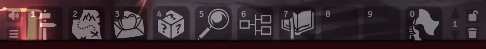

# Macros and Console Commands

The Stonetop system puts its most-used windows on your hotbar for you. This page lists every macro it ships, which hotbar slot it lands in, and the console commands behind them for GMs who are happy to press `F12`.

## The hotbar

The hotbar is the row of numbered squares along the bottom of the screen. Click a square to run its macro, or press the number key that matches it (`1` to `9`, and `0` for slot 10).

The system fills in its macros the first time each person loads the world. It never pushes out a macro you put there yourself: if its usual slot is taken, it uses the first free one instead. Once a macro is on your bar, you can drag it anywhere you like and it stays there.

### What the GM gets

| Slot | Macro | What it does |
|---|---|---|
| 1 | **Welcome to Stonetop** | Opens the GM's first-session guide: the setting premise, a button to make a character for each player (which opens character creation on that player's screen), and the guided Character Introductions. Its **New to Foundry?** link opens a plain-language primer on how Foundry works. |
| 2 | **Run an Expedition** | Opens the expedition walkthrough. See [Expeditions and Sites](Expeditions-and-Sites). |
| 3 | **Write a Love Letter** | Opens the love letter writer. GM only. See [Chronicle, Journals and Love Letters](Chronicle-Journals-and-Love-Letters#love-letters-the-gm-side). |
| 4 | **Die of Fate** | Rolls Stonetop's d6 oracle and posts a card to chat: 1-2 is **Bad**, 3-4 **Neutral / mixed**, 5-6 **Good**, with the rolled band highlighted. |
| 5 | **Browse Stonetop** | Opens one window with a tab each for the arcana, the monsters and the world's people. GM only. See [Bestiary, NPCs and Monsters](Bestiary-NPCs-and-Monsters). |
| 6 | **Relationship Map** | Opens the table's relationship map. See [The Relationship Map](The-Relationship-Map). |
| 7 | **The Chronicle** | Compiles the recorded Introductions answers and expedition log into the Chronicle journals and opens them. GM only. |
| 10 | **End of Session** | Opens the End of Session window. Press `0` to open it. GM only. |

Slots 8 and 9 stay empty in a new world. In a world that started before the time bar existed, they hold two older macros, **Seasons Change** (runs the steading's Seasons Change move without opening the steading sheet) and **Weather** (opens the Weather window, GM only). New worlds don't get them, because the time bar across the top of the screen opens both. An older world keeps them where they are.

### What players get

Players get only the two macros the whole table uses:

| Slot | Macro |
|---|---|
| 1 | **Die of Fate** |
| 2 | **Relationship Map** |

The GM's other macros never reach a player's bar. If the GM hasn't loaded the world since the system was installed, a player's Die of Fate appears after their next reload.

If your GM has turned off **Relationship Map** in the world settings, the Relationship Map macro shows "The relationship map is turned off in this world's settings." instead of opening.

### Macros in the Macro Directory only

Two macros sit in the Macros sidebar (the folder icon in the right-hand sidebar) rather than on the hotbar:

- **Import Book Art** builds the Book II illustrations from your own copy of the book. See [Import Book Art](Import-Book-Art). It is also in the **Stonetop Macros** compendium.
- **(TEST ONLY) Populate World**, in a folder called **For Testing Purposes**, makes a set of test characters. It is for trying the system out, not for a real campaign. Only the GM can see it. Delete it if you don't want it; it doesn't come back.

The **Stonetop Macros** compendium holds a copy of most of the shipped macros (all but Relationship Map and the test macro), including the older Seasons Change and Weather, so you can drag one out onto your hotbar if you want it.

> **Did you know?**
> - If you delete **Import Book Art** or the test macro from the Macro Directory, the system leaves them deleted. The hotbar macros, though, are put back on your next load if they are missing.
> - A shipped macro that lands in the wrong slot because yours was already there can simply be dragged to the slot you want.

## Turn a move into a macro

Drag any move you have learned off your character sheet and drop it on a hotbar slot. The system makes a macro that rolls that move, the same as clicking its dice icon, even with the sheet closed. Drag the same move again and it reuses the macro it already made, renamed if you renamed the move.

You need Foundry's permission to create script macros for this. If you don't have it, a notice says so; ask your GM to grant it in **Configure Permissions**.

> **Did you know?**
> - The move macro looks up the character and move each time it runs, so it keeps working after you edit the move.
> - Moves from a compendium can't become macros this way: there is no character to roll them for. Drag them from a sheet.

## Console commands (for GMs)

These are for GMs who are comfortable opening the browser console (`F12`, then the Console tab) and typing a line. Everything here is also reachable from a button somewhere, so you never need them. They are handy for making your own macros: put any line below into a new Script macro.

| Command | What it does |
|---|---|
| `game.stonetop.openWelcome()` | The first-session guide (GM only). |
| `game.stonetop.openFoundryBasics()` | The **New to Foundry?** primer. |
| `game.stonetop.openIntroductions()` | The guided Character Introductions. |
| `game.stonetop.openSpringBurst()` | The "Spring bursts forth" step that starts the campaign. |
| `game.stonetop.openCharacterCreation(actor)` | Character creation for any character, for previewing what a player sees. With no argument it uses your own assigned character. |
| `game.stonetop.openExpedition()` | The expedition walkthrough. |
| `game.stonetop.openSeasonsChange()` | The steading's Seasons Change move, with its season picker. |
| `game.stonetop.openNextSeason()` | Seasons Change straight to the season after the current one, like **Next Season** on the time bar (GM only). |
| `game.stonetop.openCampaignYear()` | **Set the Year**, as on the time bar (GM only). |
| `game.stonetop.openWeather()` | The Weather window (GM only). |
| `game.stonetop.openLoveLetter()` | The love letter writer (GM only). |
| `game.stonetop.openEndOfSession()` | End of Session (GM only). |
| `game.stonetop.saveChronicle()` | Compile and open the Chronicle journals. |
| `game.stonetop.rollDieOfFate()` | Roll the Die of Fate. |
| `game.stonetop.openBrowser("people")` | Browse Stonetop on a chosen tab: `"arcana"`, `"monsters"` or `"people"` (GM only). |
| `game.stonetop.openRelationshipMap("Name")` | A relationship map by name or id. With no argument it opens the page you were last on, or the party's page. |
| `game.stonetop.openTimeline()` | The full timeline window. There is no timeline macro on purpose; this is the line to use if you want one. |
| `game.stonetop.createArcanum({ name: "My Charm" })` | A blank homebrew minor arcanum, opened for editing. Add `major: true` for a major one. |
| `game.stonetop.inspireArcanum()` | The **Inspire me** wizard, which rolls on Book II's Artifact Creation tables and makes a homebrew arcanum from the results. |
| `game.stonetop.fight.openStart()` | **Start a fight**, or **Add to the fight** if one is already going on this map (GM only). |
| `game.stonetop.fight.lineUp(game.combat)` | **Line everyone up** for the current fight (GM only, on the map you are viewing). |
| `game.stonetop.importBookArt()` | Run the **Import Book Art** macro. |
| `game.stonetop.rebuildPortraits()` | Cut every portrait, round face and token picture this world can make out of the book art already on disk, then point people and creatures at them (GM only). Safe to run again. |
| `game.stonetop.reapplyBook2Art()` | Point the compendiums, journals and actors at the book art again, for when you have changed the art files by hand. |
| `game.stonetop.bootReport()` | A summary of how the system started up: its version, Foundry's version, and any step that failed. Paste it into a bug report if the system misbehaves. |

> **Did you know?**
> - `game.stonetop.rebuildPortraits()` is the same job a one-time chat card offers after you import book art. If you scrolled past or deleted that card, this is how to run it again.
> - If something seems broken after an update, `game.stonetop.bootReport()` is the first thing to send whoever helps you.

## See also
- [Import Book Art](Import-Book-Art)
- [The GM Toolkit](The-GM-Toolkit)
- [Chronicle, Journals and Love Letters](Chronicle-Journals-and-Love-Letters)
- [Rolling Moves and Chat Cards](Rolling-Moves-and-Chat-Cards)
