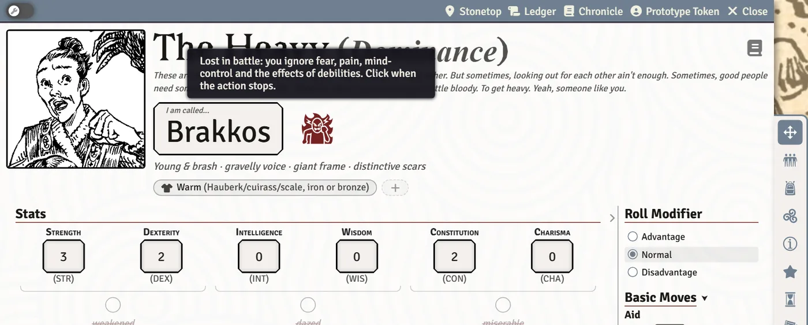

# Playbook Notes

Each playbook has moves the system tracks for you, usually as a small glyph beside the character's name or a button on the move. This page lists them by playbook. Hover any glyph for what it means; click it to act. It covers only what the system does specially, not the playbook's rules.

## The Blessed

- **Rites of the Land** and the Blessed's **Boon** are tracked on the move.
- **Marks.** A header glyph counts the beings that bear your marks; click it to open the roster. Each mark records **Which mark**, **Ward or binding**, and for a marked beast its Loyalty circles. **Lift the mark** ends one.
- Suggested names for a Blessed from the Wild add words to the name (up to three) instead of replacing it. See [Creating a Character](Creating-a-Character).

## The Fox

- **Unseen** (Catlike): click the glyph when you hide. It stays until you draw attention to yourself, move or attack; attacking ends it by itself.

## The Heavy

- **Battle Joy.** Click the glyph when you spill blood and lose yourself in battle: you ignore fear, pain, mind control and debilities (the sheet notes that your debilities are being ignored). When the action stops, click it again: **That was a rush: regain 1d4 HP**, or mark a debility.
- **Roiling with anger** (Storm Markings): +1 damage until you calm down. Click when you do.
- **Hard to Kill**: at Death's Door you can choose **Roll +nothing**, and trade a debility for 1 HP. **Unstoppable** circles change the roll and clear when you survive. See [Death and Beyond](Death-and-Beyond).

## The Judge

- **The Condemned and the Sworn.** A scales glyph counts those bearing your brand and those held to an oath; click it for the roster. A branded character's sheet carries the tag. Mark an oath broken for advantage on rolls against them (Binding Arbitration offers it on the pre-roll window). **Dismiss the brand** and **Release from their oath** end them.
- **Castigate** asks who you Censured.
- **Diligence** (Chronicler of Stonetop), **Sanction** (Commune with Aratis) and **Many Hands** add +1 to other players' rolls from a button on their roll card. See [Rolling Moves and Chat Cards](Rolling-Moves-and-Chat-Cards#help-from-your-friends).
- **A Bundle of Sticks Unbroken** shows up in Struggle as One.

## The Lightbearer

- **Holy light.** A candle glyph: **Holy light is lit** or **out**. Click to light or snuff it (or use Consecrated Flame).
- **Invocations tab.** Tap an Invocation you know to use it; tap one you don't to read it. An ongoing Invocation shows as a chip by your name; click it to end it. The tab reminds you when you've basked in sunlight.
- **Enigma.** **Back from wandering** records how long you were away; spend Enigma with **Draw on your wanderings** (Know Things as a 10+) or **Return when needed** (opens Outfit).
- **Piety** hands out a **Blessing** to whoever worshipped with you, to spend for +1 later.

## The Marshal

- **Crew** follower card with members, shared HP and Loyalty. See [Followers](Followers#crews-and-groups).
- **Personal symbol**: **Display it: crew +1 Loyalty** (max 3).
- **We Happy Few.** **Inspire who heard the speech** hands out Inspiration; each ally's **Inspiration** chip spends it to act fearlessly, for **+1d6** damage, or to **Keep 1 HP** instead of going down. **Shaken nerves** gives disadvantage until you share your doubts; click to steady them.
- **Prepare a Welcome**: when going into battle, **Lie in wait** holds Surprise.

## The Ranger

- **Animal companion** follower card, and with Beast-Bonded, **Lend it your strength** (lose 1d6 HP to heal it). Level Up asks for another companion action.
- **Unseen** (Stalker) works like the Fox's.
- **A Safe Place** shows up in Make Camp.

## The Seeker

- **Arcana tab.** Your major and minor arcana as cards. The Seeker's starting major arcanum is chosen during creation. See [Arcana and Artifacts](Arcana-and-Artifacts).
- **Never at a Loss** and **Logbook** offer their effects on the roll card.

## The Would-Be Hero

- **"Would-be".** The first time you use a starred move, the sheet crosses off "Would-be" (or click **I used it: cross off "Would-be"**). Did it by mistake? **Restore "Would-be"**.
- **In Over Your Head**: **Rescued by another PC: Mark XP**.
- **Impetuous Youth**: **Give it your all** on a roll card turns a result up a step; pick the cost (**I get hurt**, **I escalate the situation**, **Something I carry is lost or breaks**).
- **Potential for Greatness** choices (+1 stat, +4 max HP, d8 damage die) are recorded with the level you took them.
- **Up With People**: **Converse** with someone to hold Rapport; their **Rapport** chip spends it to ask a question.
- **Voice of Experience**: **Ask it** ("What is about to happen?").
- **Destined** background: a start-of-session **Roll +Omens** card, and Death's Door's 6- counts as a 7-9 until your destiny is fulfilled. **Driven**: you can always Burn Brightly.

## After death

Revenant, Ghost and Thrall inserts are covered in [Death and Beyond](Death-and-Beyond#the-post-death-tab).

## See also
- [The Character Sheet](The-Character-Sheet)
- [Rolling Moves and Chat Cards](Rolling-Moves-and-Chat-Cards)
- [Followers](Followers)
- [Leveling Up](Leveling-Up)
