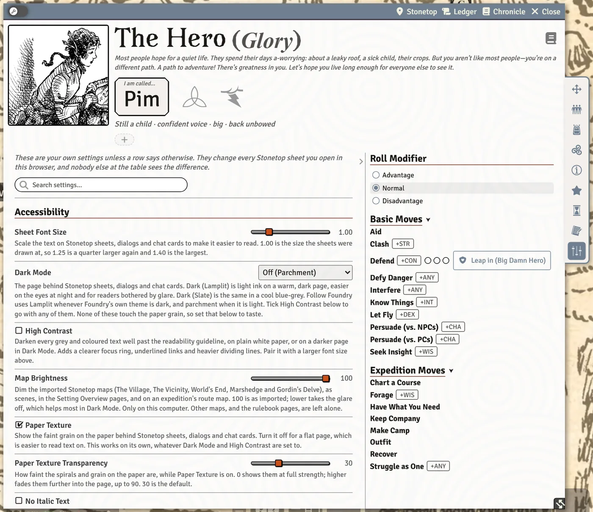
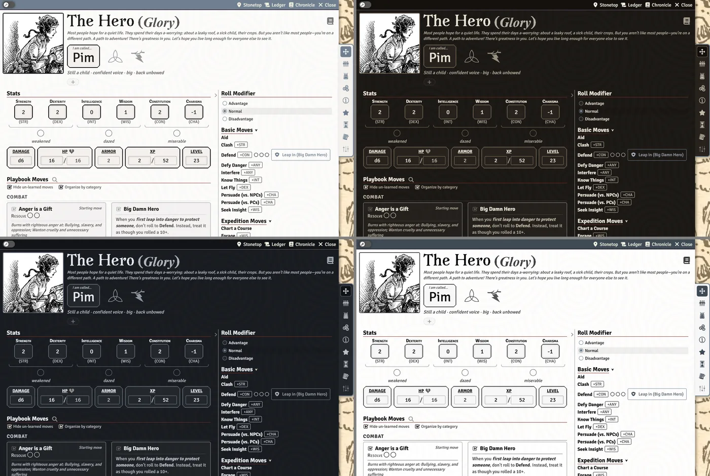

# Preferences and Accessibility

Every Stonetop setting that is about how *you* read and play (text size, dark pages, prompts before rolls, hover help) lives on the **Preferences** tab of your own character sheet. This page lists every one of them, what it does, and which combinations help most if you have low vision.

## The Preferences tab

Open your character sheet and pick the **Preferences** tab. It sits at the end of the tab list, beside **Notes**, and stays there even if you drag the other tabs into a new order.

- **It only appears on your own sheet.** You see it on the character assigned to you, or any character you own. You won't find it on someone else's character. A GM finds it on the GM Toolkit, or on their own assigned character if they have one.
- **These settings belong to you, not the character.** The note at the top of the tab says so: a change here affects every Stonetop sheet you open in this browser, and nobody else at the table sees the difference. If you play two characters, both sheets change together.
- **They are per browser.** Foundry keeps these settings in the browser you are using. If you play from a second computer, set them again there.
- **The search box is already open.** Type in **Search settings…** to filter the rows. It matches a row's whole text: its name, its hint and the names of the choices inside a dropdown. So typing "serif" finds **Sheet Font**, and "reload" finds the one row that asks for a reload. A match inside a group you had folded shut opens that group. Press `Esc` to clear the search.
- **All Stonetop Settings…** at the bottom opens Foundry's own settings window at the Stonetop section, for anything this tab doesn't carry.

Every row here writes exactly the same setting as Foundry's **Configure Settings** window, so you can use either place.

> **Did you know?**
> - Sliders show their value as you drag, but only save when you let go, so dragging is cheap.
> - Clicking anywhere on a checkbox row's name ticks the box; you don't have to hit the box itself.
> - Each group heading has a fold caret. Folded groups stay folded the next time you open the sheet.

## Every setting, by group

The groups and rows below appear in this order on the tab. Defaults are what a new browser starts with.

### Accessibility

| Setting | Choices | Default | What it does |
|---|---|---|---|
| **Sheet Font Size** | slider, 0.90 to 1.40 in steps of 0.05 | 1.00 | Scales the text on Stonetop sheets, dialogs and chat cards. 1.00 is the size the sheets were drawn at; 1.25 is a quarter larger. |
| **Dark Mode** | **Off (Parchment)**, **Dark (Lamplit)**, **Dark (Slate)**, **Follow Foundry** | Off (Parchment) | The page behind Stonetop sheets, dialogs and chat cards. Lamplit is light ink on a warm dark page; Slate is the same in a cool blue-grey. Follow Foundry uses Lamplit whenever Foundry's own theme is dark and parchment when it is light. |
| **High Contrast** | on / off | off | Darkens every grey and coloured text well past the readability guideline, on plain white paper (or a darker page in Dark Mode). Adds a clearer focus ring, underlined links and heavier dividing lines. Works with any Dark Mode choice. |
| **Map Brightness** | slider, 30 to 100 in steps of 5 | 100 | Dims the imported Stonetop maps (The Village, The Vicinity, World's End, Marshedge and Gordin's Delve) as scenes, in the Setting Overview pages and on an expedition's route map. Other maps and the rulebook pages are left alone. |
| **Paper Texture** | on / off | on | The faint grain on the paper behind sheets, dialogs and chat cards. Off gives a flat page, which is easier to read text on. Independent of Dark Mode and High Contrast. |
| **Paper Texture Transparency** | slider, 0 to 90 in steps of 5 | 30 | How faint the spirals and grain are while Paper Texture is on. 0 is full strength; higher fades them into the page. |
| **No Italic Text** | on / off | off | Draws every slanted word upright, everywhere in Foundry, not just on Stonetop sheets. Things that normally mark themselves with italics (a move's fiction, the hint under a field) will then read the same as the text around them. |
| **Reduce Motion** | on / off | off | Turns off the decorative animations, transitions and hover-zoom image popups on Stonetop sheets and dialogs. |

### Look and Feel

| Setting | Choices | Default | What it does |
|---|---|---|---|
| **Sheet Font** | **Libre Caslon Text**, **IM Fell English**, **Signika** | Signika | The font used throughout Stonetop sheets. |
| **Sheet Layout (Just for Me)** | **Use this world's setting**, **Modern (icon tabs down the side)**, **Classic (tab names across the top)** | Use this world's setting | Overrides the table's layout in this browser only. Picking Modern or Classic sticks across every world you open in this browser. |
| **Edit Pencil Reveal Delay** | slider, 0 to 3 seconds in steps of 0.1 | 1 | How long you hover a section before its edit pencil fades in. The pencils are clickable while still invisible. 0 shows them at once. |
| **Weather and Season Bar** | on / off | on | Shows the weather, the season and the year at the top of the screen. |
| **Love Letter Jingle** | on / off | on | Rings a short jingle when a love letter arrives for you. The red notice still appears when this is off. See [Relationships, Notes and Reminders](Relationships-Notes-and-Reminders#love-letters). |

### Rolling and Chat

| Setting | Choices | Default | What it does |
|---|---|---|---|
| **Ask How to Roll Each Time** | on / off | off | Asks for Advantage / Normal / Disadvantage in a window before every move or stat roll, starting at Normal each time. While it is on, the Roll Modifier selector is hidden from the character and steading sheets. While it is off, that selector is how you choose, and it stays set until you change it. |
| **Prompt for Roll Modifier** | on / off | off | Asks for a one-off modifier (a held bonus, a +1 from the GM) before each move or stat roll. Already included when Ask How to Roll Each Time is on. |
| **Adjust Damage Before Rolling** | on / off | on | Before each damage roll, asks about advantage or disadvantage on the die, a flat modifier and extra dice. This is how a bonus your sheet can't know about reaches the dice. |
| **Show Roll Stat Chips** | on / off | on | Shows labels like +STR and +ANY beside the titles of rollable moves on character and steading sheets. Clicking a chip rolls the move, the same as clicking its title. |
| **Show Move Descriptions in Chat** | on / off | on | Includes the full move description in the chat card when you roll a move. |

Holding `Shift` while you click a roll skips all three prompts for that one roll. See [Rolling Moves and Chat Cards](Rolling-Moves-and-Chat-Cards).

### Windows

| Setting | Choices | Default | What it does |
|---|---|---|---|
| **Open Sheets in Edit Mode** | on / off | off | Opens character, steading, monster and NPC sheets in Edit mode instead of Play mode. The header wrench still switches modes per sheet. This row shows on the tab for the GM only; players can still find it under **All Stonetop Settings…**. |
| **Restore Open Windows on Reload** | on / off | on | When you reload Foundry, reopens the character, steading, monster, NPC, item and journal sheets you had open, plus the Make Camp window while its camp is still going, at the same position and size. |

### On Hover Info

| Setting | Choices | Default | What it does |
|---|---|---|---|
| **Show On Hover Info** | on / off | on | The master switch: turns off every hover description and hover info panel at once. |
| **On Hover Info** (**Configure** button) | opens a window of switches | all on | Turn individual kinds of hover help on or off, listed below. |

The **Configure** window has one switch per kind of hover help:

| Switch | What it shows when you hover |
|---|---|
| **Hover Descriptions: Stats** | Stat descriptions on the character sheet's stats. |
| **Hover Descriptions: Basic Moves** | The move description panel over the Basic Moves list (and the Homefront Moves list on Stonetop's sheet in the classic layout). |
| **Hover Descriptions: Playbook Moves** | Descriptions of move names linked inside playbook and other move text. |
| **Hover Descriptions: Traits** | Trait descriptions on follower and companion trait tags. |
| **Hover Descriptions: Gear Tags** | Rules for gear tags such as close, piercing or messy. |
| **Hover Descriptions: Creature Cross-links** | On bestiary and stat-block sheets, other creatures' names are highlighted: hover for their concept, click to open their sheet. |
| **Hover Descriptions: Invocation Effects** | On the Lightbearer's Invocations tab and in the level-up picker, what Reduced and Empowered mean. |
| **Hover Descriptions: Vitals** | What Damage, HP, Armor, XP and Level mean, on the character sheet. |
| **Hover Descriptions: Monster Tags** | A creature's organization, size and quality tags on stat blocks. |
| **Hover Descriptions: Steading Stats** | Surplus, Fortunes, Prosperity, Defenses, Population, Size and debilities on Stonetop's sheet. |
| **Hover Descriptions: Trade Values** | What a "Value N" trade tier is worth, in journals and on sheets. |
| **Hover Descriptions: Debilities** | Emboldens "debility" in move text and explains Weakened, Dazed and Miserable. |
| **Hover Descriptions: Journal Cross-links** | An entry's one-line summary when you hover a link into the Stonetop journals. Links still work with this off. |
| **Hover Descriptions: Lore Terms** | Explains Stonetop's four gods (Danu, Aratis, Helior, Tor) in the Character Introductions prompts and the character creation wizard. |

### Fights

On the Preferences tab, this group holds one row, and only the GM sees it: **Fight tab (replaces the Combat tracker)**. It is a world setting, and the row says so: changing it changes it for the whole table and offers to reload everyone. See [Running Fights](Running-Fights).

Two more fight settings are your own, but live in Foundry's settings window (reach them with **All Stonetop Settings…**):

| Setting | Default | What it does |
|---|---|---|
| **Open the Fight window when a fight starts** | on | When a fight starts on the map you are looking at, the Fight tab opens in a window of its own and closes when the fight ends. If you close it, it stays closed until the next fight. In a world using Foundry's Combat tracker instead, this is called **Open the Combat window when a fight starts**. |
| **Fight buttons when you click a token** | on | During a fight, clicking a token you control puts its move and damage buttons around it. Only listed when the Fight tab is on. See [Fights for Players](Fights-for-Players). |

> **Did you know?**
> - The Stonetop map pins have an eye button at the right edge of the screen, between the chat and the sidebar. Click it to **Show place names on this map** or **Hide place names on this map**, on your screen only. Right-click it to make that map follow the GM's setting again.

## What the system remembers for you

Some things are remembered without a setting, in this browser only, so a sheet reopens the way you left it:

- Each sheet's size (character, steading, monster and NPC), per actor.
- Column widths you dragged in tables such as the relationships table.
- Sections you folded shut with a heading's caret, move groups in the moves sidebar, the whole moves sidebar if you collapsed it, Major and Minor arcana sections, single arcana and follower cards you folded, and the treasure write-ups you unfolded.
- Whether you last looked at relationships as a table or a board.
- Where the Fight window was, and the reader's last page and zoom (see [The Rulebook Reader](The-Rulebook-Reader)).

One thing is stored on the character instead, so everyone who opens it sees the same: the **tab order**. Drag a tab in the tab list to move it. Notes and Preferences always stay last.

> **Did you know?**
> - Dragging a tab onto another tab drops it before or after that tab, and the new order sticks for this character.

## Low vision: a good starting set

If you find the sheets hard to read, try these together on the Preferences tab:

1. **Sheet Font Size** at 1.25 or higher. It scales Stonetop sheets, dialogs and chat cards.
2. **High Contrast** on. It pushes every grey and coloured text to strong contrast and adds an obvious focus ring for keyboard use.
3. **Paper Texture** off, for a flat page behind the text.
4. **No Italic Text** on, if slanted text is harder for you, especially under a magnifier.
5. **Dark Mode** set to **Dark (Lamplit)** or **Dark (Slate)** if glare bothers you, and **Map Brightness** turned down to take the glare off the big maps.
6. **Sheet Font** set to **Signika** (the default), a plain sans-serif.
7. **Reduce Motion** on, if moving things are distracting.

Hover popups can get in the way of a magnifier or screen reader. Turn off just the kinds you don't want in **On Hover Info > Configure**, or all of them with **Show On Hover Info**.

**Reduced motion and attacks.** If your operating system is set to reduce motion, or you tick **Reduce Motion**, the system also hides its attack animations on the map. The attack sounds still play for you, so you can still hear every blow land.

> **Did you know?**
> - Your operating system's own "reduce motion" switch counts just as much as the Reduce Motion setting here: the system checks both.

## See also
- [The Character Sheet](The-Character-Sheet)
- [Rolling Moves and Chat Cards](Rolling-Moves-and-Chat-Cards)
- [World Settings Reference](World-Settings-Reference)
- [FAQ and Troubleshooting](FAQ-and-Troubleshooting)
