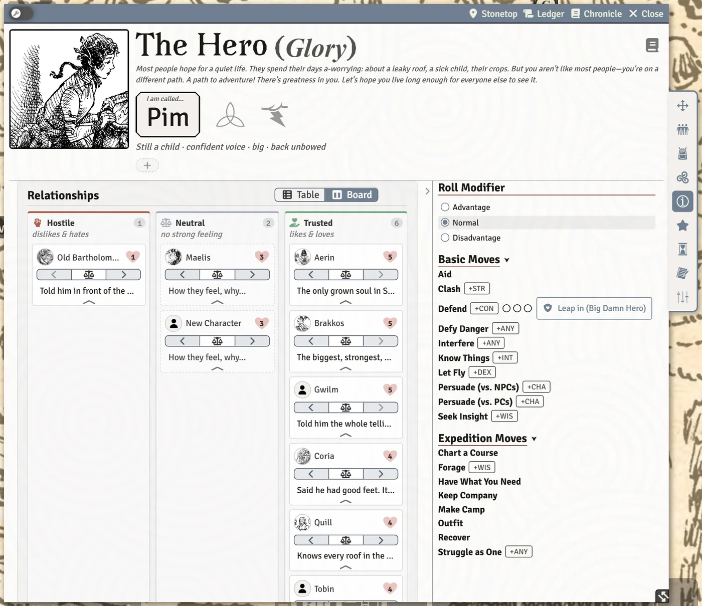

# Relationships, Notes and Reminders

Your character's ties to other people, the things the GM should keep in mind about them, and the love letters the GM sends between sessions. This page covers the **Relationships** section of the **Details** tab, the "Keep in mind" chips beside your appearance, the **Notes** tab, and love letters from the player's side.

## Relationships

The **Relationships** section on the **Details** tab lists the people your character has feelings about, each rated from 1 to 5 hearts: hates, dislikes, neutral, likes, loves. Each person has a **Notes** line for how they feel and why.

There are two layouts, switched with the **Table** and **Board** buttons in the section heading:

- **Table**: one sortable row per name.
- **Board**: three lanes, **Hostile** (dislikes and hates), **Neutral** and **Trusted** (likes and loves). Drag a card from one lane to another to change how your character feels; the hearts follow.

> **Did you know?**
> - **Drag a character or NPC from the Actors sidebar onto Relationships** to add them. One from a compendium has to be imported into the world first; the sheet tells you so.
> - Hover a small portrait in either layout to see it larger. Click a name to open their sheet.
> - Each browser remembers which layout you picked.
> - The table's relationships also appear on the shared [relationship map](The-Relationship-Map), if your GM uses it.

## Keep in mind

Short reminders for the GM about your character, like *reeks of smoke* or *owes Gwen a favor*, sit as chips at the end of your appearance line at the top of the sheet. Click the faint **+** chip at the end of the row, type one, and press **Enter** (**Escape** cancels). Hover the **+** or the box to see what a reminder is for and where it shows. Click the **×** on a reminder to remove it. They show:

- under your character's name at the top of the sheet;
- on every roll card you make;
- on the Fight tab;
- in the steading's list of player characters.

Your gear's tags that matter in play (such as *cumbersome*) are added to the list automatically, so nobody forgets them.

## Notes

The **Notes** tab holds your character's notes. Only you and the GM can change them; while **Players See Every Character Sheet** is on (the default), other players can read them.

## Love letters

Between sessions, the GM may write your character a love letter: a short message about what happened while they were away, often with a roll.

- When it arrives, a red envelope drops in at the top of your screen with a short jingle (turn the sound off with **Love Letter Jingle** on your Preferences tab; the envelope still appears). Click it to open the letter.
- The letter also appears in a **Love Letters** section on your **Moves** tab, with **Read letter**, **Read aloud** and, if it asks for a roll, a roll button with its results.
- Once you've dealt with it, the letter is resolved. The GM keeps a dimmed copy and can send it again.

The GM's side is on [Chronicle, Journals and Love Letters](Chronicle-Journals-and-Love-Letters#love-letters).

## See also
- [The Character Sheet](The-Character-Sheet)
- [The Relationship Map](The-Relationship-Map)
- [Rolling Moves and Chat Cards](Rolling-Moves-and-Chat-Cards)
