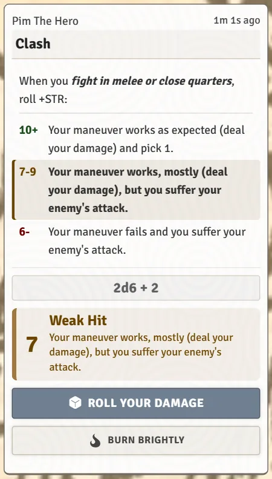
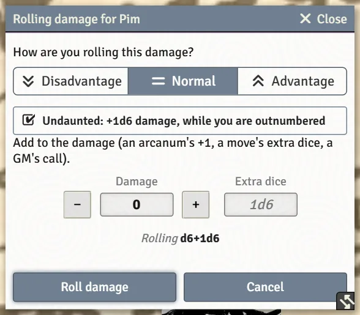
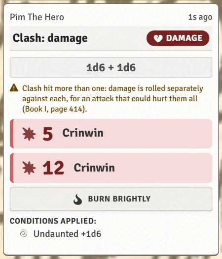

# Rolling Moves and Chat Cards

Almost everything you roll starts with one click on your sheet and ends as a card in chat. This page covers how to roll, the windows that can pop up before a roll, and the buttons that appear on the cards afterwards (several of them are for other players to press).

## Making a roll

| To roll | Click |
|---|---|
| A stat (+STR, +DEX and so on) | The stat's box on the **Moves** tab. |
| A move | The move's name, or the small stat chip beside it (**+STR**, **+ANY**). The chips can be hidden with **Show Roll Stat Chips** on your Preferences tab. |
| A basic or expedition move | Its name in the move list down the right side of the sheet. |
| Your damage | The **Damage** box. |

Moves roll 2d6 plus the stat. With **Advantage** you roll 3d6 and keep the highest two; with **Disadvantage** you keep the lowest two. Pick between them with the **Roll Modifier** buttons above the basic moves. That choice sticks until you change it.

> **Did you know?**
> - **Hold `Shift` while you click to skip every question** and roll straight away. It works on stats, moves, damage, Death's Door, Requisition, identifying arcana and the buttons around your token in a fight. A Shift-click still uses the Advantage or Disadvantage you picked on your sheet; it just doesn't ask.
> - Drag a move from your sheet onto Foundry's hotbar (the numbered slots at the bottom of the screen) to make a button that rolls it, even with your sheet closed. Your GM has to allow players to make script macros for this to work.

## Windows that can open before a roll

### How you're rolling this

Two settings on your **Preferences** tab make a small window open before each move:

- **Ask How to Roll Each Time** asks Advantage, Normal or Disadvantage for every roll, instead of using the buttons on the sheet. When it's on, those buttons disappear from the sheet.
- **Prompt for Roll Modifier** asks for a **One-off modifier** (+1 for a good idea, -1 for a bad spot) before each roll.

Even with both off, the window still opens when something you own could apply to this roll. Each one appears as a line you can tick, for example **Using violence or threats (Intimidating): advantage** or **Keeping calm and carrying on (Stone Cold): treat a 6- as a 7-9**. Ticked lines are applied and named on the card; a line you leave unticked is not spent.

### Damage

Before each damage roll, a damage window lets you roll the die with advantage or disadvantage, add a flat bonus, or add extra dice. In a fight it already has a ticked **+N** line when several of you are attacking the same foe, and moves that add dice show up as their own lines. Turn the window off with **Adjust Damage Before Rolling** on your Preferences tab, or skip it once with `Shift`.

## Reading the card

Each roll card shows:

- the result: **Miss**, **Weak Hit** or **Strong Hit!**;
- the move's full results ladder (10+, 7-9, 6-), with the rung you landed on highlighted;
- any choices the move offers as a list you can tick right on the card;
- the reminders your GM keeps for your character (see [Relationships, Notes and Reminders](Relationships-Notes-and-Reminders)).

If you've turned off **Show Move Descriptions in Chat** on your Preferences tab to keep chat short, click the **?** beside the card's title to read the move.

> **Did you know?**
> - Blind and private rolls hide the Stonetop card from anyone who isn't allowed to see the result.
> - Your character's name on chat messages includes their playbook, so everyone knows who's speaking. Messages from a Ghost, Revenant or Thrall appear on a black card.

## Buttons on the card

Which buttons appear depends on the roll and on what your character has. They are there for whoever needs them.

### Marking XP on a miss

On a 6-, the system marks your XP for you and posts a small receipt showing your new total. The receipt has an **Undo XP Gain** button, for the times a miss shouldn't have counted. If the card later changes (Burn Brightly, a GM shifting the result), the XP follows the final result.

### Burn Brightly

When you have enough XP to Level Up, a **Burn brightly** button appears on your own rolls: spend the XP after rolling to add +1. Some characters can always do this, and your GM can turn on **Advancement: Always Allow Burn Brightly** for everyone. Only the player whose roll it is can press it.

### Help from your friends

Some moves let another character spend something to add +1 to *your* roll. When one applies, a button appears on your card for them to press:

| Button | Who has it |
|---|---|
| **Diligence: +1** | A Judge with Chronicler of Stonetop |
| **Sanction: +1** | A character acting on Aratis's orders (Commune with Aratis) |
| **Many Hands: +1** | A Judge with Many Hands Make Light Work |
| **Blessing: +1** | Someone who worshipped Helior with Piety |
| **Preparation: +1** | Whoever holds Preparation from the steading's Bolster move |

The +1 is added to the card and the spender's track goes down by one.

Other buttons you may see on your own cards include **Give it your all**, **Keep 1 HP (Inspiration)**, and the Fox's ways around a bad result. These are covered per playbook in [Playbook Notes](Playbook-Notes).

### Attacks and damage

When you roll Clash or Let Fly at a target, the card offers **Roll your damage** (or a choice of how to deal it, such as **Deal +1d4 damage** or **Deal no damage** when a move gives you the option). Ammunition and the foe's counter-attack are handled on the same card.

The damage card then shows an **Apply damage** button (**Take this damage** when it's your own character's hit). Only whoever owns the target sees it: the GM for monsters, the player for their own character. It takes armor and piercing into account. When the system added a **+N** for several attackers, a **Leave off the +N** toggle lets you take it back off before applying.

### Asking another player

Aid, Interfere and Persuade can be aimed at another player character. Pick who the move is for and the card waits for that player (or the GM) to answer with the move's own options. Nothing happens to their character until they choose.

> **Did you know?**
> - If a card's button seems to do nothing, the GM's Foundry may be needed to record it. A notice says so when no GM is online.
> - Your GM can turn on **Shift Up/Down Buttons on Roll Cards** to bump a result up or down a tier. Only the GM sees those buttons, but everyone sees the card change.
> - If your GM turned on **Problematic Wound Reminder on 9- Rolls**, cards on a 7-9 or 6- remind you when a wound might be making things harder.

## See also
- [Fights (for Players)](Fights-for-Players)
- [Leveling Up](Leveling-Up)
- [Preferences and Accessibility](Preferences-and-Accessibility)
- [Hidden Tricks](Hidden-Tricks)
