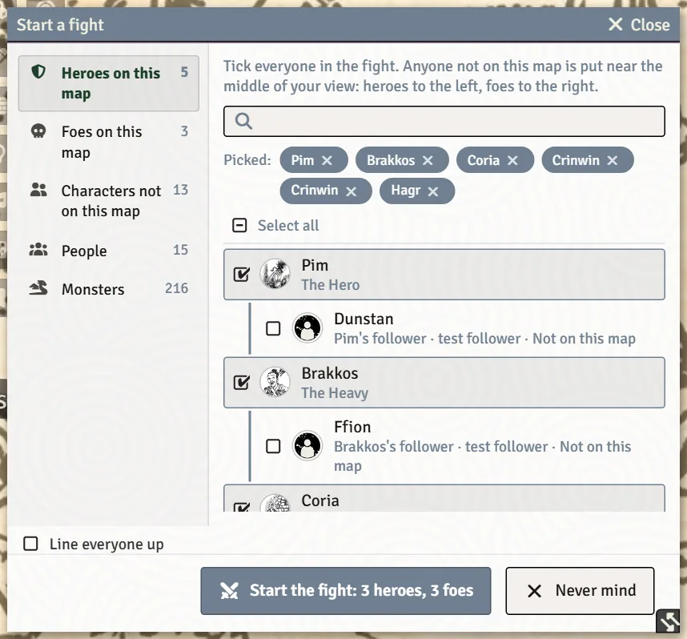
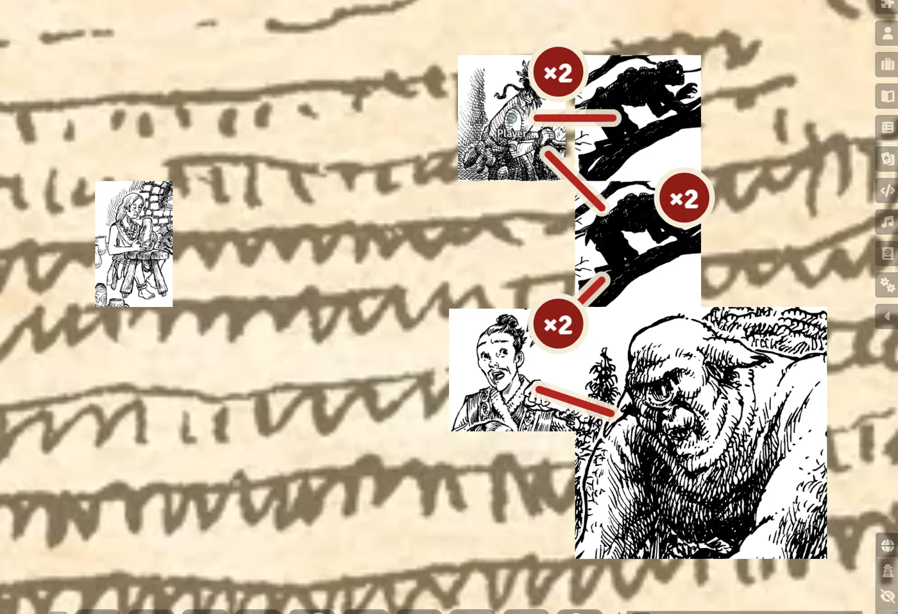

# Running Fights

Stonetop has no initiative and no turns. The system's **Fight** tab replaces Foundry's Combat tracker with a picture of who is fighting whom, applies the book's rules for several attackers and groups, and lets everyone act straight from the map. This page is the GM's side; the players' side is on [Fights (for Players)](Fights-for-Players).

## Starting a fight

On the **Fight** tab, click **Start a fight**. The window lists everyone you might put in it, with whoever you had selected already ticked:

- **Heroes on this map**, **Foes on this map** and **Others on this map** (others join as foes; you can move them later);
- **Characters not on this map**, **People** and **Monsters** (**From the bestiary**, imported for you if needed).

The button counts the sides as you tick (**Start the fight: 4 heroes, 6 foes**). Anyone not on the map is placed near the middle of your view, heroes to the left and foes to the right.

Group and horde monsters ask **how many?** (the stat block's usual number is suggested), and whether to put **A token for each one, each with its own HP** or **One token for the whole group, fighting as one**.

Later arrivals join with **Add to the fight**. **Line everyone up** puts everyone who isn't fighting anybody yet into two lines, heroes on the left and foes on the right; fights already going on stay as they are. **End the fight** takes everyone out of it (tokens stay where they are).

## The Fight tab

Each row shows who a fighter is fighting or shooting at, with a **Fought by N** or **Facing N** badge, and the rules in play (for example **+1 damage on Crinwin (2 attackers)**, or the group-against-group rule) with page citations. Hover a row for HP, Armor and Readiness. The eye on a row hides that fighter from players or shows them.

**Right-click a row** (GM) for:

| Menu item | What it does |
|---|---|
| **Move to the other side** | Switch a fighter between heroes and foes. |
| **How many are in this token** | A crew or warband on one token counts as that many attackers. |
| **Stop shooting** | End a ranged engagement. |
| **Merge into one group** / **Split into separate tokens** | Change how a group is shown on the map. |
| **Mark out of the fight** / **Back in the fight** | For someone who's down or has fled. |
| **Open sheet** | Open the fighter's sheet. |
| **Remove from the fight** | Take them out entirely. |

> **Did you know?**
> - **Drag a foe's row onto a hero's row** (or a hero onto a foe) and the token steps up next to them on the map.
> - When there are several fights on one scene, arrows at the top step between them.
> - A fight started from Foundry's own tracker shows a note that Stonetop doesn't take turns, with **Stop counting rounds**.
> - Turn the Fight tab off with the world setting **Fight tab (replaces the Combat tracker)** to get Foundry's tracker back (it takes a reload), for example to use an initiative module.

## On the map

The map shows who's engaged with whom: solid lines for melee, dashed arrows for ranged, and a **×N** disc on a token several are fighting.

**Left-click a monster's token** during a fight for a ring of buttons: one for each attack its stat block rolls, aimed at whoever it's fighting. A group monster gets **Swarm** (all of them on one foe). Followers get **Clash**, **Let Fly**, **Defend** and **Order**, which their character's player rolls. Other NPCs get their damage. See [Fights (for Players)](Fights-for-Players#buttons-around-your-token) for the heroes' ring.

## Damage

- When several attack the same foe, damage rolls are pre-filled with the book's **+N** as its own ticked line in the damage window. On the damage card, **Leave off the +N** takes it back off.
- The **Apply damage** button on a damage card appears for whoever owns the target, handles armor and piercing, and offers to spend Readiness from Defend. When a player presses it on something they don't own, the GM's Foundry makes the change.
- Beside **Apply damage** the GM has an **Ignores armor** tick, for when the fiction says armor can't stop the blow (Book I p.239).
- A monster whose armor depends on what hits it, like *Armor 4, 0 vs. bronze*, gets a ticked box on the damage card (**Not bronze: 4 armor, which bronze goes straight through**). Untick it when the blow is bronze. Weaknesses such as *+1d4 from bronze* show on the card as a reminder for the GM.
- When a monster attacks, the **Which attack?** and **Name the enemy's damage** cards are made and posted by the GM's Foundry and are hidden from players.
- A monster at 0 HP is marked out of the fight automatically, and the kill is noted on the timeline of whoever dealt it.
- Defending heroes are asked whether they lose their Readiness when it's in question; it's never wiped without asking.
- Hazards roll their damage onto the same card. See [Threats and Hazards](Threats-and-Hazards#hazards).

### Attack effects

With the Sequencer and JB2A modules installed (and SoundFx Library for sound), blows that land are drawn and heard on the map: a sword swings, an arrow flies, a bite snaps, and pressing **Apply damage** bursts on every token that loses HP. The animation is chosen from the weapon or the monster's printed attack. The world setting **Attack Effects on the Map** turns it off. Anyone whose system asks for reduced motion, or who has turned on Foundry's Photosensitive Mode, keeps the sounds without the pictures.

## When a hero drops

At 0 HP a character is dying, and Death's Door can open on their player's screen by itself. Use **Not lethal: out of the action** on the dying card when whatever dropped them wasn't likely to kill. See [Death and Beyond](Death-and-Beyond).

## See also
- [Fights (for Players)](Fights-for-Players)
- [Bestiary, NPCs and Monsters](Bestiary-NPCs-and-Monsters)
- [Rolling Moves and Chat Cards](Rolling-Moves-and-Chat-Cards)
- [World Settings Reference](World-Settings-Reference)
