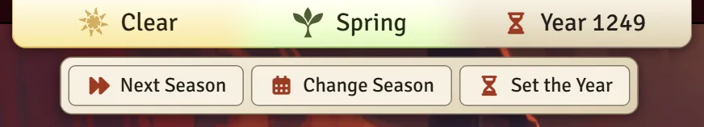
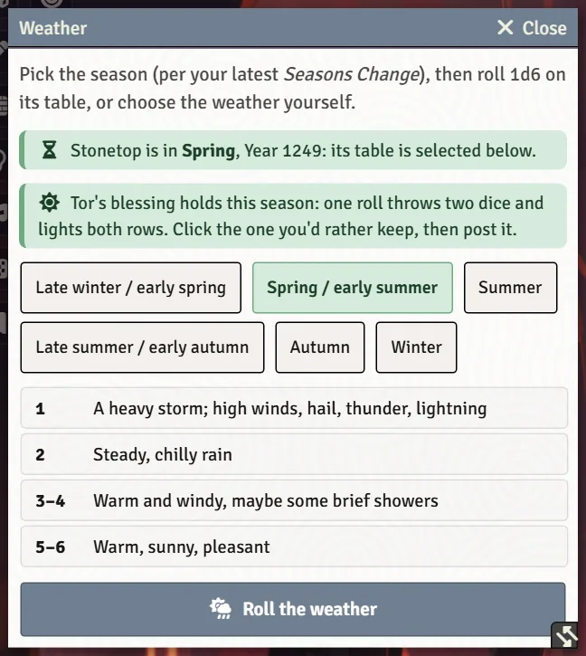

# Seasons, Weather and the Year

Stonetop keeps a clock: the season, the year, and today's weather. The system shows it to everyone, runs the Seasons Change move step by step, and can put the weather on the map. This page is mostly for GMs; players just see the bar at the top of the screen.

## The bar at the top of the screen

A bar along the top of the screen shows the **weather**, the **season** and the **year**, each lit in its own colour. Everyone sees it. Each player can hide it for themselves with **Weather and Season Bar** on their Preferences tab.

For the GM, the bar is also a set of controls:

- Click the **weather** to open the Weather window.
- Click the **season** or the **year** for **Next Season**, **Change Season** and **Set the Year**.

## Seasons Change

Run the **Seasons Change** move from the bar (**Next Season** goes straight to the season after the current one), from the season clock on the steading sheet, or from **Change Season** to pick a season yourself. Picking the season is also how you correct the clock without making the move.

The move opens as a stepped window with a list of steps on the left. Steps that don't apply this time are left out:

- **Autumn's harvest** or **Winter's end**, when they're owed;
- **Start of the season**;
- the **+Fortunes** roll, with what each result gains or costs;
- **What it brings**: the season's gains;
- in winter, **Winter's toll**: consumption. A winter that runs short means Meet with Disaster, and the window asks what it leaves behind;
- **Threats**: a reminder to advance the threats the season points at;
- **What it costs**: upkeep, herd feed and the militia;
- **The Inn**, if Stonetop has one;
- **Chronicle**: the season is written to the Seasons Change journal.

Built improvements that change the move ("henceforth...") are applied automatically.

> **Did you know?**
> - In spring, the GM can hand the +Fortunes roll to the table: a chat card asks the most hopeful character's player to roll it.
> - When a season turns, a public chat card lists each character's "once per season" moves and possessions, so nobody forgets them.
> - Every season is recorded in **The Chronicle**'s Seasons Change journal, one page per year with each season folded under it, and on the steading's [timeline](The-Timeline).

## The Weather window

Click the weather on the bar (or run the **Weather** macro, in older worlds). The window opens on the current season's table. You can:

- click **Roll the weather**: a light walks down the table and lands on a row **without posting it**, so you can roll again or click any other row;
- click a row yourself to choose the weather;
- then post the result to chat.

When **Tor's blessing** holds for the season, one roll throws two dice and lights both rows: click the one you'd rather keep. A "roll again later with disadvantage" result carries over to the next roll. **Weather settings** at the bottom opens the related settings.

### Weather on the map

With the FXMaster module installed, posting a weather result puts it on the scene your players are viewing: cloud, fog, rain, hail, snow, a blizzard, storm light. The world setting **Weather on the Scene (FXMaster)** turns this on or off, and each kind of effect has its own switch (**Weather Effects: Cloud**, **Fog**, **Rain**, **Hail**, **Snow**, **Blizzard Snow**, **Storm Light**). The Weather window gets a pause control when FXMaster is present.

## The year

The year is a name for your campaign's calendar. **Set the Year** asks **What year is it now?**: type the year, and every year already recorded, including the timeline's history from before play, moves with it. The first session's Let Spring Burst Forth asks the same question. See [The Timeline](The-Timeline).

## See also
- [The Steading and Settlements](The-Steading-and-Settlements)
- [Threats and Hazards](Threats-and-Hazards)
- [Your First Session](Your-First-Session)
- [World Settings Reference](World-Settings-Reference)
