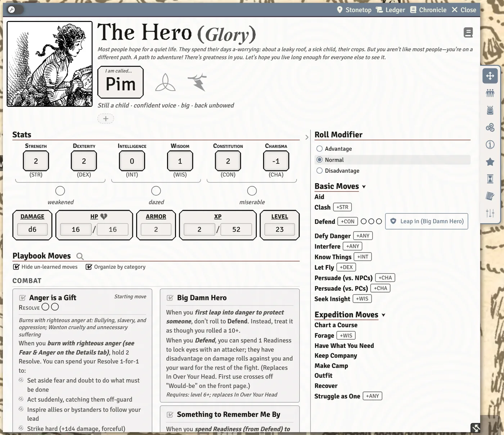

# The Character Sheet

Your character sheet is where you play from: roll moves, track HP and XP, keep your gear and followers, and note what matters about your hero. This page is a tour of the sheet and the small controls that are easy to miss.

## Two layouts

The sheet comes in two layouts. Your GM picks one for the whole table with **Sheet Layout (Whole Table)**, and you can override it for your own browser with **Sheet Layout (Just for Me)** (see [Preferences and Accessibility](Preferences-and-Accessibility)).

- **Modern (icon tabs down the side)**: the tabs are an icon strip hanging off the right edge of the window (it moves to the left edge if the window is too close to the right side of your screen). Your stats, debilities and vitals sit at the top of the **Moves** tab.
- **Classic (tab names across the top)**: the tabs are a row of names across the top, and the stats, debilities, damage, HP, armor, XP and level block stays pinned above them on every tab.

The tabs are **Moves**, **Inventory**, **Details**, **Special Moves**, **Notes** and **Preferences**, plus **Invocations**, **Followers**, **Arcana**, **Post-Death** and **Timeline** when your character has them.

> **Did you know?**
> - You can drag tabs on the strip (or the row of names) to put them in the order you like. The order is saved on the character. **Notes** and **Preferences** always stay at the end.
> - The sheet reopens at the size you last left it, in this browser.
> - When your XP reaches the Level Up cost in the Modern layout, a small dot appears on the **Moves** tab icon so you notice even from another tab.

## Play mode and Edit mode

The sheet opens in Play mode, where you roll and tick things. The wrench switch at the left of the window's title bar turns Edit mode on and off; in Edit mode you can change text, stats and lists. If you would rather sheets always open in Edit mode, turn on **Open Sheets in Edit Mode** in your preferences.

You do not have to switch the whole sheet into Edit mode to change one thing. Hover a section and a small pencil fades into its top right corner. Click it to edit just that section, then click the check mark (**Done editing**) when you are finished.

> **Did you know?**
> - The pencils are clickable before they finish fading in, so you can click the spot without waiting. **Edit Pencil Reveal Delay** in your preferences sets how long the hover takes (0 shows them at once).
> - Every section heading has a small caret beside it that folds the section away. Folds are remembered for each character in this browser. When a caret has keyboard focus, `Enter` or `Space` folds or unfolds it.

## The title bar buttons

| Button | What it does |
|---|---|
| **Edit Character** | Reopens the character creation walkthrough, or starts again with a new playbook (see [Creating a Character](Creating-a-Character)). |
| Steading (shows your steading's name) | Opens the Stonetop steading sheet. |
| **Ledger** | A history of changes to this character. You can filter it with **Filter entries…**, pick a subject (**All changes** or one thing), and sort **Newest first** or **Oldest first**. |
| **Chronicle** | Opens your character's page in the **Player Introductions** journal, once the GM has recorded introductions. |

> **Did you know?**
> - If the steading button is blank, your sheet is not linked to a steading yet. Drag the Stonetop actor from the Actors sidebar onto your sheet to link it.

## The header

### Portrait

- In **Play mode**, click your portrait to open it at full size. That window has an **Edit Photo** button in its title bar.
- In **Edit mode**, click your portrait to open the **People of Stonetop** gallery. Filter by **Masculine**, **Feminine** or **Unspecified**, by **Children** or **Not children**, and by **Unused** or **Assigned** (portraits other people already wear). **Randomize** rolls a portrait from the ones the filters show, and **Accept** uses the one on offer. **Browse files…** picks any image instead, and **Use default** puts the placeholder back.

The gallery fills up once your GM has imported the book art (see [Import Book Art](Import-Book-Art)).

<!-- SHOT: the-character-sheet-gallery | Player client: the People of Stonetop gallery opened from a character portrait in Edit mode, with the Unused filter on and one portrait selected, Accept and Randomize visible at the bottom -->

> **Did you know?**
> - Hover your portrait to reveal a small round **Frame face** button on its corner. It lets you choose the square crop of your face used in small places such as relationship rows and the steading roster. It works in both modes.
> - If the Tokenizer module is installed, a second button beside it (**Open Tokenizer**) makes a token from your portrait.

### Playbook, instinct and name

The top line shows your playbook and, in brackets, your Instinct word (for example "(Loyal)"). Hover the Instinct word to read what it means.

Once your GM has set up Book I in the world, a book button appears at the right end of that line. Click it to open Book I in the [Rulebook Reader](The-Rulebook-Reader).

Below your name sits your appearance line. If your character has died, a **Dead** tag rides at its end (see [Death and Beyond](Death-and-Beyond)). Under it, "Keep in mind" chips list the tags on the gear you carry and any reminders you added with the row's **+** chip (see [Relationships, Notes and Reminders](Relationships-Notes-and-Reminders)).

### State icons beside your name

Some playbooks show small icons next to the name plate: the Lightbearer's candle and running Invocation, the Judge's scales, the Blessed's marks, the Heavy's Battle Joy, a Marshal's shaken nerves, a Storm Markings anger, being unseen, Inspiration, and Rapport with a Would-be Hero. Hover any of them to read what it means; click it to act on it (light the candle, end an Invocation, open a list, and so on). Each is described on [Playbook Notes](Playbook-Notes).

> **Did you know?**
> - When something has promised you advantage (or disadvantage) on your next roll, an icon appears beside your name. Hover it to see where it came from. Click it to give it up without rolling.
> - A Would-be Hero who crossed off "Would-be" by mistake can switch to Edit mode and press **Restore "Would-be"** next to the playbook name.

### Wounds

When your character carries a problematic or permanent wound, a line under the header lists them after **Problematic wounds:**. Hover a wound to read its details. While you can edit the sheet, each wound has buttons:

| Button | What it does |
|---|---|
| **Tend (Recover)** | Tends a problematic wound. |
| **Edit** | Opens the wound editor. |
| **Remove** | Deletes the wound. |

Healed wounds fold into a **Scars (n)** list you can open.

To add a wound, use the small button beside the **HP** label (**Add a problematic or permanent wound**). The wound editor has four panels down its left side: **The wound**, **Treatment**, **Lasting effects** and **Make a Plan**.

## The Moves tab

### Stats and vitals

- **Click a stat** to roll it.
- **Click your Damage die** to roll your damage. In Edit mode it becomes a text box; clear it to go back to your playbook's die.
- Tick **weakened**, **dazed** or **miserable** for debilities. Hover each to read what it does.
- Hover the **Damage**, **HP**, **Armor**, **XP** and **Level** labels to read what they mean. Hover your max HP or Armor number to see what is adjusting it.
- In Edit mode you can type a new max HP or Armor; the sheet keeps the difference as a lasting adjustment on top of what your playbook and gear give.
- When your XP reaches the Level Up cost, a level-up icon appears next to **Level** (**Ready to level up!**). Click it to start leveling (see [Leveling Up](Leveling-Up)).

### Your moves

- **Click a move's name** to roll it. Moves with no roll post their text to chat. If **Show Roll Stat Chips** is on, a chip such as "+STR" follows the name; clicking it rolls too.
- Some moves carry rows of circles (hold, uses, and the like). Click a circle to fill or empty it.
- Some moves show buttons right in their text, for things you do with them during play.
- A move that only works with a lighter load or without armor says so on its card (for example "needs a light load"). Hover it for why.
- A warning triangle means you own the move but do not meet its requirement.
- **Hide un-learned moves** hides the playbook moves you have not taken, and **Organize by category** splits them into the playbook's groups.
- In Edit mode, each row in **Other Moves** has a learned checkbox. Untick it to keep the move on the sheet but switched off (not rollable, bonuses off).
- **Create a move** at the bottom of the tab opens the custom move editor. If your GM has turned on **Custom Moves: GM Only**, players do not see it.

If you have fewer (or more) moves than your level allows, a notice at the top of the list says so.

> **Did you know?**
> - A hand-pointer icon on a move means it still owes you a choice (a pick, a background answer, or which stat to raise). Hover it to see what is missing, and click it (or press `Enter` while it has focus) to jump straight to making that choice.
> - Move names inside other moves' text explain themselves when you hover them.
> - The magnifier beside the **Playbook Moves** heading opens **Filter moves…**. Type to filter the whole tab; press `Esc` to clear it.
> - You can drag a move from your sheet onto the hotbar to make a macro that rolls it (see [Rolling Moves and Chat Cards](Rolling-Moves-and-Chat-Cards)).

### The Basic Moves sidebar

Beside the tabs is a sidebar listing **Basic Moves** and **Expedition Moves**. Click a move's name to roll it. Click a group's title to fold it, or click the chevron at the top to collapse the whole sidebar. Both are remembered.

Above the lists is **Roll Modifier**: choose **Advantage**, **Normal** or **Disadvantage** for your next rolls. It stays set until you change it. If you turned on **Ask How to Roll Each Time**, this control is hidden because you choose in a window before each roll instead.

The **Defend** row shows your Readiness circles. Click a circle to set how much you hold. If you have Big Damn Hero, a **Leap in (Big Damn Hero)** button sits there too: it counts as a 10+ on Defend without rolling, once per fight, and goes away once you have used it in the current fight. See [Fights (for Players)](Fights-for-Players).

> **Did you know?**
> - Hover a move in the sidebar to read its full text without opening anything. Turn this off with **Hover Descriptions: Basic Moves** in your **On Hover Info** settings.

## The other tabs

- **Inventory**: your gear, load and special possessions. See [Inventory and Gear](Inventory-and-Gear).
- **Details**: **Background**, **Instinct**, **Appearance**, **Origin**, your **Lore** answers and **Relationships**. While background questions are unanswered, **Answer Background Questions** opens the walkthrough on them.
- **Special Moves**: **Death's Door**, **Recover**, **Convalesce**, **Level Up**, **Burn Brightly** and, while your character is still in play, **Retire** (retire or leave Stonetop; shown to the owner and the GM), each with its own button. A move that is not available right now says why (for example, Level Up needs enough XP; Death's Door is only for a dying character).
- **Invocations** (the Lightbearer, or anyone who learned to invoke the Sun God): see [Playbook Notes](Playbook-Notes).
- **Followers**: see [Followers](Followers).
- **Arcana**: see [Arcana and Artifacts](Arcana-and-Artifacts).
- **Timeline** (Modern layout): your character's track on the campaign timeline. See [The Timeline](The-Timeline).
- **Notes**: your free notes. See [Relationships, Notes and Reminders](Relationships-Notes-and-Reminders).
- **Preferences**: your own display and rolling settings. See [Preferences and Accessibility](Preferences-and-Accessibility).

## Other players' sheets

If your GM has **Players See Every Character Sheet** on (the default), you can open any character's sheet to read it, but only its owner and the GM can change it. Dropping items onto a sheet you cannot edit does nothing.

## See also
- [Creating a Character](Creating-a-Character)
- [Rolling Moves and Chat Cards](Rolling-Moves-and-Chat-Cards)
- [Inventory and Gear](Inventory-and-Gear)
- [Playbook Notes](Playbook-Notes)
- [Preferences and Accessibility](Preferences-and-Accessibility)
- [Hidden Tricks](Hidden-Tricks)
