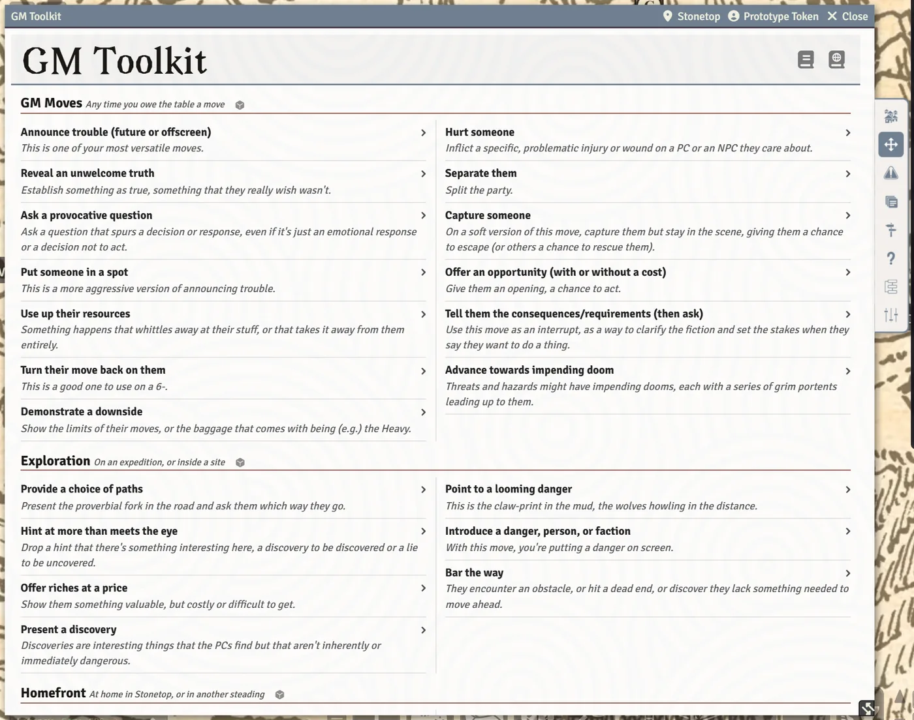
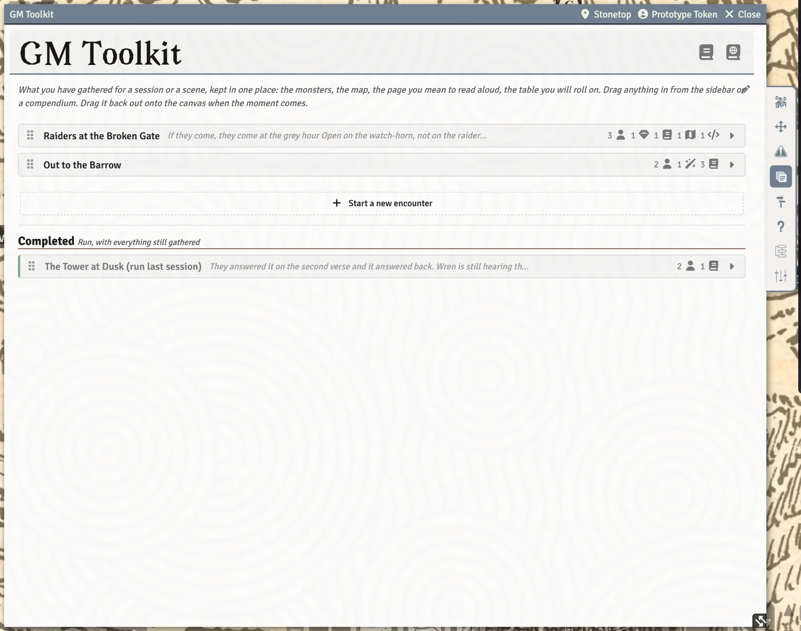
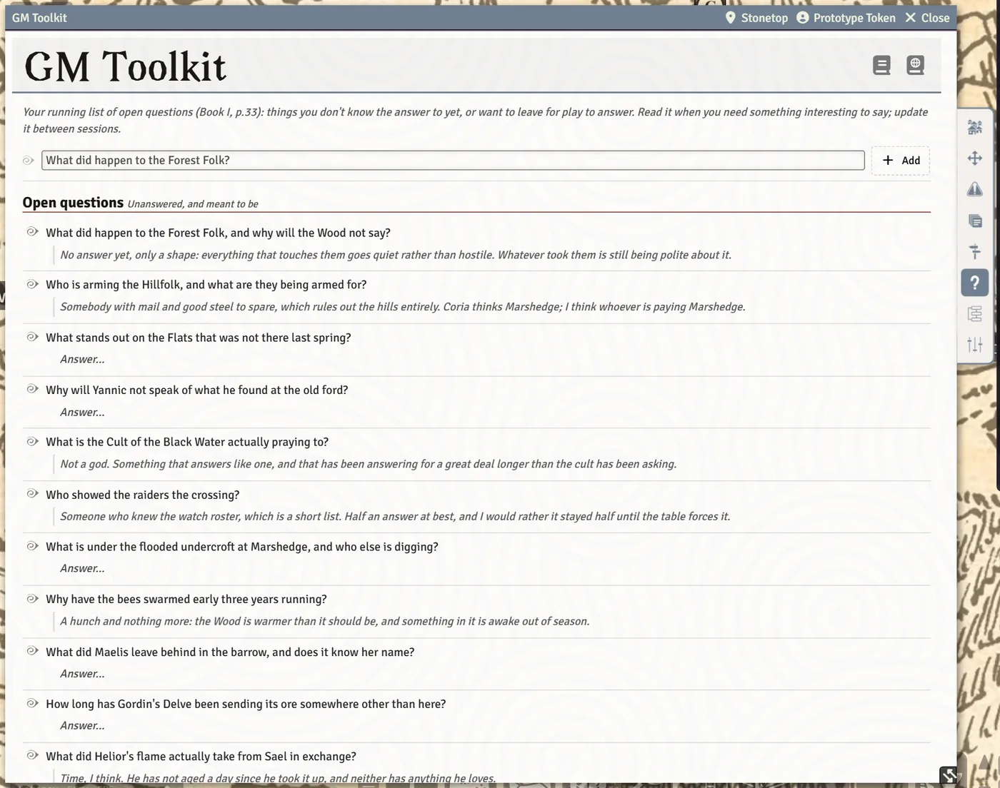
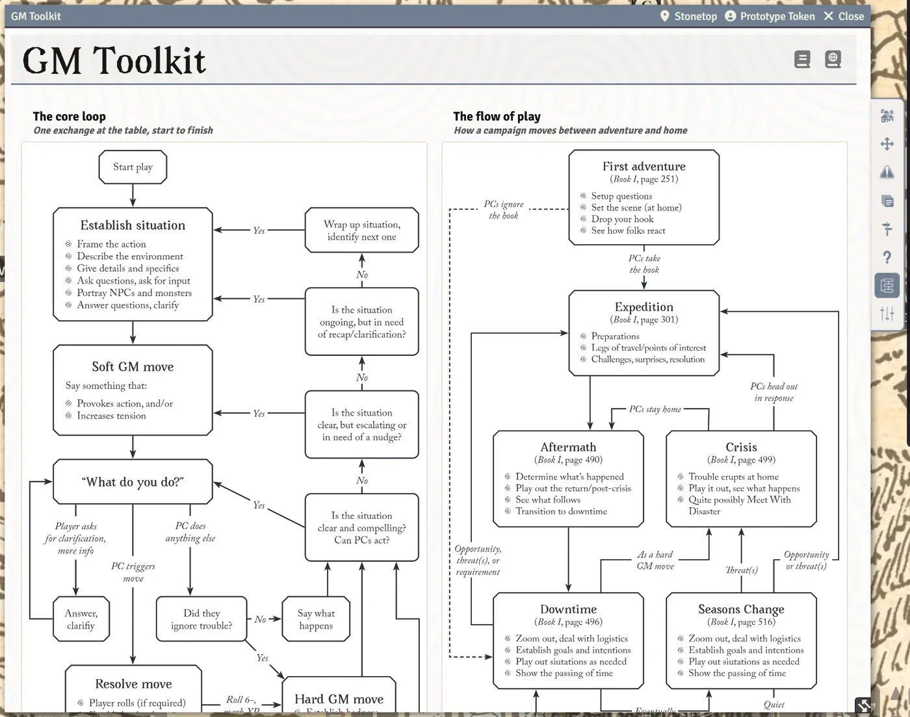

# The GM Toolkit

The GM Toolkit is the GM's own sheet: the GM playbook on screen, with your moves, the homefront reference, your threats, the encounters and trips you have prepared, and your "I wonder..." list.

## Opening the toolkit

Every world has exactly one **GM Toolkit** actor. It is created for you on the first load, assigned as the GM's character, and owned by GMs only, so players never see it. A second one cannot be created and the last one cannot be deleted. Open it from the Actors sidebar like any other actor.

The tabs are an icon strip hanging off the right edge of the window (it moves to the left edge if the window is too close to the right side of your screen). Hover a tab icon to see its name.

| Tab | What it is for |
| --- | --- |
| **Homefront** | The GM playbook's Homefront page, for when the party gets home. |
| **GM Moves** | Your move lists, to read, post or draw at random. The sheet opens here. |
| **Threats & Dangers** | Your threats, hazards and the book's guidance on writing them. |
| **Encounters** | Named bundles of what you gathered for a session or scene. |
| **Expeditions** | Trips prepared ahead, plus your Sites. |
| **I Wonder...** | Your list of open questions, and the players' wishes. |
| **Core Loop** | The GM playbook's two flowcharts, plus agenda and principles. |
| **Preferences** | Your own text size and other personal settings, at the foot of the rail. See [Preferences and Accessibility](Preferences-and-Accessibility). |

The window header also has a button with the steading's name (normally **Stonetop**) that opens the steading sheet.

### Your rulebooks

The banner at the top carries two book icons, **Book I** and **Book II**. Click one to open your own PDF of that book in the reader. A book this world has not been pointed at yet is drawn dimmed, and clicking it opens **Your rulebooks** so you can point at your copy instead. The tooltip says which it will do ("Open ..." or "Point at your copy of ...").

Page citations all over the toolkit work the same way: click a "Book I, page N" line to open your book at that page. See [The Rulebook Reader](The-Rulebook-Reader).

## Homefront

The GM playbook's Homefront page, whole, in folding sections:

- **Life in Stonetop**: the village's own facts, for when someone asks.
- **Questions to ask**: their answers are true from then on.
- **The year's work**: what folk are doing in each season. The season the steading's clock is in is marked **now**, and the mark follows the clock when the season changes.
- **Aftermath**: after every expedition, and after every crisis.
- **Downtime**: between adventures, until the next one starts.
- **Make a Plan**: the player move you answer with requirements.
- **Relative Value**: what an item of each Value is generally worth.

Nothing on this tab rolls or is stored. It is reference.

## GM Moves

Three lists, each in its own box:

- **GM Moves**: any time you owe the table a move.
- **Exploration**: on an expedition, or inside a site.
- **Homefront**: at home in Stonetop, or in another steading.

Each entry shows the move's name and the first line of what the book says about it.

- **Click the line under the name** to open the entry in place. The rest of the paragraph carries on where you are reading, followed by any further paragraphs, the book's quoted examples of play, and the page it came from.
- **Click the move's name** to post it to chat. It is whispered to the GMs only.
- **Click the die beside a section's heading** to draw one move from that list at random. A highlight walks down the list, lands on the move, and then the move is whispered to the GMs. The die avoids drawing the same move twice in a row.

A posted move card carries one of the book's examples and a **Share with Players** button. Press it to reveal the card to the whole table.

> **Did you know?**
> - Clicking a second die while the first highlight is still travelling cancels the first draw and starts the new one.
> - Each draw picks a different example from the book when the move has several, so the same move drawn next session reads differently.
> - The **Share with Players** button disappears once the card has been shared, and players never see it.

## Threats & Dangers

This tab holds your threats on proximity trackers, each with a button to write one up, your hazards with **Make a hazard**, a **Crossed off** fold for threats that are no longer threats, and folding guidance from the book, including the eight threat types and what each does next. Drag any threat or hazard card onto a scene to pin it to the map.

Everything about this tab, from writing a threat to rolling a hazard's damage, is on [Threats and Hazards](Threats-and-Hazards).

## Encounters

An encounter is a named bundle of pointers to things you mean to use in one session or one scene: the monsters, the battle map, the page you will read aloud, the table you will roll on.

- **Start one.** Click **Start a new encounter**, or simply drop something onto the empty tab and an encounter is started for you.
- **Gather things.** Drag anything in from the sidebar or a compendium: actors, items, arcana, journals, journal pages, scenes, roll tables and macros. What is stored is a pointer, never a copy, so the original stays where it is.
- **Name it** in the box at the top of the card ("What you call this encounter").
- **Note what each entry is for** in the small field beside it ("What this one is for").
- **Write notes** for the whole encounter with the pencil button ("Write the notes for this encounter"). The notes open in a pop-up rich-text editor; press **Done** to keep them. A collapsed card shows a short peek of its notes. Links in the notes always show the target's current name, so renaming a linked monster renames the link too.
- **Open an entry** by clicking its name. Drag the name onto the map to drop it there.
- **Put every monster in this encounter on the current map.** The deploy button places every monster and NPC in the encounter as tokens on the scene you are viewing. A monster that only exists in a compendium is imported into the world first, so the token has an actor to point at.
- **Put every monster in this encounter on the map and start a fight with them.** Next to deploy, this places them and then opens the start-a-fight window with those tokens ticked as foes and the party on the map ticked beside them. It appears only while **Fight tab (replaces the Combat tracker)** is on (it is on by default). See [Running Fights](Running-Fights).
- **Mark complete.** The **Mark complete** button files a run encounter into the **Completed** fold at the foot of the tab, with everything still gathered. **Put back on the list** lifts it back up.

An entry whose document has since been deleted stays on the card under the name it had, marked as no longer in the world.

> **Did you know?**
> - Drag a card by the grip at its left to reorder the list, or click in its name box and press `Alt` with the `Up` or `Down` arrow.
> - You can drag an entry from one encounter onto another to move it.
> - The two delete buttons (deleting a whole encounter, and taking an entry out) only appear once you unlock the tab with the pencil in its top-right corner. Everything else works while it is locked.
> - Deleting an encounter never touches the monsters, pages or maps it points at. To clear one off the list but keep it, mark it complete instead.
> - The list lives on the toolkit, so every GM in the world sees the same encounters.

## Expeditions

The Expeditions tab uses the same cards as Encounters, for trips you prepare before the night you run them: the map of the route, the sites on the way, whatever waits at the end, the page to read when they arrive. Everything above about gathering, notes, deploying, reordering and **Completed** applies here too. Each card adds two buttons:

- **Run it**: opens the **Run an Expedition** walkthrough on a new trip, named after this card.
- **Open the walkthrough**: opens the walkthrough on this card's trip, with everything already noted in it.

A bar at the top offers **Call for Struggle as One**. While one is under way the button reads **Open the Struggle as One** and shows how many have rolled.

The **Sites** section sits at the foot of the tab: where a trip is going, and what is on the way.

For the walkthrough, journey tools and sites, see [Expeditions and Sites](Expeditions-and-Sites).

## Followers

The toolkit has no Followers tab. Your levers on a follower sit on the follower's own card, on the character sheet: **They balk** and **Use up their resources**, beside **Order**, plus the debility chips under the card's pencil. See [Followers](Followers#when-they-balk). The book's between-session review of followers (Book I, p.480) is folded into the **End of Session** window.

## I Wonder...

Your running list of open questions (Book I, p.33).

- Type a question in the box at the top and press **Add**.
- Each question has an answer box ("The answer, or a hunch"), saved as you leave it.
- **Answered: file it below** moves a question into the **Answered** fold. **Put this back on the open list** reopens it.
- **Delete this question** removes it and any answer, after asking.
- A folded **Keeping the list** panel holds the book's advice.

**Players' wishes** lists the wishes each player offered at End of Session, newest first. It is read-only: what a player said is theirs. See [Chronicle, Journals and Love Letters](Chronicle-Journals-and-Love-Letters).

> **Did you know?**
> - The file, reopen and delete buttons only appear once you unlock that list with its pencil, so a stray click mid-session can't file or delete a question. Adding and answering always work.

## Core Loop

Two figures from the GM playbook: **The core loop** (one exchange at the table, start to finish) and **The flow of play** (how a campaign moves between adventure and home). Each is also written out as steps with page citations, so the tab is useful even without the pictures.

The pictures are the publisher's artwork, so they don't ship with the system. Until you import them, each figure shows a placeholder with an **Import Book Art** button; add your copy of the free GM playbook PDF on that window's GM playbook page. Once imported, click a figure to **Open in a window you can zoom and pan**.

Below the figures, folded sections hold **Your agenda**, **Your principles**, **The Line**, **What not to do** and **First adventure prep**.

## See also
- [Your First Session](Your-First-Session)
- [Threats and Hazards](Threats-and-Hazards)
- [Expeditions and Sites](Expeditions-and-Sites)
- [Followers](Followers)
- [Running Fights](Running-Fights)
- [The Rulebook Reader](The-Rulebook-Reader)
- [Import Book Art](Import-Book-Art)
