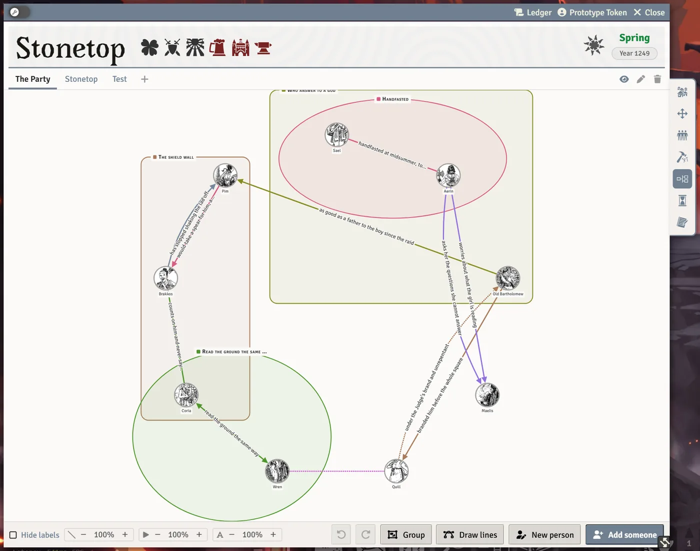

# The Relationship Map

The relationship map is a shared board of who knows whom: portraits of the party and the village, joined by labelled lines and gathered into named groups. Everyone can work on a map the GM has shown them, at the same time, and each person can undo their own changes.

## Opening it

- The **Relationship Map** tab on the Stonetop steading sheet.
- The **Relationship Map** button at the top of the Journal sidebar.
- The **Relationship Map** macro on the hotbar (the GM's slot 6, the players' slot 2).

Each named board is a page in a collection; tabs along the top switch between them. The journals that hold the maps are hidden from the Journal sidebar so they don't clutter it.

Your GM can turn the whole feature off with the world setting **Relationship Map**. Nothing is deleted; it's just hidden.

## Boards

- New boards start as the GM's own. The GM shows a board to the players with the eye on its tab, and can hide it again.
- The GM can seed a collection in one go: a board for the party, built from the answers to the Introductions questions, and a board for the village, built from the steading's residents.
- Rename, delete and reorder boards from their tabs. Drag a tab to move it, or use `Ctrl` + `Left`/`Right`.

> **Did you know?**
> - When the Introductions answers name someone ambiguously, a **Who did they mean?** window lets you match each answer to the right person before the party board is built.

## Putting people on a board

- **Drag a character or NPC in from the Actors sidebar.**
- **Add someone** ticks several people at once.
- **New person** makes a new NPC with the Person worksheet and puts them straight on the map.

**Double-click** a portrait to open their sheet. **Right-click** a portrait to show its delete button; taking someone off a map never touches their sheet.

## Drawing lines

- **`Alt`-drag** from one person to another to draw a line between them.
- Or click **Draw lines**, then drag from one person to another (or click one, then the other). `Esc` stops.

Click a line to change it in its bar: **What it says**, **Colour**, **Which way it is read** (an arrow toward one end, or none), **The stroke** (solid, dashed or dotted) and **How big the writing is**. Drag the words along the line to move them out of the way. A colour too pale to read on the map is drawn a shade deeper.

**Hide labels** hides the words on every line, so a crowded map is easier to read; clicking a line still shows its words.

## Groups

Click **Group** and drag a box round some people (the hunters, the elders) to make a named group. With people already selected, **Group** groups them. Click a group to name it, recolour it, choose a **Box** or **Oval** outline, add or remove the selected people, or drag its corners to resize it (hold `Shift` while resizing for a square or a circle).

## Moving people

- `Shift`-click to select several people, then drag any of them to move them together.
- With people selected, the **arrow keys** nudge them. `Esc` lets go.

## Undo

**`Ctrl`+`Z`** takes back your last change to the map, and **`Ctrl`+`Shift`+`Z`** (or `Ctrl`+`Y`) does it again. It's yours alone: it never takes back what someone else did.

## Line and word weights

The **-** and **+** buttons in the map's bottom bar set how heavily the map is drawn **for you**: **Lines**, **Arrowheads** and **Words**, as percentages. Click a percentage to put it back to 100%. Raise them on a big screen or for easier reading; nobody else's map changes.

## See also
- [Relationships, Notes and Reminders](Relationships-Notes-and-Reminders)
- [The Steading and Settlements](The-Steading-and-Settlements)
- [Your First Session](Your-First-Session)
- [Hidden Tricks](Hidden-Tricks)
