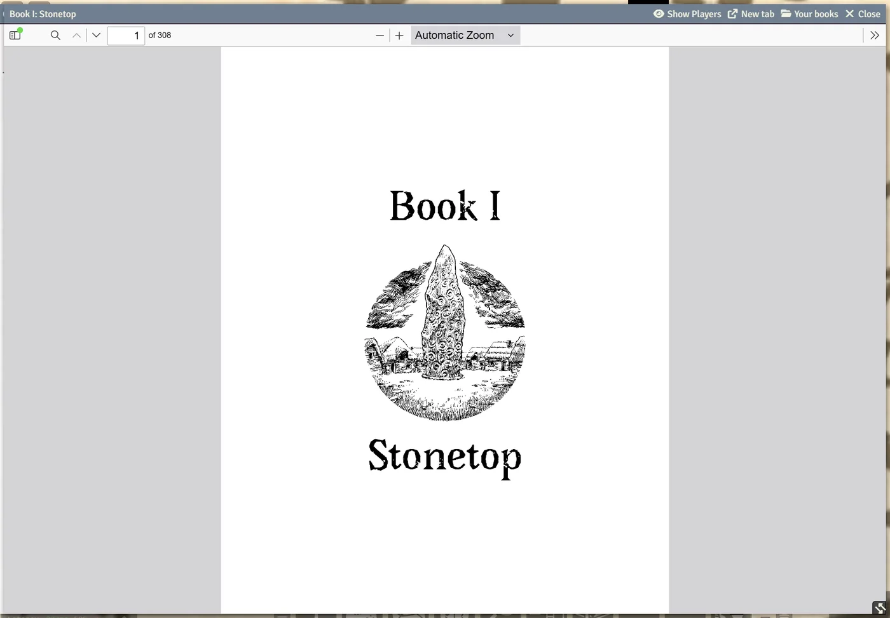

# The Rulebook Reader

If your GM owns the Stonetop PDFs, the books can be read right inside Foundry, by everyone at the table, with page links that jump straight to the rule you need. The reader uses Foundry's built-in PDF viewer, so it has the usual outline, search and links; the system adds bookmarks, a better zoom, and a way for the GM to show everyone a page.

## Setting up the books (GM)

The GM adds the books once per world:

1. Open the GM Toolkit. In its banner, the Book I and Book II icons are dimmed while no book is set.
2. Click one to open **Your rulebooks**, and point it at your copy of **Book I: Stonetop** and **Book II: The Wider World and Other Wonders**. These are usually the 308 and 302 page "spreads" PDFs.
3. The file is copied into the world so your players can read it too. A big file takes a moment.

If the PDFs are already in your Foundry data's `stonetop-books` folder, a new world picks them up by itself and says so.

> **Did you know?**
> - If your PDF has a different page count from the spreads edition, the system warns that page numbers from the book may land a little off.

## Opening a book

- On your character sheet, the small book icon beside the playbook name opens Book I.
- The GM Toolkit's banner icons open Book I and Book II.
- Page citations across the system, such as **Book I, page 243** on the Fight tab or in the GM Toolkit, open the book at that page.

Both books can be open side by side.

## Reading

- **`Ctrl` + mouse wheel** (`Cmd` on a Mac) zooms around the pointer. It zooms the page, never the whole browser.
- The viewer's sidebar has the book's outline and full-text search.
- **New tab** opens the book in its own browser tab.
- Close the book and reload Foundry, and it reopens at the page and zoom you left it on.

## Your bookmarks

The viewer's sidebar has an extra **Your bookmarks** tab. Turn to a page you keep looking up and click **Bookmark this page**: it remembers the page and the zoom. Bookmarks can be renamed and removed.

Your bookmarks belong to you, not to the world: nobody else sees them, and they follow you to another computer.

## Show Players (GM)

In the reader's window header, the GM has **Show Players**: it opens the page the GM is on, on every player's screen. After that, each player can browse on their own.

> **Did you know?**
> - Players who aren't sure where a rule is can ask the GM to Show Players instead of searching.
> - If a player clicks a citation and the world has no copy of that book, the notice tells them the GM adds it from the GM Toolkit.

## See also
- [The GM Toolkit](The-GM-Toolkit)
- [Fights (for Players)](Fights-for-Players)
- [Import Book Art](Import-Book-Art)
