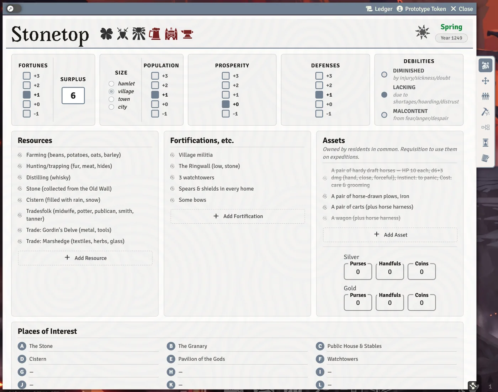

# The Steading and Settlements

Stonetop itself is an actor with its own sheet: its stats, resources, people, improvements and homefront moves. Other villages and towns can get simpler **Settlement** sheets. Everyone at the table can open the steading; most of it is the GM's to change. Open it from the **Stonetop** button in any character sheet's header, or from the Actors sidebar.

## The header

- **The season clock.** The season and year sit at the top right. Click them to make the **Seasons Change** move, or just correct what the sheet says. See [Seasons, Weather and the Year](Seasons-Weather-and-the-Year).
- **Things owed.** Small glyphs beside the name flag unresolved obligations, such as upkeep due or a held bonus. Hover one to see what it is.
- **Ledger.** A dated history of every change to the steading, with search, a filter by subject, sorting, and select-to-delete. Characters and NPCs have a Ledger too.

## Overview

The stats row shows **Fortunes**, **Surplus**, **Size**, **Population**, **Prosperity** and **Defenses**, with the three debilities (**Diminished**, **Lacking**, **Malcontent**) beside them. Hover any stat or debility for its rules.

Below are **Resources**, **Fortifications, etc.**, **Assets** (owned in common; anything requisitioned for an expedition is struck through and tagged with the trip until it comes home), the steading's purses, and **Places of Interest**.

> **Did you know?**
> - Each Place of Interest has a lettered disc (A to R). **Drag a disc onto a scene** to drop a map pin there, linked to that place's page in the Chronicle's Places of Interest journal.

## Homefront Moves

The **Homefront Moves** tab prints each move the steading makes: Aurochs Hunt, Meet with Disaster, Persuade, Seasons Change, Deploy, Muster, Pull Together, Requisition, Trade & Barter, Bolster and Return Triumphant. Click a move's stat chip to roll it. Advantage and disadvantage for steading rolls are chosen at the top of the tab.

The cards those rolls make carry their own buttons, for example:

- **Mark XP** on a miss (whoever made the move marks XP), or **Mark XP for someone else** to pick the character (the GM, who plays nobody, gets just **Mark XP**, and it asks who);
- spending Fortunes or Stock, marking a debility, raising a muster;
- handing over what Trade & Barter got you;
- holding Preparation from Bolster, which anyone can spend later for +1 (see [Rolling Moves and Chat Cards](Rolling-Moves-and-Chat-Cards#help-from-your-friends)).

Requisition asks how many horses you take from the herd, if Stonetop has one.

## Residents

The **Residents** tab has three lists: **Player Characters**, **Residents of Stonetop** and neighbors. Each person is an NPC actor, so they have a full sheet of their own.

- Drag NPCs from the sidebar onto a list to add them, or **Add Resident**.
- **Residents follow their Home.** An NPC whose **Home** names a settlement is on that settlement's Residents, wherever they were made, and changing someone's Home on their sheet moves them. Dropping someone who lives elsewhere asks **Move (name) to (place)?** first. The remove cross asks **Where does (name) live now?** rather than just taking them off the list.
- **Drag player characters onto the Player Characters list** to keep them with Stonetop; their Keep in mind reminders show there.
- Each person is a card showing their **Occupation**, **Traits**, **Relations** and **Notes**, kept A to Z by name. Click a list's pencil to edit its fields; the pencil beside a resident's Notes then opens that NPC's notes in a pop-up editor, and changes go straight to their sheet.
- The magnifying glass filters the list.
- The **Relationships** card at the bottom rates how Stonetop stands with each other settlement (see [Other settlements](#other-settlements)).

> **Did you know?**
> - Clicking a resident's portrait opens the **People of Stonetop** gallery: about 155 faces from the books (once you've run [Import Book Art](Import-Book-Art)), with a filter for faces not used yet and a button to roll a random unused one.
> - Players can create NPCs for these lists. The system grants them Foundry's Create Actor permission once per world.

## Improvements

The **Improvements** tab lists the improvements the book offers and the ones you've built. Filter by category or search; tick a requirement as you meet it, and the sheet asks **Earn this improvement?** when they're all done. Built improvements apply their effects (for example to Seasons Change) and some add moves of their own, like **Bring Folks Together** at the Inn (spend 1 Surplus to clear a debility).

Homebrew improvements can be made with the improvement builder (see [Homebrew Content](Homebrew-Content)), and improvement cards in journals can be **dragged onto this tab**. Tick **Hide improvements not started** to shorten the list.

## Relationship Map and Timeline

The steading has its own **Relationship Map** tab (the table's shared boards) and **Timeline** tab (Stonetop's own history). See [The Relationship Map](The-Relationship-Map) and [The Timeline](The-Timeline). Your GM can turn either feature off for the whole world.

## Notes

The **Notes** tab holds, in this order:

- **Plans**: **New plan** records something the village hopes to achieve and what the GM says it requires (Make a Plan), with a checkbox per requirement.
- **Notes**: free notes for the GM.
- **Content guidelines**: excluded content, veiled content, special requests and the line, to review at the start of each session.

## Other settlements

Other villages, towns and bands are **Settlement** actors. Create one from the Actors sidebar's **Create Actor** button, choosing Settlement, then a place from Book II, a typical stat block, or a blank sheet. A settlement sheet has **Overview**, **People**, **Homefront Moves** and **Notes** tabs:

- Size, Population, Prosperity and Defenses, with resources, defenses, trade partners and a **Read in the gazetteer** link to its journal entry;
- **Who runs it**, notable people (link them to NPC sheets) and groups;
- on **People**, a **Residents** table like Stonetop's: **Add Resident**, or drag an NPC from the sidebar onto the tab (residents follow their Home here too);
- on **Notes**, its own **Plans**, made and edited the same way as Stonetop's;
- its own Trade & Barter, Muster, Deploy and Pull Together, rolled off its stats. A hamlet rolls these with disadvantage and a town or city with advantage.

A settlement starts **Hidden from players**; click the toggle in its header to show it to them. How each settlement stands with Stonetop is stored on Stonetop's sheet, in the **Relationships** card at the bottom of its Residents tab, where you rate each one and use the pencil to choose which settlements to show.

## See also
- [Seasons, Weather and the Year](Seasons-Weather-and-the-Year)
- [Threats and Hazards](Threats-and-Hazards)
- [Expeditions and Sites](Expeditions-and-Sites)
- [Homebrew Content](Homebrew-Content)
