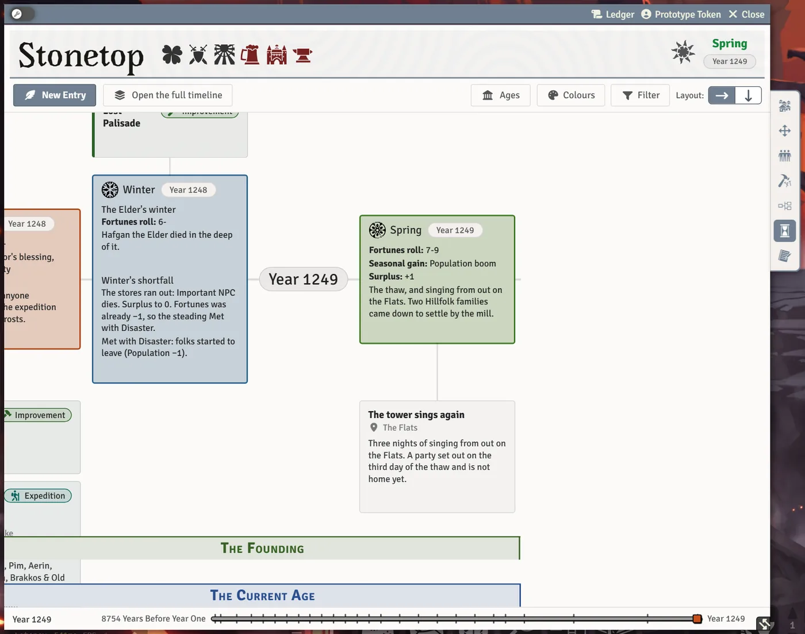

# The Timeline

The timeline is the campaign's history, season by season: Stonetop's own thread and one for each character. Much of it fills itself in as you play (level-ups, deaths, expeditions, kills), and anyone can write their own entries. Every player can read it.

## Opening it

- The **Timeline** tab on the Stonetop steading sheet shows Stonetop's thread.
- The **Timeline** tab on each character sheet shows that character's thread (in the Modern sheet layout).
- **Open the full timeline** on either tab shows every thread together in its own window.

Your GM can turn the whole feature off with the world setting **Timeline**. The system keeps recording in the background either way.

## What's recorded for you

The timeline writes these down by itself, in the season they happened:

| Entry | When |
|---|---|
| **Level up** | A character reaches a new level, naming the move they learned. Levels gained before the timeline existed are filled in too. |
| **Death** | A death or a fate taken at Death's Door. |
| **Lasting wound** | A wound that stays. |
| **Arcanum** | An arcanum is found, worked out or mastered, or a Consequence is marked. |
| **Follower** | A follower joins. |
| **Kills** | Foes a character finishes in a fight. |
| **Expedition** | A trip out and home again, on everyone who went. |
| **Site visit** | A site marked visited, on everyone who went and on Stonetop. |
| Seasons Change | Each season's roll, gains and costs, on Stonetop's thread. |
| **Threat** | A threat's grim portent or doom, if the GM chooses to add it. |

## Writing an entry

Click **New Entry** (or hover a season and click **Add** in it). The entry window has:

- **When**: the season and year it happened;
- **Title**: a line to remember it by;
- **Where**: a place name. Drop a place, scene or person here to link it, or just type;
- **Details**: as much or as little as you like. Drop people, places or creatures into the text to link them;
- **Slain**, for kills: one foe per line ("Crinwin ×3" counts three);
- **Tag**: one tag per entry. **New tag** makes your own, with a colour, shared with the whole table.

Entries can be edited, removed, or moved earlier or later within their season.

## Reading it

- **Filter** hides threads (**Subject**) and kinds of entries (**Entries**) you don't want to see, and the Ages bands.
- **Layout** switches between **Horizontal** (along one line, like a slide) and **Vertical** (down the page, one season under the next).
- The **Jump to year** slider brings a year to the middle.
- The timeline opens on the current season.

These choices are remembered per browser.

## Ages (GM)

**Ages** names long stretches of the world's history, like the Time of the Makers or the Current Age, drawn as coloured bands along the timeline for everyone. Give each a name, a first year and a last year (or leave it **Still going**). The book's Ages are added once for you. Click a band to edit its Age.

## Colours (GM)

**Colours** chooses the colour each kind of entry wears, for everyone in the world. A colour too pale to read is adjusted.

## The year

Years on the timeline follow your campaign's calendar. Naming the current year (**Set the Year**, from the bar at the top of the screen) moves every recorded year with it, including history from before play. See [Seasons, Weather and the Year](Seasons-Weather-and-the-Year#the-year).

> **Did you know?**
> - When the GM ticks a threat's grim portent or doom, they're asked **Put this on the timeline?** Players only see it if the GM adds it.
> - History from before play can be recorded too: an entry with no season, or one sixty years back.
> - GMs comfortable with the browser console can open the full timeline with `game.stonetop.openTimeline()`.

## See also
- [Seasons, Weather and the Year](Seasons-Weather-and-the-Year)
- [Expeditions and Sites](Expeditions-and-Sites)
- [Leveling Up](Leveling-Up)
- [Death and Beyond](Death-and-Beyond)
