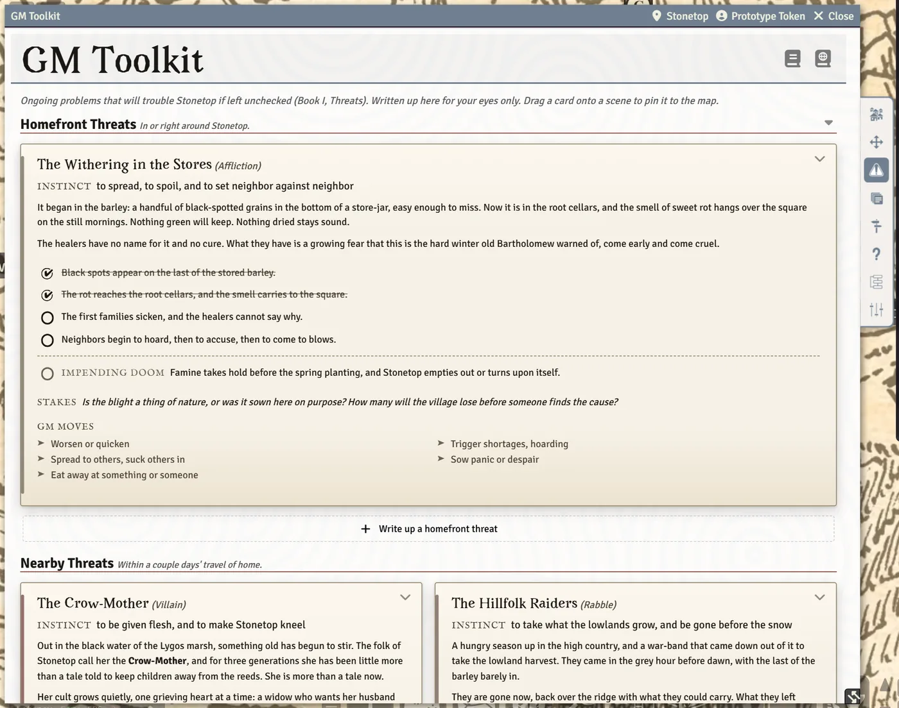

# Threats and Hazards

Threats are the trouble that gets worse if left alone; hazards are the dangers of a place. Both live on the GM Toolkit's **Threats & Dangers** tab, and both are for the GM's eyes only. This page covers writing them up, tracking them, and putting them on the map.

## The Threats & Dangers tab

Threats are grouped by how close they are (Homefront, Nearby and further out), each group with its own **Write up a ... threat** button. Each threat is a card showing its **Instinct**, its grim portents and impending doom as checkboxes, its stakes and the GM moves it suggests.

Panels from the book sit alongside: **Writing a threat**, **When to write one up**, **Portents, dooms and stakes**, **Between sessions**, and **The eight threat types** with what each type does next. Each cites its page in Book I.

### Writing up a threat

**Write up a ... threat** opens a short guided write-up: pick one of the eight threat types and its GM moves appear as a checklist, then give it a name, an instinct and a proximity. The full editor opens afterwards for portents, doom, stakes and notes.

### Tracking a threat

- **Tick a grim portent or the impending doom** as it comes to pass. The system asks **Put this on the timeline?**: **Add it to the timeline** records it on Stonetop's timeline (which every player can read), **Keep it to myself** doesn't.
- **Cross off** a threat that's dead, gone or resolved. It moves to a **Crossed off** fold, greyed out, and can be **Put back**.
- **Give to players** turns a move the threat gives the players into a custom move they can drag onto their sheets. You can add a roll before saving it.

> **Did you know?**
> - Threats are kept in one hidden journal per steading, so players never see them by accident. Only a move you give them is shared.
> - An NPC sheet has a **Threat** field: link the NPC to the threat they're part of.

## Threats on the map

**Drag a threat card onto a scene** (from the Threats & Dangers tab) to put a pin there with the threat's icon and name. The pin ignores fog of war, and clicking it opens the card with its portents live. Hazards and sites can be pinned the same way.

With the world setting **Threats: Show Cards on the Map** turned on, each pinned threat shows its whole card on the map, following as you pan and zoom.

<!-- SHOT: threats-and-hazards-map | GM client: a poster-map scene with a threat pin and, with Threats: Show Cards on the Map on, the threat's card drawn on the map beside it -->

## Other ways to make threats

- **Create Item**, then **Dangers & Places**, offers **Threat**, plus generators for the Things Below: **A Thing Below**, **A corrupted site**, **A corrupted being** and **An emanation**. The last two make monster stat blocks.
- **Right-click a character or NPC** in the Actors sidebar (GM only) and choose **Becomes a Threat...** when a PC or a follower turns. It writes them up as a threat, and can make a monster stat block for them too.
- Homebrew threat ideas can be saved as cards in a GM-only journal and dragged onto the Threats tab when you need them. See [Homebrew Content](Homebrew-Content).

## Hazards

**Make a hazard** walks through the book's hazard steps (Book I pp.381-389). A hazard's card has two buttons:

- **Roll damage** rolls its damage onto the shared damage card, against whoever you have targeted (or pick when asked). Tick **It caught them off-guard** for advantage, or **They knew or suspected, and took precautions** for disadvantage. Hazard damage ignores armor.
- **Certain death** is for something that would definitely kill a normal person: no damage roll, whoever it catches is reduced to 0 HP and goes to Death's Door.

## Seasons and threats

The Seasons Change move has a **Threats** step that points at the threats to advance as the season turns. See [Seasons, Weather and the Year](Seasons-Weather-and-the-Year).

## See also
- [The GM Toolkit](The-GM-Toolkit)
- [Expeditions and Sites](Expeditions-and-Sites)
- [Bestiary, NPCs and Monsters](Bestiary-NPCs-and-Monsters)
- [The Timeline](The-Timeline)
