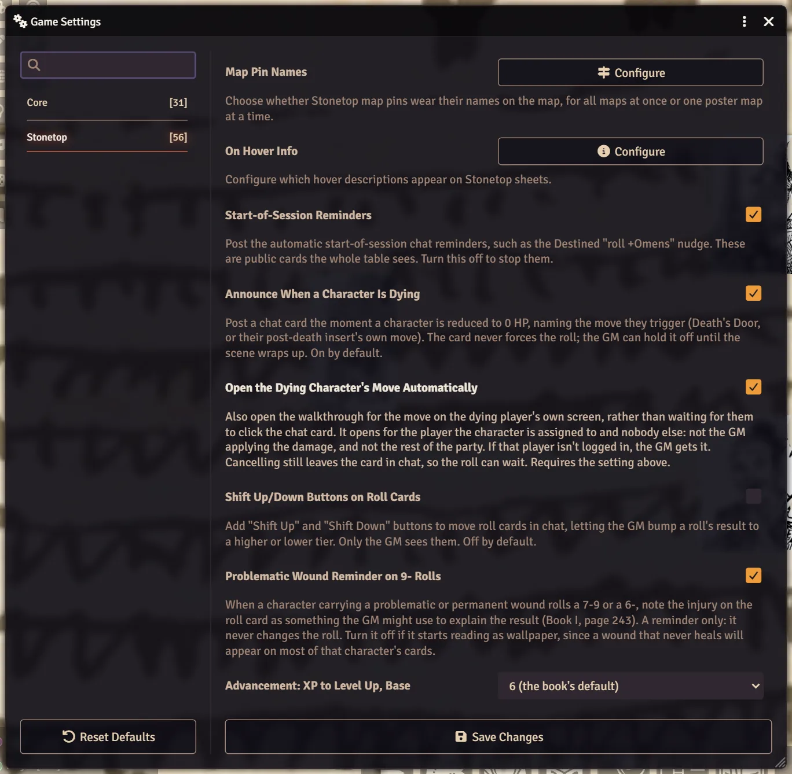

# World Settings Reference

Every table-wide switch the Stonetop system adds, in one place: its name as you see it, what it starts at, and what it changes. World settings belong to the GM and apply to everyone in the world.

## Where to find them

As the GM, open the **Game Settings** tab in the right-hand sidebar, press **Configure Settings**, and pick the Stonetop section.

Only one setting needs a reload: **Fight tab (replaces the Combat tracker)**. Foundry asks you to reload when you change it. Everything else applies straight away, or the next time the thing it affects is drawn: a roll card posted after the change, a sheet you close and reopen, a window you open next.

## Rolls and XP

| Setting | Default | What it changes |
|---|---|---|
| **Start-of-Session Reminders** | On | Posts the automatic start-of-session chat reminders, such as the Destined's "roll +Omens" nudge. They are public cards the whole table sees. |
| **Shift Up/Down Buttons on Roll Cards** | Off | Adds **Shift Up** and **Shift Down** buttons to move roll cards, so you can bump a roll's result one tier higher or lower. Only the GM sees them. |
| **Problematic Wound Reminder on 9- Rolls** | On | When a character carrying a problematic or permanent wound rolls 7-9 or 6-, the roll card notes the injury as something you might use to explain the result (Book I, page 243). It never changes the roll. |
| **Advancement: XP to Level Up, Base** | 6 (the book's default) | The fixed part of the Level Up cost. The other choice is 10 (slower). |
| **Advancement: XP to Level Up, Per Level** | 2 x level (the book's default) | What each current level adds to the cost. The other choice is 3 x level, much slower at high levels. |
| **Advancement: Reset XP to 0 on Level Up** | Off | Optional rule (Book I, page 582): Level Up empties XP instead of subtracting the cost, so a character can level only once between adventures. |
| **Advancement: Always Allow Burn Brightly** | Off | Optional rule (Book I, page 582): anyone may Burn Brightly (spend 2 XP after a roll for +1) even without enough XP to Level Up. |

A change to any Advancement row redraws open character sheets, so the XP track shows the new cost at once.

## Characters and sheets

| Setting | Default | What it changes |
|---|---|---|
| **Players See Every Character Sheet** | On | Every player can open and read every character's sheet; only its owner and the GM can change it. Off keeps each sheet to its own player and the GM. A sheet you shared or hid yourself with Configure Ownership keeps what you set. |
| **Custom Moves: GM Only** | On | Only the GM sees the **+ Custom Move** button and the edit pencils on custom moves. Existing custom moves still show and roll for everyone. Turn it off to let players write their own. See [Homebrew Content](Homebrew-Content). |
| **Guided Monster Builder** | On | Creating a blank Monster from Create Actor opens the guided worksheet that works out HP, Armor and Damage from your tag picks. Off gives you a blank stat block. See [Bestiary, NPCs and Monsters](Bestiary-NPCs-and-Monsters). |
| **Announce When a Character Is Dying** | On | Posts a chat card the moment a character drops to 0 HP, naming the move they trigger (Death's Door, or their post-death move). It never forces the roll. |
| **Open the Dying Character's Move Automatically** | On | Also opens that move's walkthrough on the dying character's player's own screen. If that player isn't logged in, the GM gets it. Needs the setting above. |

## Arcana

| Setting | Default | What it changes |
|---|---|---|
| **Arcana Creation: GM Only** | On | Only the GM sees the buttons that create homebrew arcana on the Arcana tab. Players can still edit cards they own. |
| **Arcana: Players See Both Sides** | Off | Lets players open the back of a card they haven't unlocked yet. Off, a locked back stays hidden until you reveal it on that card. A player always sees a back once they unlock it. |
| **Artifacts Arrive Unidentified** | Off | A treasure dropped onto a character sheet arrives with its tags, Value and uses withheld, until the player learns more (Book I, pp.430-431). Either way you can hide or hand over any single artifact from the mask icon on its gear row. |

More in [Arcana for GMs](Arcana-for-GMs).

## Fights

| Setting | Default | What it changes |
|---|---|---|
| **Fight tab (replaces the Combat tracker)** | On | The Combat tab becomes a Fight tab showing who fights whom, with lines on the map and extra damage for several attackers filled into damage rolls. Off gives you Foundry's own Combat tracker back, for example to use an initiative module. **Needs a reload.** |
| **Attack Effects on the Map** | On | A landed blow is drawn on the map and heard at the table. The pictures need the Sequencer and JB2A modules; the sounds need SoundFx Library. Anyone with reduced motion asked for, Sequencer's Enable Effects off, or Foundry's Photosensitive Mode on keeps the sounds without the pictures. |

The **Fight tab** switch also sits on the **Preferences** tab of your GM Toolkit, in its own group at the bottom, so you can flip it without opening Configure Settings. It runs Foundry's reload prompt the same way. See [Running Fights](Running-Fights).

## Threats, weather and the map

| Setting | Default | What it changes |
|---|---|---|
| **Threats: Show Cards on the Map** | Off | A threat pinned to a scene also draws its full card on the map, anchored to the pin, so you can tick its doom track right on the canvas. Off, the pin opens the card in a window. Only the GM ever sees these. See [Threats and Hazards](Threats-and-Hazards). |
| **Weather on the Scene (FXMaster)** | On | Posting a result from the Weather window puts matching particles on the scene your players are on. Needs the FXMaster module. The Weather window carries the same switch as a Pause button. |
| **Weather Effects: Cloud** | On | Drifting cloud. Off leaves fine, overcast and windy days with nothing on the map. |
| **Weather Effects: Fog** | On | The low haze of a muggy day. |
| **Weather Effects: Rain** | On | Falling rain, from shower to storm. |
| **Weather Effects: Hail** | On | Hail mixed into a storm's rain. |
| **Weather Effects: Snow** | On | Ordinary falling snow. |
| **Weather Effects: Blizzard Snow** | On | The heavier driven snow of a blizzard. |
| **Weather Effects: Storm Light** | On | The slate grey a storm or tornado washes the daylight with. |
| **Map Pin Names** (a **Configure** button) | Show by default | Opens a small window. **Map Pin Names: Show By Default** decides whether Stonetop map pins wear their names on the map or wait for the cursor. Under it, each imported poster map can **Follow the world setting**, **Always show names**, or **Show names on hover only**. |

Each player can also quiet pin names on the current map for themselves; see [Chronicle, Journals and Love Letters](Chronicle-Journals-and-Love-Letters#map-pins).

## Features on and off

| Setting | Default | What it changes |
|---|---|---|
| **Relationship Map** | On | Off takes away the steading's map tab, the Journal sidebar button and the hotbar macro, for everyone. Nothing drawn is lost. See [The Relationship Map](The-Relationship-Map). |
| **Timeline** | On | Off takes away the Timeline tabs and the Timeline journal for everyone. It keeps recording in the background, so nothing is missing when you turn it back on. See [The Timeline](The-Timeline). |

## Layout

| Setting | Default | What it changes |
|---|---|---|
| **Sheet Layout (Whole Table)** | Modern (icon tabs down the side) | The layout for everyone who hasn't picked their own. **Classic (tab names across the top)** is the older look. A world that existed before the two layouts stays on Classic until you change it. Monster sheets look the same either way. |
| **Classic Layout: Character Sheets** | On | Only matters while the sheets are on Classic. Untick to keep character sheets modern while others go classic. |
| **Classic Layout: Steading Sheets** | On | The same, for steading sheets. |
| **Classic Layout: NPC Sheets** | On | The same, for NPC sheets. |

Each player can override the table's layout for themselves with **Sheet Layout (Just for Me)**, a client setting.

> **Did you know?**
> - The three **Classic Layout** boxes only do anything once **Sheet Layout (Whole Table)** is set to Classic. They default to ticked so one change brings the whole old look back.
> - **Map Pin Names** is a button, not a checkbox. The world default lives inside the window it opens, next to the per-map choices.
> - Turning off **Relationship Map** or **Timeline** never deletes anything. Turn it back on and everything is where it was.

## Settings you won't see in the list

Some world settings are kept out of Configure Settings because they have a better home. You change them here instead:

| What it holds | Where you set it |
|---|---|
| The campaign's year | Click the season or the year on the time bar at the top of the screen and choose **Set the Year** ("What year is it now?"). The year is a display offset: every recorded year moves with it. See [Seasons, Weather and the Year](Seasons-Weather-and-the-Year). |
| Timeline colours for each kind of entry | **Colours** on the timeline's toolbar. See [The Timeline](The-Timeline). |
| Timeline Ages (named stretches of years) | **Ages** on the timeline's toolbar. |
| Your rulebook PDFs | **Your rulebooks** in the GM Toolkit. See [The Rulebook Reader](The-Rulebook-Reader). |
| The book art folder and URL prefix | The **Import Book Art** macro. See [Import Book Art](Import-Book-Art). |
| Map pin names per map | The **Map Pin Names** window above. |

The rest are the system's own bookkeeping: whether the compendiums and bestiary folders have been set up, which one-time chat cards have already been posted, the Introductions and Spring answers, the last End of Session award, and similar. You never need to touch these.

## Client settings

Font size, Dark Mode, High Contrast, roll prompts, hover descriptions and the other settings that only change your own screen are covered in [Preferences and Accessibility](Preferences-and-Accessibility).

## See also
- [Preferences and Accessibility](Preferences-and-Accessibility)
- [The GM Toolkit](The-GM-Toolkit)
- [Running Fights](Running-Fights)
- [Homebrew Content](Homebrew-Content)
