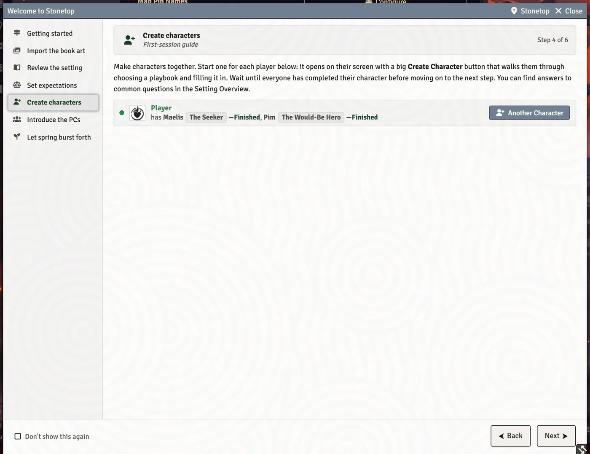
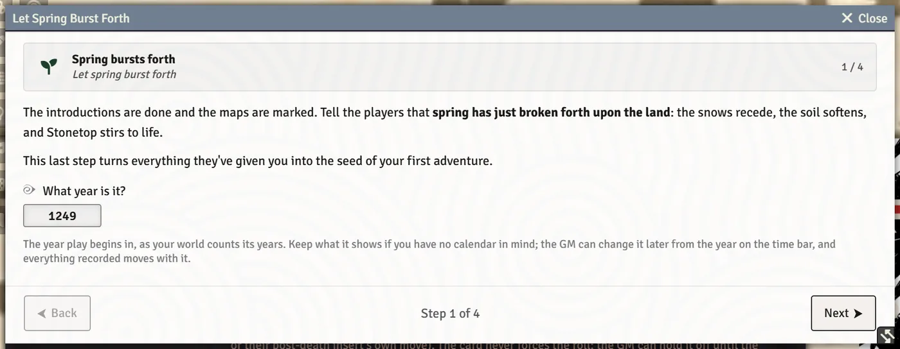

# Your First Session

This page walks a GM through opening a brand-new Stonetop world and running session zero: what the system sets up for you, the **Welcome to Stonetop** guide, and the two walkthroughs that take your table from blank sheets to the first spring.

## What happens the first time you load a new world

The first time a GM opens a new world, Stonetop fills it in the background. A window titled **Setting up your world** narrates the work, one row per job, with an overall progress bar:

| Row | What it brings in |
| --- | --- |
| **Book art you have already imported** | Shown only if you imported book art in another world. The art lives outside the world, so it is wired in again without your PDFs. |
| **Journals, gazetteer and bestiary codex** | About 160 journal entries: the Setting Overview, places, lore, reference and the bestiary codex. |
| **Monster sheets** | About 200 monster actors, filed in a **Bestiary** folder in your Actors sidebar. |
| **Treasures & Wonders** | The 168 Book II treasures, filed in a **Treasures & Wonders** folder in your Items sidebar, one subfolder per section. |
| **Finishing touches** | Last tidy-ups once the imports land. |

The window never blocks you. The work carries on whether it is open or not, so closing it changes nothing, and it closes itself a moment after it says "Your world is ready." If a row fails, the summary says so and the next load tries again.

<!-- SHOT: your-first-session-world-setup | GM client, brand-new world on first load: the "Setting up your world" window mid-run, with the journal row ticked, the Monster sheets row spinning with a partial bar, and the overall bar at about 60% -->

### What else the system sets for you

- **The steading.** An actor named **Stonetop** is created for the village. Every player owns it, so anyone can edit it directly.
- **The GM Toolkit.** One GM Toolkit actor is made for the world and assigned as the GM's character. There is only ever one: a second cannot be created, and the last one cannot be deleted. See [The GM Toolkit](The-GM-Toolkit).
- **Players can create actors.** Once per world, the Player and Trusted Player roles are granted Foundry's Create Actor permission, so players can build their own characters and add Residents and Neighbors to the steading (each one is an NPC actor). If you revoke it under **Configure Permissions**, it stays revoked.
- **Automatic Token Rotation** is switched off in a brand-new world.
- **Tinted folders.** The four top-level journal folders get their own colours so you can tell the trees apart: **Bestiary** (brick red), **Lore** (violet), **Places** (dusty blue) and **Reference** (ochre). The Bestiary actor folder uses the same red, and the treasure folders are gold. A folder you have tinted yourself is left alone.
- **Hidden monsters.** The imported monster actors are owned by the GM only, so players never see them in their sidebar.
- **Hotbar macros.** Your hotbar gets the system macros: **Welcome to Stonetop** (slot 1), **Run an Expedition** (2), **Write a Love Letter** (3), **Die of Fate** (4), **Browse Stonetop** (5), **Relationship Map** (6), **The Chronicle** (7) and **End of Session** (10). Each player's hotbar gets **Die of Fate** in slot 1 and **Relationship Map** in slot 2. Once a macro is placed you can move it anywhere and it stays there.

### The cards in chat

A few one-time cards appear in chat. The welcome card goes to everyone; the rest are whispered to GMs only.

| Card | When it appears | Its button |
| --- | --- | --- |
| **Welcome to Stonetop** | Once, on the first load. Lists what the system does and where to buy the books. | **Open the First-Session Guide** (GM only; hidden for players) |
| **Import Your Book Art** | Once you are past the Welcome guide, if you have never imported book art. | **Import Book Art** |
| **Finish Your Art Import** | If an earlier import left some pictures missing. | **Import the missing N** |
| **Rebuild Book Art** | If finer portraits and token squares can be cut from art you already imported (no PDFs needed). | **Rebuild N pictures** |
| **Add The GM Playbook** | If adding the free GM playbook PDF would give you sharper regional maps or the two flowcharts. | **Add the GM playbook** |
| **Weather On The Map** | Once you are past the Welcome guide, if FXMaster is not active. | (none; explains the module) |
| **Attacks You Can See And Hear** | Suggests the free modules that draw and sound attacks on the map. | (none) |

For book art itself, see [Import Book Art](Import-Book-Art). For the optional modules, see [Installing and Recommended Modules](Installing-and-Recommended-Modules).

## The Welcome to Stonetop guide

The **Welcome to Stonetop** window is your first-session guide. It opens by itself for the GM on each load until you either tick **Don't show this again** at the bottom, or finish both session-zero walkthroughs (Introductions and Let Spring Burst Forth). You can reopen it any time from the signpost macro, **Welcome to Stonetop**, in hotbar slot 1. It is GM only: a player who runs the macro is told "The first-session guide is for the GM."

A rail down the left side lists the steps. Click any of them to jump there, or use **Back** and **Next** at the bottom. Each panel keeps its state when you switch away.

| Rail entry | What it does |
| --- | --- |
| **Getting started** | The premise of the game, a **New to Foundry?** link, and **Open Setting Overview**. |
| **Import the book art** (marked optional) | Explains the art importer and offers **Import Book Art** (or **Import Book Art Again** if this world found art you already imported). When finer portraits can be cut from art on disk, a **Build N more portraits from art you already have** button appears too. |
| **Review the setting** | Suggests 10 to 15 minutes with the Setting Overview, then questions. **Open Setting Overview**. |
| **Set expectations** | Points you at the Setting Overview's **Agenda & Principles** tab, and at talking through content to exclude, veil or handle with care. |
| **Create characters** | One row per player, with a dot showing whether they are online. **Create Character** opens a new character on that player's screen with a big Create Character button. If they already have one, the button reads **Another Character** and asks whether the new one joins theirs or replaces it. While they work, their row shows the playbook they picked and a live progress count. If nobody has joined the world yet, a **Configure Players** button takes you to Foundry's player management page (you leave the game and come back). |
| **Introduce the PCs** | **Start Introductions** launches the guided introductions. |
| **Let spring burst forth** | **Walk Through Let Spring Burst Forth** launches the last walkthrough. |

Click a character name on the **Create characters** panel to open that sheet.

### New to Foundry?

The **New to Foundry?** button opens a short primer for first-time GMs. In brief:

- Everything lives either in **your world** (the sidebars, yours to edit) or in **compendiums** (read-only libraries, like a sealed book).
- Compendiums can't be edited on purpose. To change something from one, you import a copy into your world and edit the copy.
- Your journals are already copied into the **Journals** sidebar, so edit those freely. You only open the journal compendium to check the original wording.
- Monsters are dragged onto the canvas, or right-clicked and imported. Each imported monster is its own copy, so three wolves are three separate wolves. In a Stonetop world the **Bestiary** folder in your Actors sidebar already holds a copy of each one.
- Right-click almost anything for a menu; drag and drop works almost everywhere; each sidebar tab has a search box.

### The Setting Overview

**Open Setting Overview** shows the seeded **Setting Overview** journal as a tabbed window, one tab per page: The Premise, Character Creation FAQ, Agenda & Principles, Stonetop: The Village, The Vicinity, Travel Times, Gear: Terms & Value, Special Items, If You Want To… and The World's End. It also pops open by itself once a new world's journals finish importing. Because it reads the journal, any edit you make to those pages shows here too.

> **Did you know?**
> - The guide's window header has a button with the steading's name (normally **Stonetop**). Click it to jump straight to the steading sheet. The same button sits in the header of Character Introductions, the GM Toolkit and the season picker.
> - Cross-links in the Setting Overview show hover summaries, and links a player cannot open are shown as plain text for them.

## Character Introductions

**Start Introductions** opens **Character Introductions**, which takes the table around in turn order, round by round.

1. **Pick the order.** The first screen lists every character with a playbook. Use the up and down arrows beside a name to move it, or **Randomize** to shuffle. Then click **Begin Introductions**.
2. **Go around.** The steps are **Introduce yourself**, **Possessions & contribution**, **Your place in Stonetop**, **Bonds & ties**, **Asking the others** and **Let spring burst forth**. The first three are one pass around the table. **Bonds & ties** and **Asking the others** loop: each turn a player picks one of their playbook's questions to answer (or ask), until everyone has passed or used all four.
3. **Each player's turn opens on their screen.** When the turn reaches a player, the window opens for them and they type their answer into it while everyone watches it appear. Players press **Done** to record an answer on the looping steps, or **Pass** to sit out the rest of a step (they are asked to confirm). The GM moves on with **Next**, which reads **Everyone's done, continue** once the step is finished.
4. **Finish.** On the last step, each player adds their home to the steading's Places of Interest (players reach the steading from the **Stonetop** button on their character sheet). The GM clicks **Save to Chronicle**, which compiles every answer into a **Player Introductions** journal in a folder named **The Chronicle**, readable by the whole table.

> **Did you know?**
> - If a player closed their window, click **Show players** in the GM's window header. It force-opens the introductions on every player's screen at the GM's current spot. It only works after you have begun.
> - The GM's left rail lets you jump straight to any step.
> - On the looping steps, a player who is waiting sees how many turns until they are up.

## Let Spring Burst Forth

**Walk Through Let Spring Burst Forth** is a four-step walkthrough:

1. **Spring bursts forth.** Read the opening to the players. It also asks **What year is it?** The number you enter is what your world calls the first year of play. Keep what it shows if you have no calendar in mind; the GM can change it later from the year on the time bar, and everything recorded moves with it. See [Seasons, Weather and the Year](Seasons-Weather-and-the-Year).
2. **Make the Seasons Change move.** The players decide whose character is the most hopeful. Click **Ask the most hopeful to roll**: a chat card asks that player to roll +Fortunes (with the first spring's +1), and the season's reminder card is posted too. Read the omen for the result, tick the seasonal gain they choose, and write down the hook it opens.
3. **One last question.** Ask each player what excites them most about playing their character, and record it per character.
4. **After the session.** A checklist for your prep: organise your NPCs into the steading's Residents and Notable Neighbors, build a timeline, identify threats, start an "I wonder..." list, and plan the first adventure.

Click **Done** to finish. This first spring is recorded in the **Seasons Change** journal, under Spring on this year's page ("Year One" unless you named another year), like every later season.

After this, make the **Seasons Change** move each season by clicking the season in the bar across the top of the screen and choosing **Next Season**.

> **Did you know?**
> - Introductions, Let Spring Burst Forth and Run an Expedition all survive a browser refresh: if one was open when you reloaded, it reopens on the page it was on.
> - The **The Chronicle** hotbar macro (slot 7) recompiles your recorded answers into the Chronicle journal and opens it. Re-running it keeps any edits you made inline.

## See also
- [Import Book Art](Import-Book-Art)
- [Installing and Recommended Modules](Installing-and-Recommended-Modules)
- [Creating a Character](Creating-a-Character)
- [The GM Toolkit](The-GM-Toolkit)
- [The Steading and Settlements](The-Steading-and-Settlements)
- [Seasons, Weather and the Year](Seasons-Weather-and-the-Year)
- [Chronicle, Journals and Love Letters](Chronicle-Journals-and-Love-Letters)
